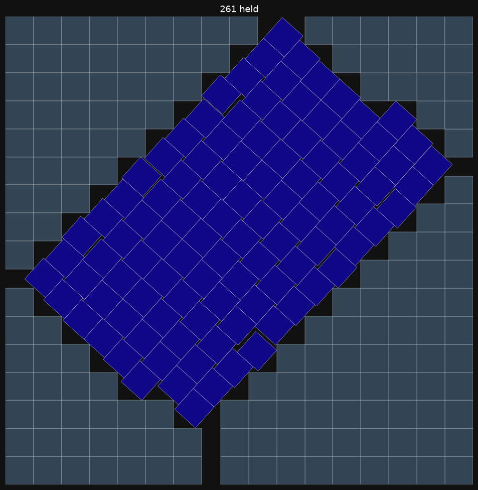
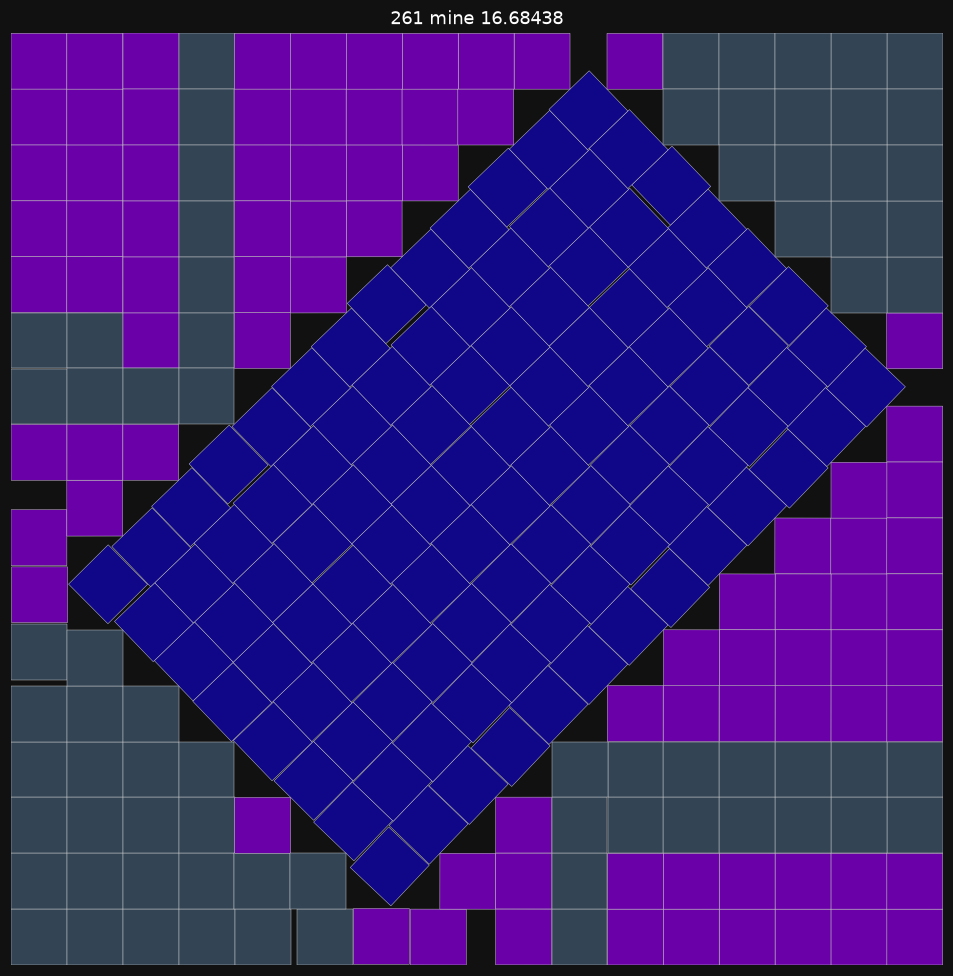

# Avenue: band (2026-11-10)

**Result: no layout beats our best. Nothing was submitted. The public score stays 22.2145943790.**

We extended the band model of the [structure avenue](structure.md) and ran its go line. The go line failed: the model rebuilds n = 974 and does not rebuild n = 904 or n = 593. We then measured why, and tested one more idea that came out of it (sheared blocks). All numbers are in [`results/band-2026-11-10.tsv`](../results/band-2026-11-10.tsv) and [`results/band-scan-2026-11-10.tsv`](../results/band-scan-2026-11-10.tsv).

Words used here: the side is `L = m + f` with `m` whole and `0 < f < 1`. `k = n - m²`. A band is a strip one square wide in which tilted squares of one angle slide freely. A cell is one place of a corner grid. "Exact refill" is Evan Daniel's `fillfast.fill` (MIT, imported from his clone): the largest set of upright squares around given tilted squares. `fq` is his all-free quench, which shrinks the side with every square free to move and turn.

## 1. What was built

`band_model.py` holds two versions of the model. Both keep the exact count: with the uprights fixed, every free stretch of a band holds `floor(length)` squares.

| part | what it adds |
|---|---|
| `Model` | Four staircases, one per corner grid, in place of two. Several angle families, each inside its own window. A free pitch: the bands of a family may start at any offset, at least 1 apart, and a one-dimensional dynamic programme picks the best offsets. |
| `Cells` | Uprights are any set of cells of the four grids. A cell does not need a row that starts at a wall. One move adds or removes one cell, and only the bands that the cell crosses are recounted. It runs 20,000 to 40,000 moves per second. |

A layout that the model writes passes the lane's `floatsafe` (the official metric, with 2.2e-11 clearance): the rebuilt 974 is certified at 31.707106784.

One trap is now fixed in the code. A corner that only touches the edge of a band used to split the band in two, and the count lost a square. The strips are tested 1e-9 inside their edges.

## 2. The go line

Each layout is read from our file: its main tilt angle, and its uprights as staircases or cells. The count is taken at the held side, then after annealing.

| layout | held | two grids (structure avenue) | four staircases | free cells |
|---|---|---|---|---|
| 974, rigid strip at 45° | 974 | 973 | **974** | **974** |
| 904, sheared strip at 33.9° | 904 | 899 to 900 | 900 | 901 |
| 593, steep rows at 30° to 35° | 593 | 587 to 589 | 588 | 586 |

**Verdict: no-go. One of three.** The four grids fixed 974: the square at each end of its strip is on the third and fourth grid. They did not fix the other two.

More families made the count worse. With three families 904 falls from 900 to 897 before annealing, and 593 falls from 586 to 582, 581 and 579 with two, three and four families. A window is filled first and takes room from the main family.

A larger side does not help either. The model needs 0.12 more side to hold 593 (it holds 594 at 24.9667), and at 0.12 more it still holds only 902 of 904. The board is 0.015 to 0.03 below us. So "build with the rigid model, then quench" starts four to eight times too far away.

## 3. Why the model fails on the held layouts

Three measured causes. None of them is a band with a free slide.

**The rows are not straight.** In our 261 (the 8 × 13 block that also makes 971) all 105 tilted squares stand at 41.882°, to within 0.00015°. Neighbours along one lattice direction are exactly 1 apart and slip sideways by 0 or 0.077. Neighbours along the other direction are 1.000 to 1.002 apart and slip by 0, 0.077, 0.110, 0.167 or 0.243. 0.077 is `√2 · tan(45° − 41.88°)`: one slip for each step of the 45° staircase beside the block. So every row is a line with slips, in both directions, and no strip one square wide holds a whole row. The model holds 256 of 261, with a fixed pitch and with a free pitch.

**The outline is ragged.** The held 261 block has 105 squares, which is 8 × 13 plus 1. Its chains end at different places, and each end sits in a notch of a staircase.

**Some uprights are on no grid, and some squares have their own angle.** In 904 six uprights lie on no corner grid. They are at the centre, between the two half strips. Six tilted squares beside them stand at 36° to 40° in place of 33.9°. The free-cell model ends 3 short there. In 593 the strip has three stretches at 30.2°, 32.4° and 34.7°, four squares at 9° to 13° where it slips, and 95 uprights turned by 0.1°.

One more limit is in the search, not in the model. The annealer cannot find a block. On 401 (a rigid 5 × 5 block, which `Cells` holds exactly) it was started from the plain grid and ran 300,000 moves on three seeds: 400 each time. With 40 cells removed around the block it comes back to 400, not 401. There are very many layouts with the plain count and very few with one more.

## 4. Sheared blocks: a rigid block, then a quench

The rigid rule of the structure avenue says a block of `a × b` squares at 45° needs `f ≥ fa = (a·√2 − A)/2` and `f ≥ fb = (b·√2 − B)/2`. When `fa` and `fb` differ, the block is tight in one direction and loose in the other. The held 261 uses that: 8 × 13 is rigid at 0.6924 (`fa` = 0.657, `fb` = 0.692) and we hold it at 0.6788.

`band_shear.py` builds the rigid block with the exact refill and hands it to `fq`.

| run | result |
|---|---|
| control: 8 × 13 at m = 16, built at 16.6925 | `fq` ends at **16.68438**. Rigid is 16.69239, held is 16.67878 |
| the same with 48 kicked quenches and two hop runs | 16.68432 |
| the same with refill and quench in turn | no step refills to 261 |
| scan 1: 133 blocks that tie our side with room in one direction (m ≥ 10, k ≤ 12) | 0 below our side |
| scan 2: blocks whose rigid side is up to 0.03 over ours, built there and quenched | 370 of 391 ran. 0 below our side, 4 ties (n = 451, 538, 585, 634) |

Scan 2 was stopped by the 30 minute limit of its background job with 21 blocks left, all at the largest n.

What this says:
- The quench does turn the squares. In the 8 × 13 block they end 1.1° off 45° (at 43.9° and 46.1°). The side ends 0.008 below the rigid side. 83 of the 370 blocks came down by more than 1e-4, the most by 0.0099.
- It reaches the public record and stops there. The quenched 6 × 23 block lands on our 451 to six digits (21.75610).
- It does not reach the ragged outline. The quenched block keeps its 104 squares in a clean rectangle and stays 0.0056 above the held 261.

## 5. The 82 puzzles with k ≤ 8 at m ≥ 20

82 puzzles of this class trail the board today (0.0309 of the gap). `band_scan.py` ran the free-cell model on all of them, even with the go line red, because the count is exact and the run costs 55 CPU-minutes.

| step | result |
|---|---|
| the model holds our layout at our side | 30 of 82. All 30 stand at exactly 45°. 37 of the 82 do |
| cells annealed at 0.0005 below our side (5 angles, 2 seeds) | 0 hits. The nearest is 1 square short, on 6 n |
| cells annealed at 0.003 below our side | 0 hits. The nearest is 1 square short, on 5 n |

The other 52 layouts are sheared or have several angles, and the model is 1 to 23 squares short of them at their own side.

## 6. Why the board needs less waste on almost every n

- **It is not a family.** There are three ways to get one entry from another: drop one square, add an L-shaped strip of `2m + 1` squares, and put two gadgets in opposite corners. Our file and the board are both closed under all three: each gives 0 new sides on 1,000 n. On the board, 409 of the 416 entries we trail come from no smaller board entry. So the shared fractional parts across m (842, 901 and 962 at 0.50215) are the L strip, and every other entry was found for its own n.
- **It is not polish.** 33 puzzles with n ≥ 300 improved by more than 0.008 since our seed of 2026-11-07. 20 of them changed their main tilt by more than 3°, and 22 changed the number of tilted patches. A better entry is a different layout.
- **It is not a block shape the rule knows.** Section 4: 503 rigid blocks, quenched, give 0 sides below ours.
- **It is about one square per layout.** The board holds n at about the side where we hold n − 1 or n − 2.

What this points to: the board's lead is in the outline of each tilted block or patch. Which squares stand at its edge, and which notch of a staircase each one sits in, is chosen for each n. Sections 3 and 4 show the same thing from our own file. The held 261 beats the quenched rectangle by 0.0056, with one more tilted square and uneven chain ends. This is our reading of the evidence. We did not build an outline and beat a side with it.

It also explains why our tools stop where they do. A quench keeps the outline. An exact refill keeps the tilted squares. The band model and the rigid rule only know straight edges.

## 7. What a next step would need

A search over the outline of one block, for one n at a time:
- the state is the set of tilted squares of a block at one angle, with slips allowed in both directions
- a move adds, removes or shifts squares at the edge of the block
- each state is scored by the exact refill and then by `fq`, so the score is a side and not a count.

The count alone is flat and the annealer of section 3 shows what that costs. The first control is clear and small: from the quenched 8 × 13 at 16.68438, reach the held 16.67878. We did not build this.

## Files

| file | what it does |
|---|---|
| `band_model.py` | `Model` (four staircases, families, free pitch) and `Cells` (free cells), with their annealers. |
| `band_ctl.py` | The go line on one held layout. `--cells`, `--fams N`, `--events` (free pitch), `--dl` (larger side), `--out`. |
| `band_scan.py` | The free-cell model on every trailing n with k ≤ 8 at m ≥ 20. |
| `band_shear.py` | Rigid block, exact refill, `fq`. `ctl` is the 8 × 13 control. `scan` runs every block near our side. |
| `band_cert.py` | Certifies a layout text file with `floatsafe`. |

`SQ_BEST` points at the submission to read (start from `gather/engine-2026-11-10a.csv`). `EVAND_PACKER` and `SQ_BOX` point at Evan Daniel's clone, as in the other avenues.

## Summary

- No gain. No submission used. Best stays 22.2145943790.
- Go line: 1 of 3. The model with four grids rebuilds 974. It holds 901 of 904 and 588 of 593.
- The cause is measured. Rows in the held layouts are lines with slips in both directions, and block outlines are ragged. A few uprights and tilted squares follow no grid and no shared angle. A band with a free slide has none of these.
- A rigid block plus a quench comes 0.008 below its rigid side and lands on the public record: 0 of 503 blocks beat a side we hold.
- On the 82 puzzles with k ≤ 8 the model holds 30 of our layouts, all rigid, and finds 0 smaller sides.
- The board's entries are found one n at a time (409 of 416 come from no other entry), and a better entry is a different layout. Our reading is that the lead sits in the outline of each block.
- **Next, if this avenue continues:** an outline search scored by refill and quench, with the 8 × 13 block as its control.

# Round 15 (2026-11-12): a shell step for the jonathan1506 bands

**Result: dry. No band layout certifies, and nothing went to the take. The step is exact where the band does not change: 966 down to 905 and 905 up to 966 land on the held sides to the last digit. Where the band must change, it ends 1 to 3 squares short of its line on all 38 runs. So the band does not carry down its line at a fixed tilt. Nothing was submitted from here.**

Words used here: "held" is `gather/round14-2026-11-12a.csv` (gate dir `gate/cand-round14-1112a`). `n = m² + k` and the side is `L = m + f`. "The line k" is every `n` with the same `k`. "Count" is the number of squares that a step's layout holds at side `m + f` of its donor, after the exact upright refill. A step "reaches its line" when the count is the `n` on the donor's line at the new `m`. Two jonathan1506 runs give the donors. The run of 03:51 UTC is in the held file. Harvest pass j brought the run of 09:02 UTC (`take-harvest-2026-11-12j`), with a new 905 and 966 at f = 0.566822.

## 8. The band, measured

`band_step.py measure` reads each layout in the frame where the band runs from (0, 0) towards (L, L).

| n | m | k | f | tilt | tilted | chains | normal step | per chain | slips | slip gaps | uprights above (rows × cols) | below (rows × cols) |
|---|---|---|---|---|---|---|---|---|---|---|---|---|
| 403 | 20 | 3 | 0.564936 | 34.58° | 75 | 25 | (0.678, 0.779) | 1.017 | 6 | 3 4 3 4 3 | 155 (18 × 18) | 173 (20 × 18) |
| 444 | 21 | 3 | 0.564936 | 34.58° | 75 | 25 | (0.678, 0.779) | 1.017 | 6 | 3 4 3 4 3 | 156 (18 × 30) | 213 (29 × 36) |
| 629 | 25 | 4 | 0.566006 | 35.05° | 96 | 32 | (0.775, 0.678) | 1.015 | 8 | 3 4 3 4 3 4 3 | 278 (23 × 25) | 255 (23 × 23) |
| 680 | 26 | 4 | 0.565624 | 34.89° | 96 | 32 | (0.778, 0.678) | 1.016 | 8 | 3 4 3 4 3 4 3 | 304 (40 × 26) | 280 (24 × 25) |
| 733 | 27 | 4 | 0.565624 | 34.89° | 96 | 32 | (0.778, 0.678) | 1.016 | 8 | 3 4 3 4 3 4 3 | 331 (34 × 27) | 306 (37 × 29) |
| 788 | 28 | 4 | 0.563197 | 33.60° | 108 | 36 | (0.786, 0.678) | 1.020 | 9 | 3 4 3 4 4 3 4 3 | 327 (26 × 26) | 353 (26 × 28) |
| 845 | 29 | 4 | 0.563136 | 33.56° | 108 | 36 | (0.787, 0.678) | 1.020 | 7 | 4 3 4 7 4 3 | 382 (30 × 29) | 355 (27 × 28) |
| 904 | 30 | 4 | 0.563136 | 33.56° | 108 | 36 | (0.787, 0.678) | 1.020 | 7 | 3 4 7 4 3 4 | 359 (29 × 31) | 437 (56 × 34) |
| 905 | 30 | 5 | 0.568166 | 35.86° | 118 | 40 | (0.773, 0.675) | 1.013 | 10 | 3 4 3 4 3 4 3 4 3 | 408 (28 × 30) | 379 (28 × 27) |
| 965 | 31 | 4 | 0.562051 | 32.59° | 120 | 40 | (0.795, 0.679) | 1.024 | 7 | 7 4 3 4 7 4 | 437 (29 × 41) | 408 (40 × 29) |
| 966 | 31 | 5 | 0.568166 | 35.86° | 118 | 40 | (0.775, 0.674) | 1.013 | 10 | 3 4 3 4 3 4 3 4 3 | 409 (28 × 31) | 439 (61 × 56) |
| 905 (09:02) | 30 | 5 | 0.566822 | 35.38° | 117 | 39 | (0.772, 0.678) | 1.014 | 10 | 3 4 3 4 3 4 3 4 3 | 379 (28 × 27) | 409 (29 × 31) |
| 966 (09:02) | 31 | 5 | 0.566822 | 35.38° | 117 | 39 | (0.772, 0.678) | 1.014 | 10 | 3 4 3 4 3 4 3 4 3 | 410 (29 × 32) | 439 (59 × 58) |

"Per chain" is how far one chain moves the band along the diagonal. Rows and columns count the distinct centre heights and abscissae of the uprights on each side, so the corner zones are in them. 487 does not read as one band: its tilted squares spread up to 2.9 from the diagonal.

What the table says:

- **Each band is one stack.** It is chains of 3 squares at one tilt. Each chain is face to face with the next (1.000 to 1.004 apart across the faces).
- **The normal step drifts.** It slides the next chain by about +0.23 along its length. Its y part is 0.678 in all 11 bands (x part 0.773 to 0.795), so the stack runs at 41° and leaves the diagonal.
- **The slips bring it back.** A slip slides the next chain by about -0.04. The slips come every 3 or 4 chains, so 2 slips in 7 chains. A gap of 7 (845, 904, 965) is a missing slip, and the band has a fault of another kind there.
- **A shell is 1.4 chains.** One chain moves the band 1.013 to 1.024 along the diagonal. A shell is √2 of diagonal, which is 1.38 to 1.40 chains. Three shells are 4.1 to 4.2 chains.
- **The notebook carries a band with grid only.** 680 and 733 hold the same 96 tilted squares. 788, 845 and 904 hold the same 108, and 905 and 966 the same 118 (117 in the run of 09:02). One m up, it adds one grid row and one grid column, and the band stays. On the line k = 4 the band takes 4 chains (12 squares) more every 3 shells. Each time it has a new tilt: 35.05° (629), 34.89° (680, 733), 33.6° (788 to 904) and 32.6° (965). f falls from 0.5660 to 0.5621 on the way.

## 9. The shell rule

We wrote this rule down before the build.

- **The grids follow the box.** They are lattices anchored at the walls. Evan Daniel's exact refill (`fillfast`, MIT, imported from his clone) rebuilds them around any band. It gives back the held count of 845, 904, 905 and 966 exactly, in 0.2 s each. So one row and one column on each side come and go with the box, and a step only has to change the band.
- **One shell is not a whole number of chains.** Down one shell takes about 1.4 chains out of the band. The ends of the band must take up the 0.4, or the count falls.
- **Three shells are one period.** 4 chains with one slip move the band by (2.87, 2.87). That is 0.13 short of (3, 3) on each axis.
- **The edits.** `band_step.py` deletes a chain and pulls the rest back by its step, so the slip pattern after it stays. It repeats a chain with its own step, or inserts one with the median normal step or slip. It turns a normal step into a slip or back, and drops an end square. For three shells it deletes 4 chains in a row, at every place along the band. Then it puts the band into the new box at four corner anchorings (five for two shells or more). It drops the squares that are outside and refills the uprights exactly. The count names the n that the layout holds at the donor's f.
- **The search.** A beam (4 wide, 0 to 3 deep) runs over the edits. A layout whose count reaches an n with a bar above the donor's f would go to the squeeze of `family_step.py` (sequential LP, then fq) and to floatsafe. No layout got there.

## 10. The control

| step | count | side | held |
|---|---|---|---|
| 966 down one shell (m = 30) | 905, no edit, anchor (0, -1) | 30.568166 | 30.568166 |
| 905 up one shell (m = 31) | 966, no edit, anchor (0, 0) | 31.568166 | 31.568166 |
| the turn scan of section 12 at 0° on the 905 of 09:02 | 905 | 30.566822 | 30.566822 (harvest pass j) |
| 905 of 09:02 up one shell, then the squeeze and fq | 966 | 31.566822491 | the 966 of 09:02, to 1.2e-12 of score |

The step lands on the held side, so the refill and the anchors are right. The last row went the whole way of a result: squeeze, fq and floatsafe on boxD and the take on boxA. It certifies, but it is only 1.2e-12 of score below the 966 of harvest pass j, so the take drops it. These steps test only the grid, because the band is the same in donor and target. No two held layouts differ by a band edit at the same f, so the band edit has no exact control.

## 11. The targets

Every run is in [`results/band-r15-2026-11-12.tsv`](../results/band-r15-2026-11-12.tsv), with the box, the donor run, the edit and the anchor.

| donor | shells | target (held f) | count at the donor's f | short by |
|---|---|---|---|---|
| 905 (03:51), f 0.568166 | 1 down | 846 (0.583782) | 845 (delete 3 chains at the start) | 1 |
| 905 (09:02), f 0.566822 | 1 down | 846 (0.583782) | 845 (delete 2 chains at the start) | 1 |
| 905 (03:51) | 1 up | 967 (0.591378) | 966 | 1 |
| 629, 680, 788, 845, 966 (09:02) | same m | 630, 681, 789, 846, 967 (0.583782 to 0.591378) | 629, 680, 788, 845, 966 | 1 |
| 904 | 3 down | 733 (0.565624) | 732 | 1 |
| 845 | 3 down | 680 (0.565624) | 679 | 1 |
| 966 (both runs) | 3 down | 789 (0.591378) | 788 | 1 |
| 733, 680 | 3 down | 580, 533 (0.583782) | 579, 532 | 1 |
| 905 (both runs) | 3 down | 734 (0.591378) | 732 | 2 |
| 788, 965, 629, 444, 403 | 3 down | 629, 788, 488, 327, 292 | 627, 786, 486, 325, 290 | 2 |
| 904, 845, 680, 733, 966 (09:02) | 6 down | 580, 533, 404, 445, 630 | 578, 531, 402, 443, 628 | 2 |
| 905 (09:02), 965, 629, 788 | 6 down | 581, 629, 365, 488 | 578, 626, 362, 485 | 3 |
| 905 (09:02), 966 (09:02), 965, 788 | 9 down | 446, 489, 488, 365 | 443, 487, 485, 362 | 2 to 3 |

The best edit is most often no edit at all. The new box then cuts the end of the band, so a plain crop is as good as any chain we tried to take out. A tolerant refill lets the uprights overlap the band by up to 0.01, for the squeeze to repair. It gives the same counts on 966 to 789, 905 to 846, and the same-m steps of 680, 788 and 845. So the missing square is not a near miss that the LP could close.

What it would have paid: 846 at the f of 905 is 5.4e-4 to 5.8e-4 of score. 789 at the f of 966 is 8.3e-4 to 8.7e-4. 681 and 734 at the f of 680 and 733 are 9.9e-4 and 9.5e-4.

## 12. Why the line breaks, and the turn scan

Each held band sits against both staircases along its whole length. Move a band by 0.017 and the refill loses 4 uprights. A first version of the turn scan set every chain exactly 1 apart, where the held chains are 1.000 to 1.004 apart. At 0° it held 901 squares in place of 905. So an edit keeps the count only where it keeps the band where it was. That is the whole band for a crop, but a crop throws away the end chain.

The notebook does not step its bands. It builds a new one for each length, with a new tilt and a new f (section 8). So we also turned the band: every chain turns about its centre, and each step keeps its distance across the faces and its slide (or its y part). Then the turned band goes into the new box with its ends cut, at f from the donor's up to 0.582.

| donor | target | turns | f | best count at 0° | best count turned |
|---|---|---|---|---|---|
| 845 | 846 (same m) | -1.5° to +1.5° by 0.25° | 0.563136 to 0.582 | 845 | 826 (-0.25°, f 0.582) |
| 788 | 789 (same m) | the same | 0.563197 to 0.582 | 788 | 776 (+0.25°, f 0.582) |
| 680 | 681 (same m) | the same | 0.565624 to 0.582 | 680 | 663 (-0.25°, f 0.582) |
| 629 | 630 (same m) | the same | 0.566006 to 0.582 | 629 | 617 (+0.25°, f 0.582) |
| 905 (09:02) | 846 (1 shell down) | the same, 3,516 of 4,680 fills before the deadline | 0.566822 to 0.582 | 844 | 827 (+0.25°, f 0.582) |

A turn of 0.25° loses 12 to 20 squares, even with up to 0.019 more side. The chains move against the teeth of the staircases, and the refill drops every upright they touch. So a band cannot be turned as a rigid stack. Its slides must be solved again for each tilt (section 13, item 1).

## 13. Next runs

1. **A band generator with the tilt free**, in place of edits of a held band. The state is the tilt, the start corner and the slip pattern. For each tilt, solve the slide of the normal step and of the slip against the two staircases at that f. The end squares of the chains must touch the teeth. Score by the exact refill, then the squeeze. Its first control is to build 905 and 966 from nothing at 30.566822 and 31.566822. The targets are those of section 11: 846, 789, 734 and 681 are worth 5.4e-4 to 9.9e-4 each.
2. **The same for the line k = 6.** No band holds a k = 6 n today. The held f there is 0.5914 at m = 30 and 31 and 0.6087 below, so a band at f 0.57 would pay 7e-4 to 1.3e-3 each.
3. **No more fixed-tilt edits.** 38 runs and the turn scan show the count falls 1 to 3 below the line.

## Files of round 15

| file | what it is |
|---|---|
| [`band_step.py`](../band_step.py) | `measure`, `search` (the beam over band edits), `build` (search, squeeze, certify), `tilt` (the turn scan) and `take` |
| [`results/band-r15-2026-11-12.tsv`](../results/band-r15-2026-11-12.tsv) | every run: donor, run of the notebook, target line, count, edit, anchor, refill |
| `<scratch>/bounties-squares/take-band-r15/` on boxA | the take dir: `take.tsv` with its header only |
| `take-band-r15/work/` | the measurements, the run logs and rows per box (`boxD-copy/` is what ran on boxD), `scripts/` (`chains.py`, `cmp.py`, `draw.py`, `mkresults.py`) and the drawing of 904 and 905 |

## Summary of round 15

- Dry. No band layout certifies. The take dir has no rows.
- The 12 bands are stacks of chains of 3, with a slip every 3 or 4 chains. A shell is 1.4 chains, and three shells are one period of 4 chains.
- The step is exact where the band stays: 966 to 905 and 905 to 966 land on the held sides.
- Where the band must change, every run ends 1 to 3 squares short of its line. Examples: 846 (845), 789 (788), 967 (966), 733 (732), and the same-m steps to 630, 681, 789 and 846. A tolerant refill does not close the gap.
- The notebook builds each band length with its own tilt. The next step is a band generator with the tilt free, with 905 and 966 from nothing as its control.

# Round 16 (2026-11-12): a band generator with the tilt free

**Result: one small win. The generator builds the held counts of 905 and 966 from nothing at their own side. The squeeze then ends 1.3e-4 above the held 905. With the exact refill, every target stays one square short of its line at every f we tried. With a refill that lets the uprights overlap the band by up to 0.1, the band holds the target n, and the fq quench repairs the overlap. On 789 that certifies, 1.8e-6 of score below held. Nothing was submitted from here.**

Words used here are those of round 15. "Held" is now `gather/round15-2026-11-12a.csv` (gate dir `gate/cand-round15-1112a`). Its 905 and 966 are the jonathan1506 run of 09:02 UTC, at f = 0.566822. The frame puts the band from (0, 0) to (L, L).

## 14. The generator

`band_gen.py` builds a band from nothing. It does not edit a held band.

- **The corridor.** The upper grid is the lattice anchored at the left and top walls. It keeps each cell whose lower right corner has y − x ≥ a + f. The lower grid is anchored at the bottom and right walls. It keeps each cell whose upper left corner has y − x ≤ −(b + f). Only the cells on the cut can touch the band. The held 905 has a = 2 and b = 1 to the last digit: its teeth lie at y − x = 2.566822 and −1.566822.
- **The chains.** A chain is 3 squares along u = (cos t, sin t), where t is the tilt. The next chain sits face to face along v, at right angles to u. Put a chain at height q along v. Then each tooth cell forbids an open interval of slides p along u. The interval is exact: it comes from the four separating axes. The upper grid gives p ≥ lo(q), the lower grid gives p ≤ hi(q), and the walls give one more interval.
- **The greedy.** Each chain goes to the smallest q that is at least 1 above the last chain and has lo(q) ≤ hi(q). Two chains face to face only need 1 between them in q. So from a given start, the greedy holds the most chains. The normal steps and the slips come out of the teeth. Nothing sets them.
- **The rest of the search.** A start offset moves the first chain up. A drop takes whole chains off either end. Then the exact refill puts the uprights. It can run with a tolerance tau: an upright may then overlap the band by up to tau, and the squeeze must repair it. The search runs over the tilt, the two corridors (2, 1) and (1, 2), the offset, tau and the drops. A layout whose count reaches n goes to the squeeze of `family_step.py` (sequential LP, then fq) and to floatsafe.

## 15. The control

| step | result | held |
|---|---|---|
| greedy at the held side and tilt (30.566822, −35.378°) | 39 chains, each exactly 1 above the last. 23 of them have no slack, and the most slack is 0.105 | 39 chains, 1.000 to 1.004 apart |
| exact refill of that band | 904 | 905 |
| other tilts (±0.05° to ±0.3°), 20 offsets, 3 slide picks | 903 or less, and 872 once a chain no longer fits | |
| the band started 0.1 higher, refill with tau 0.03 | **905** | 905 |
| that layout through the squeeze, fq and floatsafe | 30.566955625 | 30.566822491, so 1.33e-4 lower |
| 966: band from corner to corner | 965 at 31.566822 | 966 |
| 966: the same band with one chain less at the far end, tau 0.03 | **966** | 966 |

What the control says:

- **The band is jammed at one tilt.** At the held side, only −35.378° holds 39 chains. Every other tilt we tried loses at least one square.
- **The held 905 holds one square more than the exact refill.** Its band sits 0.1 further along the diagonal. Three of its corner uprights are turned by 0.02° to 0.08°, at (1.82, 0.51), (2.99, 0.50) and (30.06, 30.06). The refill only places straight uprights. So it needs tau 0.03 to see that square.
- **The held 966 is the 905 band plus grid.** Its band does not run from corner to corner. The generator gets 966 when it drops one chain at the far end.
- **The count control is exact. The side control misses by 1.33e-4.** The squeeze starts from uprights that overlap the band by up to 0.03. It took 49 s and stopped 1.33e-4 above the held side.

## 16. The targets

Every run is in [`results/band-r16-2026-11-12.tsv`](../results/band-r16-2026-11-12.tsv), with the box and the best layout of each probe. A probe is the best count over the tilts, both corridors, the offsets, tau and the drops at one f. The tilts ran from −37.5° to −33.5° by 0.1°, or from −38.5° to −32.5° by 0.2°.

| target (line k) | held f | f probed | best count | short by | best tilt |
|---|---|---|---|---|---|
| 846 (k = 5, m = 29) | 0.583782 | 0.567, 0.572, 0.577 | 845 | 1 | −35.4° at 0.567, −37.0° above |
| 789 (k = 5, m = 28) | 0.591378 | 0.590 | 788 | 1 | −37.7° |
| 734 (k = 5, m = 27) | 0.591378 | 0.590 | 733 | 1 | −36.5° |
| 681 (k = 5, m = 26) | 0.591378 | 0.590 | 680 | 1 | −36.5° |
| 580 (k = 4, m = 24) | 0.583782 | 0.575, 0.583 | 579 | 1 | −37.7° and −38.5° |
| 533 (k = 4, m = 23) | 0.583782 | 0.583 | 532 | 1 | −37.9° |
| 488 (k = 4, m = 22) | 0.591378 | 0.590 | 487 | 1 | −36.5° |
| 327 (k = 3, m = 18) | 0.583782 | 0.583 | 326 | 1 | −37.9° |
| 630 (k = 5, m = 25) | 0.591378 | 0.590 | 629 | 1 | −36.5° |
| 906 (k = 6, m = 30) | 0.591378 | 0.570 to 0.590 by 0.005 | 905 | 1 | −35.9° to −36.5° |
| 967 (k = 6, m = 31) | 0.591378 | 0.570, 0.575, 0.585, 0.590 | 966 | 1 | −35.4° to −39.5° |

Where the best tilt sat at the edge of the range, a second probe ran from −42.5° to −38.5°. It gave the same counts: 579 for 580 (at −38.7°), 788 for 789 and 966 for 967 (both at −39.5°).

## 16b. Overlap first, repair after

The refill can take the missing square if the uprights may overlap the band by up to 0.1. The fq quench then pushes the squares apart, and the side grows. `work/scripts/taun.py` runs this path: the best tolerant layout at one f, fq, then the squeeze and floatsafe.

| target | band side | overlap | after fq | held | result |
|---|---|---|---|---|---|
| 846 | 29.577 (tilt −37.4°, tau 0.1) | 0.094 | 29.591659 | 29.583782 | 7.9e-3 above |
| 789 | 28.580 (tilt −38.2°, tau 0.1, one chain off the far end) | under 0.1 | **28.591327709** | 28.591378147 | **certified, 1.796e-6 of score below held** |
| 906 | 30.578 (tilt −36.4°, tau 0.15) | under 0.15 | 30.621336 | 30.591378 | 3.0e-2 above |
| 734 | 27.580 (tilt −38.0°, tau 0.15) | under 0.15 | 27.625072 | 27.591378 | 3.4e-2 above |
| 681 | 26.580 (tilt −38.0°, tau 0.15) | under 0.15 | 26.621230 | 26.591378 | 3.0e-2 above |
| 967 | 31.580 (tilt −38.2°, tau 0.15) | under 0.15 | 31.621230 | 31.591378 | 3.0e-2 above |

The repair costs 0.011 to 0.015 of side from an overlap of 0.1, and 0.041 to 0.045 from an overlap of 0.15. On 789 the held side is 0.0114 above the band, so the repair lands just below it. A gentler repair than fq could keep more of that 0.011.

## 17. Why the count does not move with f

- **The grids fix most of the count.** For each m and corridor (a, b), the two lattices hold a fixed number of squares: `(m-1-a)(m-a)/2 + (m-1-b)(m-b)/2`. That is 784 at m = 30 and 729 at m = 29. The band adds 3 squares a chain.
- **f is too small a lever for a chain.** From f = 0.567 to 0.590 the diagonal grows by 0.03. One chain takes 1.01 of diagonal. So over the whole range of f that pays, the band holds the same number of chains, and the count stays flat. 846 is 845 from 0.567 to 0.577. 906 is 905 from 0.570 to 0.590. 967 is 966 from 0.575 to 0.585.
- **The tilt follows f.** The best tilt grows with f, from −35.4° at 0.567 to −37° and more at 0.58. That is the jam line: a wider corridor needs a steeper chain to stay against both staircases. It moves the band, not its count.
- **The missing square is in a corner.** The held 905 holds 4 squares more than its lattices and band (784 + 117 = 901). The held 966 holds 8 more (841 + 117 = 958). These squares sit where the band ends, and some of them are turned uprights. The generator finds them only at the held layouts, with tau and the right offset. At every other m it ends one square short. Round 15 measured the same gap with band edits.

## 18. Next runs

1. **A corner search.** At each end of a generated band, free the end chains in place and angle and let the corner uprights turn by up to 0.1°. Score by a tolerant refill, then the squeeze. Its control is the corner of the held 905 at (0, 0), which holds one square more than the exact refill.
2. **The held corners on a generated middle.** Take the corner zones of a held band (905, 966, 845, 788) as they stand. Join them with a generated band at the target m, and match the phase with the tilt.
3. **A squeeze for overlapping starts.** The 905 control stops 1.33e-4 above the held side after 49 s. A wider first LP, or fq from the overlapping start, may close that.
4. **The overlap path on every line.** Run the tolerant refill with tau 0.05 to 0.1 on each target, and repair with a slower quench than fq. 789 shows that a repair of 0.011 already pays on the k = 5 line.
5. **No more probes in f alone.** On 11 targets and 4 lines, the count is flat in f and one short.

## Files of round 16

| file | what it is |
|---|---|
| [`band_gen.py`](../band_gen.py) | `ctl` (one band, its chains and count), `scan`, and `build` (probes in f, then squeeze, fq and certify) |
| [`results/band-r16-2026-11-12.tsv`](../results/band-r16-2026-11-12.tsv) | every probe and build: box, run, target, m, k, f, best count, how many short, best layout |
| `<scratch>/bounties-squares/take-band-r16/` on boxA | the take dir: `789.csv` and `take.tsv` |
| `take-band-r16/work/` | run logs per box (`boxD-copy/` is what ran on boxD), the row files, `scripts/` (`look.py`, `cmp.py`, `corner.py`, `ctl1.py`, `tau846.py`, `taun.py`, `take.py`, `mkresults.py`) |

## Summary of round 16

- One small win: 789 certifies 1.796e-6 of score below held. The band holds 789 at f 0.580 with uprights that overlap it by up to 0.1, and the fq quench repairs the overlap at 28.591328.
- The generator builds a band from nothing: two lattices cut along the diagonal, chains of 3 placed by a greedy, and slides from exact bounds. It is jammed at the held tilt: 23 of the 39 chains of 905 have no slack.
- The count control is exact. 905 and 966 come back at their held sides, with the band 0.1 further along and a tolerance of 0.03 for the corner uprights. 966 also needs one chain less at the far end. The squeeze from that start ends 1.33e-4 above the held 905.
- Every target is one square short at every f we probed: 846, 789, 734, 681, 630, 580, 533, 488, 327, 906 and 967. The count is flat in f, because f moves the band by far less than one chain.
- The missing square is in the corners. The next step is a corner search on the ends of a generated band.
