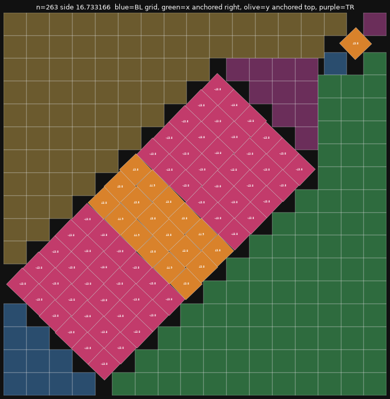
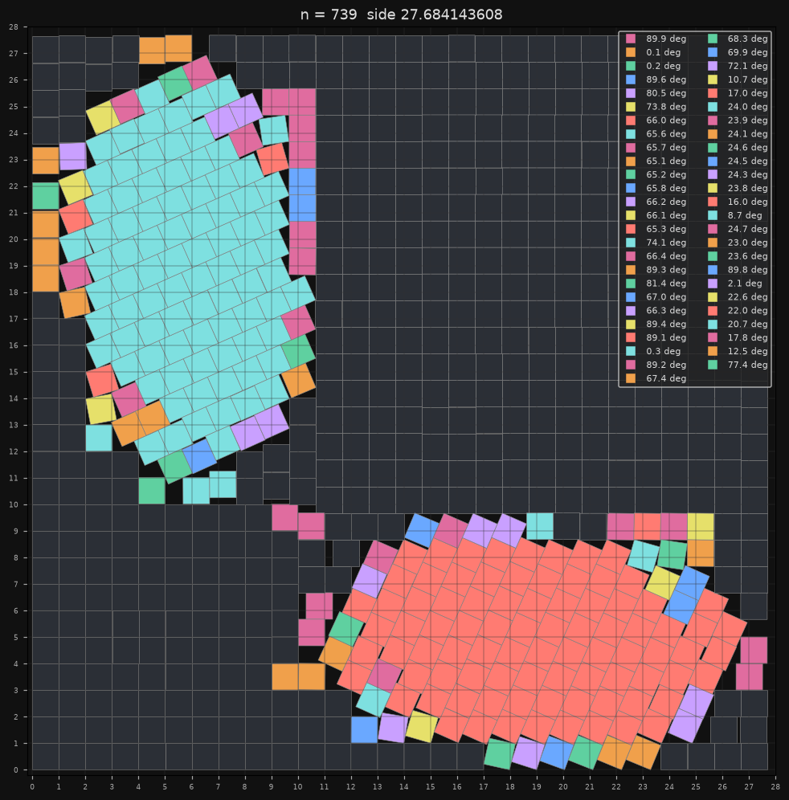

# Avenue: forensics (2026-11-12, round 17)

**Result: 2 n certify below the held file, 639 and 791. The gain is 3.019e-5.** Both use one rule that this avenue read off the board. A small packing goes into the corner of a larger layout, and one of the two keeps that corner free. The matcher passes its controls and its kill line. It gives an exact value to 3 of the 17 repeated board values that had no known form. 0.7244 is `(101 − 19√3)/94`. 0.7381 is `(91 − 10√5)/93`. 0.6841 is the root of a quintic. It also finds one single value, `12/17` at n = 854. The first two values are our own six-wide diagonal band at another angle. We did not build that band. The third is a block of 82 squares that we hold at five n. Sections 8 to 10 are the work after the first report. Section 11 is the work after the second cut: the same rule with every known layout of each part.

**Round 19: 202 and 409 certify and count. The gain is 2.973e-4 against the round 17 file.** Each follows a new layout of another lane by a rule of this avenue. 365 certified the same way, and two lanes went lower on it later. The arm beside the 0.6841 block passes its control only with rows read from the held arm, so we built none of its targets. Section 13 has the round.

The board publishes one thing per n: the best side, with the team and the date. This avenue reads the designs of the leading teams from those sides alone.

Words used here: "held" is `gather/round15-2026-11-12a.csv` (22.1672602051, gate dir `gate/cand-round15-1112a`). "The board" is the per-puzzle board, the best side per n over all teams (`results/per-puzzle-lb-2026-11-09.json`). The side is `L = m + f` with `m` whole, and `k = n - m²`. A "repeated value" is one `f` that the board holds at two or more n, equal to 1e-9. `C`, `S` and `T` are the cosine, sine and tangent of the tilt `t`. A "chain" is a line of contacts from one grid line or grid corner to another. A chain gives one equation in `t` and `f` with whole coefficients. A "design" is a set of chains that fixes `t` and `f`. The "height" of a design is its largest coefficient. A "stick" is a row of squares set face to face across a band. The four "grids" are the uprights pushed into the four corners of the square: bottom-left, bottom-right, top-left and top-right.

## 0. Kill line and controls (written 2026-11-12 14:00Z, before the first run)

**The idea.** A repeated value comes from a rigid design. We list the designs with small whole coefficients, compute the `f` of each, and compare it with every repeated value. A match gives the layout recipe: the row length, the angle and the period.

**Kill line.** The idea pays only when a match cannot come from chance. For each repeated value the matcher also runs on decoys: board values moved by a few 1e-6. The decoys measure how many designs of each height match a number that means nothing. A match counts when the decoys match less than 0.05 times each at that height. **No repeated board value with such a match = the idea is dead for the families listed here.**

**Positive control.** The matcher gets only the digits of 0.5355, 0.6066, 0.6569, 0.6924, 0.7426 and 0.7071. It must return the 45° block of 5, 15, 8, 13 and 6 squares and the strip one square wide. A second control with a known form at another angle: 0.8229 at n = 18, which is `(√7 − 1)/2`.

**Negative control.** The same numbers moved by 3e-7 must return no design. A matcher that explains every number fails here.

## 1. The board has not moved

The notebook `inversion/squares-in-squares-per-puzzle-leaderboard` is still at version 28, run 2026-11-08 23:03Z. Its newest entry is dated 2026-11-08 04:29 UTC. We read the rendered page again on 2026-11-12 13:30Z: 0 of 1,000 sides differ from `results/per-puzzle-lb-2026-11-09.json`. So no file for 2026-11-12 was saved.

The page gives 50 decimals. A side that comes from an optimiser is good to about 1e-10. A side that a team wrote from an exact construction repeats to 1e-14 across n. The matcher uses 2e-10 for the first kind and 3e-13 for the second.

## 2. The repeated values

The board holds 25 values at two or more n. Eight have a known form. Seventeen had none.

| f | where (m, k) | team | held | k per unit of m |
|---|---|---|---|---|
| 0.502152708 | (29,1) (30,1) (31,1) | Cats and boxes | no, 0.5208 | 0 |
| 0.514078774 | (30,2) (31,2) | Cats and boxes | no, 0.5355 | 0 |
| 0.565624195 | (26,4) (27,4) | Goo Packers | yes | 0 |
| 0.580898766 | (24,4) (29,5) | Cats and boxes | no, 0.5838 | 1/5 |
| 0.590016439 | (16,3) (21,4) (22,4) (26,5) (27,5) (31,6) | Nevska, Cats and boxes | no, 0.5914 | 1/5 |
| 0.591378145 | (11,2) (20,4) (30,6) | Nevska, webmaking | yes | 1/5 |
| 0.596043117 | (15,3) (23,5) | Nevska, square1000 | no, 0.6046 and 0.6066 | 1/4 |
| 0.605884509 | (28,7) (30,8) | Cats and boxes, rekhasri | no, 0.6341 | 1/2 |
| 0.623065212 | (17,4) (21,5) | Nevska, Delphin Rukundo | yes | 1/4 |
| 0.629165290 | (28,8) (31,9) | Cats and boxes | no, 0.6370 and 0.6390 | 1/3 |
| 0.684143606 | (23,8) (27,10) | Shadoks, Junie | 739 yes, 537 no (0.6924) | 1/2 |
| 0.724372709 | (14,6) (16,7) | Cats and boxes | no, 0.7279 and 0.7332 | 1/2 |
| 0.738057207 | (18,8) (20,9) | Cats and boxes | no, 0.7404 | 1/2 |
| 0.760980782 | (23,12) (26,14) | Cats and boxes | no, 0.7615 | 2/3 |
| 0.838815270, 0.870013850, 0.880960372 | m up to 17 | several | yes | 5/7 to 5/6 |

The last column is the step between members: `k` gained per unit of `m`. It says how fast the design grows. [`results/forensics-steps-2026-11-12.tsv`](../results/forensics-steps-2026-11-12.tsv) holds, for each value and each m, the largest k the board and the held file reach at a side of `m + f` or less. Three facts from it:

- **0.5022, 0.5141 and 0.5656 keep their value from m to m + 1 with the same k.** The design does not span the side. It is a local piece, and the extra unit of side is plain grid.
- **0.5900 holds k squares at m = 5k + 1 and 5k + 2. 0.5914 holds k at m = 5k.** They are the same design, and 0.5900 needs one more unit of side. Section 6 shows that both sit on one chain.
- **At a side of m + 0.6841 the board holds `k = ceil(m/2) − 4` for every m from 20 to 31. We hold one less at m = 21, 23, 25, 29, 30 and 31.** We hold the design at m = 27 (n = 739). From one odd m to the next the step is 2 units of side and 1 square. The board is at or below 0.6841 at all six n of the table. If the 739 design carries to them, the sum is 2.5e-3 of score:

| n | (m, k) | held f | gain at 0.6841 |
|---|---|---|---|
| 448 | (21,7) | 0.6924 | 3.9e-4 |
| 537 | (23,8) | 0.6924 | 3.6e-4 |
| 634 | (25,9) | 0.7036 | 7.7e-4 |
| 852 | (29,11) | 0.6970 | 4.4e-4 |
| 911 | (30,11) | 0.6892 | 1.7e-4 |
| 973 | (31,12) | 0.6966 | 4.0e-4 |

The held 739 has two mirrored groups of 82 squares at ±23.99°. It came from `family_readers.py`, one shell up from n = 684. Section 9 reads the group and says what each of the six n needs.

## 3. The matcher

[`forensics_match.py`](../forensics_match.py) knows four chains:

```
L   a·C + b·S = c + d·f               corners of tilted squares on grid lines
B   (i + d·f)·C + (j + e·f)·S = a     grid corners on the two sides of a tilted block
P   p/C + q·T + a·C + b·S = c + d·f   p rows of an arm advance along the wall (pitch 1/C, slide T)
S   (c+1)·C + S = c + f               the slot of an arm of rows of c + 1 squares
```

and three kinds of design:

- A rational `f = p/q`.
- One chain at its extreme angle: `hypot(a, b) = c + d·f` or `hypot(i + d·f, j + e·f) = a`. The rigid 45° block is the first form with `a = b` and `d = 2`.
- Two chains at one angle. The first chain (L, B or S) gives the angle from `f`. The second (L, B or P) must then hold.

Two arms that close along a wall are covered: the other arm adds its slot width `c2 + f`, so the chain is a P chain with `d` moved by one. Two arms that touch tilted square to tilted square give products of two angles. Those are not listed.

The bounds: L up to 24, B up to 16, P up to 40, slots up to c = 40. That is about 58,900 angles per value and 2 s per value on one core.

**The match is measured in f.** The first chain holds exactly. The second misses by `r`. The design that satisfies both then has an `f` that differs by `r·|dA/dt| / |det|`, where `det` is the determinant of the two gradients. A pair with `det = 0` fixes nothing and is dropped.

**The negative control failed twice, and each failure changed the matcher.** The first version explained the shifted numbers with chains that hold for every `f` at 45°. The second explained them with a chain at a double root (`1/C = 2S` near 45°). The rule above removes both.

**Controls, final version.** All eight pass, and all eight shifted numbers return no design.

| value | returned |
|---|---|
| 0.5355 | `hypot(5,5) = 6 + 2f` |
| 0.6066 | `hypot(15,15) = 20 + 2f` |
| 0.6569 | `hypot(4,4) = 5 + f`, the block of 8 halved |
| 0.6924 | `hypot(13,13) = 17 + 2f` |
| 0.7426 | `hypot(6,6) = 7 + 2f` |
| 0.7071 | `hypot(1,1) = 2f` |
| 0.8229 (n = 18) | `hypot(f, 1 + f) = 2`, which is `(√7 − 1)/2` |
| 0.8467 (n = 54) | `(1 + f)·C + f·S = 2` and `(2 − f)·C + (1 + f)·S = 2` at 34.73° |

**One limit the controls show.** A value in a quadratic field has many exact designs. 0.6066 also equals five two-chain designs of height 4 to 8 at other angles. So a match names candidates. The layout picks among them.

**Decoys.** 100 decoys in two runs, at 2e-10. No decoy has a design of height 10 or less. 2 of 60 have one at height 12 or less, 7 of 60 at 20 or less, and 34 of 60 at 40 or less. At 3e-13 no decoy matches at any height.

## 4. What matches

Rows: [`results/forensics-match-2026-11-12.tsv`](../results/forensics-match-2026-11-12.tsv) for the repeated values and [`results/forensics-all-2026-11-12.tsv`](../results/forensics-all-2026-11-12.tsv) for the board side of all 399 n where we trail.

| value | n | design | height | verdict |
|---|---|---|---|---|
| 0.724372709 | 202, 263 | `(4 + f)·C + (3 + f)·S = 6` and `−f·C + (3 − f)·S = 1` at 42.4120° | 4 | match |
| 0.738057207 | 332, 409 | `(4 + f)·C + (3 + f)·S = 6` and `(3 − f)·C + (7 − f)·S = 6` at 44.4526° | 7 | match |
| 0.705882353 | 854 | `12/17`. Many chains at the angles of the 8-15-17, 5-12-13 and 7-24-25 triangles | 2 | match |
| 0.502152708 | 842, 901, 962 | two B chains at 27.72° | 16 | chance |
| 0.605884509 | 791, 908 | L and P at 7.72° | 11 | chance |
| 0.629165290 | 792, 970 | slot c = 3 and P at 42.37° | 19 | chance |
| 12 other repeated values | | none within the precision | | none |

**The kill line holds: two repeated values match at a height where no decoy does.** "Chance" is a count, not a guess. The decoys match 0.25 times each at height 20 or less. Fifteen unexplained values then give about 3.8 matches by chance, and we see three.

**The two matches have exact values.** The sum of the two chains of 0.7244 has no `f` in it: `4C + 6S = 7`. That gives `C = (14 + 3√3)/26`, and the first chain then gives `f`. The same holds for 0.7381:

```
0.7244:  4C + 6S = 7     t = 42.412046°   f = (101 − 19√3)/94 = 0.724372709108
0.7381:  7C + 10S = 12   t = 44.452599°   f = (91 − 10√5)/93  = 0.738057206720
```

The board's four sides are above these values by 3.5e-11 (263), 5.8e-11 (202), 7.5e-11 (332) and 8.3e-11 (409). That is a team's margin on a rigid layout: always above, never below. The matcher was not told which side to prefer.

0.7381 has a second design, of height 12: `(1 + f)·(C + S) = 2` with `(9 − f)·C + (12 − f)·S = 10` at 9.4566°. Two decoys of 60 match at that height. Our own layouts sit next to the six-wide form (section 6), so we read the value as that form.

Among the single board values, five more have a design of height 5 to 10: 605, 640, 647, 742 and 848. No decoy of 60 matches at height 10. That bounds the chance rate below 1 in 60, which still allows up to 6 among 399. No held layout supports them. 742 is the closest: slot c = 5 with `10/C + 6T + C − 6S = 12 + f` at 29.04°, off by 6e-12.

**The values that stay closed** match no design of the four chains, at any height, within their precision. They are 0.5141, 0.5656, 0.5809, 0.5900, 0.5914, 0.5960, 0.6231, 0.6841, 0.7610, 0.8388, 0.8700 and 0.8810. Seven of them are layouts we hold. Section 6 says why they have no short form. Section 8 opens 0.6841 with a chain read from the layout.

## 5. A second test with no design behind it

A design with one chain that has no `f` puts `C`, `S` and `f` in the field of one square root. So [`forensics_surd.py`](../forensics_surd.py) asks a plainer question: is the value `(p + q·√d)/r` with d up to 30, q up to 40 and r up to 150? A number with no meaning passes 0.0065 times. Output: [`results/forensics-surd-2026-11-12.txt`](../results/forensics-surd-2026-11-12.txt).

- **Controls.** 7 of the 8 known forms come back. 0.8467 does not, because its design has `f` in both chains. 0 of the 8 shifted numbers pass. 0 of 100 decoys pass.
- **Repeated values.** Exactly eight pass: the six known forms in √2 and √7, and the two new matches, in √3 and √5. None of the other 15 does. The two tests agree.
- **Single values.** Four more pass: 372 as `(169 − 28√10)/102`, 382 as `(216 − 22√13)/139`, 808 and 815, all from Cats and boxes. Chance gives 2.5 among 385. No design of small height stands behind any of them, so we claim none. One detail for later: at 372 and 382 the board is above the form by 6.0e-11 and 7.0e-11. The four confirmed n show the same sign and size.

## 6. The held layouts read the same way

[`forensics_curve.py`](../forensics_curve.py) takes a held layout, finds its main tilt, and lists the chains that hold at its `(t, f)`. One chain with `f` in it is a curve `f(t)`: the side the same block needs at another angle. The tool then places the board's side on that curve and looks for a second chain there. Rows: [`results/forensics-curve-2026-11-12.tsv`](../results/forensics-curve-2026-11-12.tsv).

Of the 394 trailing n it read (n from 60), 188 held layouts satisfy a small chain:

- 90 satisfy the arm chain `(c+1)·C + S = c + f`, with c = 5 (27 n), 6 (19), 7 (38), 8 (5) and 10 (1). On it the board's side is a turn of 0.23° at the median.
- 78 satisfy a block chain. The most common are `(2 + f)·C + (1 + f)·S = 3` (23 n, a band three squares wide) and `(4 + f)·C + (3 + f)·S = 6` (6 n, a band six wide).

**Every held layout satisfies one chain only.** Its angle is not fixed by a second short chain. It is fixed by many contacts with uneven slides. That is why our own 0.5914 returns no design. For 0.6841 the second chain is a row chain, which this tool does not pair with a block chain (section 8). Nevska's 0.5900 and 0.5914 both lie on the three-wide chain, at 40.7505° and 40.9742°. We searched a second chain there up to height 120 at 2e-12 and found none.

**Three n have a second chain at the board's point: 263, 332 and 409.** Together they are 7.9e-4 of score. With 202, which the board holds at the same value as 263, it is 1.04e-3. Our 202 is another design, rigid at 45° with 18 tilted squares.

| n | held f, angle | board f, angle on our chain | second chain there |
|---|---|---|---|
| 263 | 0.733166, 43.8095° | 0.724373, 42.4120° | `−f·C + (3 − f)·S = 1`, and their sum `4C + 6S = 7` |
| 332, 409 | 0.740417, 44.7402° | 0.738057, 44.4526° | `(3 − f)·C + (7 − f)·S = 6`, and their sum `7C + 10S = 12` |

So the board's layout is the band we hold, turned 1.40° and 0.29° further. On the chain the side falls as the band turns away from 45°:

| angle | 45° | 44.7402° | 44.4526° | 43.8095° | 42.4120° | 38.23° |
|---|---|---|---|---|---|---|
| f | 0.742641 | 0.740417 | 0.738057 | 0.733166 | 0.724373 | 0.713075 |
| who | rigid block of 6 | held 332, 409 | board 332, 409 | held 263 | board 202, 263 | lowest point of the chain |

**What the band is.** In the held 263 the band runs along the main diagonal, between the top-left grid (74 squares) and the bottom-right grid (88). Two small grids of 11 sit in the other two corners. The band is six squares across. It is 13 sticks long, cut into blocks of 5, 3 and 5 sticks, and the blocks turn to 46.19° and 43.81° in turn. A stick is held between one corner of the bottom-right staircase and one corner of the top-left staircase, `(4 + f, 3 + f)` apart: that is the chain. Each stick slides along its own length until it rests on its own stair corner. The slide between two sticks is `√2·sin δ`, with δ the turn off 45°: 0.0294 in the held 263, as measured. The middle block is not clean: 5 of its 18 squares sit at a third angle, 44.88°, where it meets the two outer blocks.



**What the second chain can mean.** The first chain plus k times the chain with no `f` is again a chain of the same kind:

```
0.7244:  (4 + 4k + f)·C + (3 + 6k + f)·S = 6 + 7k       6, 13, 20
0.7381:  (4 + 7k + f)·C + (3 + 10k + f)·S = 6 + 12k     6, 18, 30
```

Read along the band, the member k = 1 is a count of sticks. 13 sticks side by side lie between a corner of the bottom-left grid and a corner of the top-right grid, `(9 + f, 8 + f)` apart. For 0.7381 it is 18 sticks, `(13 + f, 11 + f)` apart. Our held 263 has 13 sticks. Our held 332 has 107 tilted squares, one less than 18 sticks. A band of 18 sticks does not fit at m = 16, and the board changes value between m = 16 and m = 18. So the reading is: the board's band has the sticks we have, and the two small corner grids stop it lengthwise. Section 7 tests the plainest form of it, one straight run, and does not confirm it.

## 7. Building the band at the board's angle

Nine tools. None reached the count. The uprights always come from the same exact fill. From the tilted squares of the held 263 and 332 it returns 263 and 332.

| tool | control | at the board's angle and side |
|---|---|---|
| [`forensics_turn.py`](../forensics_turn.py): turn each block as one piece, then the fq quench | the held start returns the held side | 132 starts on 263 and 332: 0 below held. The quench turns the blocks back |
| [`forensics_lp.py`](../forensics_lp.py) `curve`: every angle fixed, the centres by LP | the held angles return the held side to 8e-10 | the held contact graph needs +0.0048 of side per 0.14° of turn, and +0.0477 at the board's angle |
| `forensics_lp.py` `drop`: the side held on the chain, then the exact fill | the held tilted squares refill to 263 | 259 of 263 |
| [`forensics_band.py`](../forensics_band.py): the held blocks as exact lattices, one stair corner each | **red**: two lattices at the held angle give 248, the held squares 257 | 255 of 263 |
| [`forensics_block.py`](../forensics_block.py): one lattice block of 13 by 6 on two grid corners | none, it is a plain count | 825 positions, best 251 of 263, below the plain grid of 256 |
| [`forensics_sticks.py`](../forensics_sticks.py) `search`: runs of sticks at rest on the staircases, found by annealing | each held block alone gives 258, and so does its stick rebuild. **The search itself at the held side and angle is red: 260 of 263** after 240 s and 14,915 tries | 260 of 263 (420 s, 21,199 tries), 328 of 332, 200 of 202 |
| `forensics_sticks.py` `lock`: one straight run with its end on a corner of a corner grid | none, it is a plain count | 259 of 263, 199 of 202, 327 of 332, 403 of 409. Six rows of 13 along the band instead: 255 of 263 |
| [`forensics_follow.py`](../forensics_follow.py): start from the held runs and follow the chain | **red**: the runs read from the held 263 overlap at the held point | no step counts |
| [`forensics_stuff.py`](../forensics_stuff.py): add the missing squares to the 260 and quench | none | 263 ends at side 17.0000 and 332 at 19.0000, the plain grid one size up |

**What this says.**

- A lattice block is far worse than sliding sticks: 251 against 260. The sticks must slide.
- The stick model is not good enough to judge the board's design. Its search does not find our own 263 at our own side and angle. So its 260 at the board's side proves nothing about the board.
- The reason is the joint. Where two runs of opposite turn meet, the held layout sets 5 squares at a third angle. The model has one angle per run. The same gap makes the follow tool fail its seed check.
- The held contact graph cannot follow the chain: its side grows when the band turns.

## 8. 0.6841 is a block chain and a row chain

The matcher pairs a row chain only with a slot or a short L chain. The arms we hold sit on a block chain. [`forensics_rowlock.py`](../forensics_rowlock.py) takes the block chain that section 6 read from a held layout, puts a side on it, and looks for a row chain at that angle.

**The measure.** The tool prints how many row chains a scan finds by chance. A row chain counts only when that number is well below 1. **Controls.** A point planted on a block chain and a row chain comes back from its digits alone. Twelve shifted copies return nothing. With the scan range cut below the planted form the control goes red.

The scan read 294 chains. Rows: [`results/forensics-rowlock-2026-11-12.tsv`](../results/forensics-rowlock-2026-11-12.tsv).

- **At the held side, 0.6841 has a row chain at four n.** They are 491, 685, 794 and 851. The chance count for the whole scan is 1.16. The same chain comes back four times.
- **At the board side, one new n: 444.** The board's 0.564693 lies on the three-wide chain with `1/C − 5T + C + 5S = 2 − f` at 34.4586°, off by 1.2e-10. The chance count is 0.12. Our 444 and 487 lie on the same chain with another row chain. The gap is 1.2e-5.

```
0.6841:  (13 + f)·C + (3 + f)·S = 14   and   3/C + 3T + 10S = 8 + f
         t = 23.988624239°   f = 0.684143606358868
         u = tan(t/2) solves 8u⁵ + 7u⁴ − 18u³ + 4u² + 14u − 3 = 0
```

**Two teams confirm it.** The board's 537 (Shadoks) and 739 (Junie) are above this value by 2.33e-13 and 2.28e-13. The surd test of section 5 could not see it: `u` solves this quintic and no equation of lower degree with coefficients up to 400. Our own 491, 685, 739, 794 and 851 are above it by 4.8e-10 to 1.4e-9. That slack is worth 4.9e-11 of score per n at most, below what the take rule counts.

**The same search without a layout fails its kill line.** The tool can also try every block chain up to 14 for a value. Then 7 of the 15 open board values match at height 14 or less, and so do 10 of 20 decoys. Only 0.6841 matches at 3e-13. So a row chain needs the layout to name the block chain.

## 9. The block of 82 squares

[`forensics_pod.py`](../forensics_pod.py) cuts the block out of the held 491 and counts layouts with the exact fill. We call the block with its loose squares the pod: 82 squares at 23.9886° and 31 loose squares round them.



**What the pod does, measured.** Alone it puts 5 squares more than the grid into a slab 17 wide and `10 + f` high. The fill returns `m² + 5` for the pod alone at each m we ran from 17 to 31, which is all but 27. It returns 491 for all tilted squares of the held 491. At m = 16 the pod leaves the square.

**Modules add when they share no row and no column.** A row of the square has `m` squares and one gap of width `f`. A module uses that gap in every row and column it covers. So two modules need separate rows and separate columns. Measured on the held 685: the pod part alone gives 681, the other part alone gives 680, and together they give 685. That is 5 + 4.

| held n | (m, k) | what it is |
|---|---|---|
| 739 | (27,10) | two pods, 17 + 10 columns and 10 + 17 rows |
| 685 | (26,9) | a pod and an arm: 13 rows of 5 to 9 squares at 24.9°, 97 squares, worth 4 |
| 491 | (22,7) | a pod and a small piece of 26 squares in 5 columns, worth 2 |
| 794, 851 | (28,10), (29,10) | the 739 with plain rows added |

**So the board's 537 is a pod with 3 squares more in 6 columns and 13 rows.** An arm is the only piece we know that fits there. Its rows of `c + 1` squares lie in a slot `c + f` wide, at the tilt `(c + 1)·C + S = c + f`, and a flush arm gains `g = f − S` squares per unit of length. With the pod, the arm has `c = m − 17` and a length of `m − 10 + f`:

| n | (m, k) | c | flush gain | loss allowed | gain against held |
|---|---|---|---|---|---|
| 537 | (23,8) | 6 | 3.11 | 0.11 | 3.6e-4, the board holds it |
| 634 | (25,9) | 8 | 4.65 | 0.65 | 7.7e-4 |
| 686 | (26,10) | 9 | 5.37 | 0.37 | 8.8e-4 |
| 795 | (28,11) | 11 | 6.78 | 0.78 | 4.8e-4 |
| 852 | (29,11) | 12 | 7.45 | 1.45 | 4.4e-4 |
| 853 | (29,12) | 12 | 7.45 | 0.45 | 7.9e-4 |
| 973 | (31,12) | 14 | 8.79 | 1.79 | 4.0e-4 |
| 974 | (31,13) | 14 | 8.79 | 0.79 | 6.2e-4 |

The arm of the held 685 has `c = 7` and loses 0.43. Shadoks' 537 shows that a loss of 0.11 exists.

**The length in this table counts the gap.** It is `m − 10 + f`: the rows above the slab and the gap of width `f`. The held arm of 685 is 15.22 long in 16.0 rows, so it does not use the gap. With a length of `m − 10` the table changes:

| n | flush gain | loss allowed |
|---|---|---|
| 537 | 2.96 | none: 0.04 short |
| 634 | 4.45 | 0.45 |
| 686 | 5.16 | 0.16 |
| 795 | 6.53 | 0.53 |
| 852 | 7.20 | 1.20 |
| 853 | 7.20 | 0.20 |
| 973 | 8.51 | 1.51 |
| 974 | 8.51 | 0.51 |

The held arm of 685 loses 0.25 by this count. So a flush arm of rows of 7 in 13 rows does not give the board's 537. Its arm reaches into the gap or into the rows of the slab, or the 3 squares are another piece. We have no layout of 537 to read. 852 and 973 allow the largest loss by both counts.

**Longer arms do not follow from the held one.** One more unit of side makes the held arm of 685 one unit longer. By the flush bound that gains 0.27 of a square. The step to (27, 10) needs one full square. So longer rows do not carry the held 685 to (27, 10) or (28, 11).

**We did not build one. The builder fails its control.** `forensics_pod.py scan` sets flush rows beside the pod and fills the rest with uprights. For the held 685 it returns 683, two short. A taper of shorter rows at both ends returns 682. The ends of the held arm hold squares at other angles, and the builder has none.

| target | builder | short by |
|---|---|---|
| 685 (control) | 683 | 2 |
| 537 | 535 | 2 |
| 634 | 631 | 3 |
| 852 | 849 | 3 |
| 795 | 791 | 4 |
| 911 | 906 | 5 |
| 973 | 968 | 5 |

Two more tries, both dead:

- **Add the missing squares and quench.** 537 from the 535 ends at 23.810, which is 0.117 above held. 634 from the 631 ends at 25.802, which is 0.098 above held. Eight and six quenches.
- **A small packing as a fixed box beside the pod.** The boxes were the held 17, 26, 37, 50, 66 and 103, at m = 17 to 24. Each gives 2 to 5 squares over the grid. The pod alone gives 5. The box takes rows and columns that the pod needs.

## 10. Two layouts in one square

The row and column rule gives a construction. A layout of `a² + ka` squares goes into the top-left corner and one of `b² + kb` squares into the bottom-right corner of a square of side `a + b + f`. Here `f` is the larger of the two side fractions. Two grid blocks fill the other two corners. The count is `(a + b)² + ka + kb`. The two boxes overlap in one small square at the middle, so the two packings must not collide there. A layout with a free corner gives that. [`forensics_compose.py`](../forensics_compose.py) does it.

**Control.** n = 18 from two packings of 5 must give no layout, because the known side of 18 is larger. It gives none.

**The board uses this rule.** The board's 263 has the side of the board's 202, and its 409 the side of its 332. In both pairs the larger n is the smaller one with the packing of 5 squares in a corner: 2 units of side and 1 square more. These are the two pairs of repeated values of section 4. Our 202 is another design with no free corner, so our 263 cannot be built this way. Every board n whose side equals the larger side of two smaller board layouts is in [`results/forensics-board-inherit-2026-11-12.tsv`](../results/forensics-board-inherit-2026-11-12.tsv).

**Our table.** By the sides alone, 29 n have a pair of held layouts with a side lower by more than 1e-9. Another 36 differ only by the padding of the held grid layouts. Most pairs collide. Rows: [`results/forensics-compose-2026-11-12.tsv`](../results/forensics-compose-2026-11-12.tsv).

| n | from | side | held side | certified gain |
|---|---|---|---|---|
| 639 | held 10 in the corner of held 497 | 25.780441186 | 25.781136523 | 2.751e-5 |
| 639 | held 10 in the corner of the 497 of round 17 (section 11) | 25.780373384 | 25.781136523 | 3.019e-5 |
| 791 | held 26 in the corner of held 535 | 28.634070747 | 28.634070754 | 1.98e-10 |

The held 791 is already this layout, built on an older 535. The other 27 n fail in all 64 pairs of symmetries. When only the tilted squares are kept and the uprights are filled again, 6 n end one square short: 206, 332, 367, 370, 412 and 590. With the round 16 and 17 takes of the other lanes as parts the result is the same. At 16:02Z 66 n of theirs are below held, and no new n opens. Our new 639 and 791 open none either.

**Each failing pair collides in one pair of squares.** For each of the 27 n we took the pair of symmetries with the least collision. It is one corner square of each part in the same place, 0.54 to 0.85 deep, in every one. A quench does not repair that: one square has no place. One part must have a free corner of side `f`.

**One square less does not help.** A pair with its colliding square left out is a valid layout of one square less. By the sides, 347 such pairs with 1 to 3 squares left out are below held, for 24 n. All 24 are grid layouts where only the padding differs, 5e-11 each. None is a real gain.

**A box inside a layout: dry.** [`forensics_boxscan.py`](../forensics_boxscan.py) looks for a box anywhere in a held layout that no square crosses. The box must hold fewer squares than a small held packing of its side. Its control is a grid with a known box, found, and the same grid with one column moved into the box, refused. Over the 1,000 held layouts it finds no box that gives a side below held. The test is stricter than the corner rule: in our 639 the 497 reaches into the box of the 10 and touches none of its squares.

## 11. Every known version of the parts

[`forensics_pool.py`](../forensics_pool.py) repeats the corner rule with every layout we have of each part. The pool is 374 distinct packing files, 10 GB: every public file we fetched and every file we held. The tool also reads the per-n files of our 105 take dirs. The 26 targets need 29 part sizes, and the pool has 9 to 49 layouts of each. A part may also hold one or two squares more than the split needs. The tool then leaves out the squares that collide.

**Controls.** 639 must come back from a 10 and a 497, and it does. n = 18 from two packings of 5 must give no layout below the held side of 18. The pool has 9 layouts of the 5. Their 45 pairs give 0 layouts below that side. They give 9 layouts at or above it, from loose packings of 5 in a box of side 3. So the tool returns a layout where one exists and none where none exists.

**Result: one n, and it is 639 again.** The midm lane certified a lower 497 in round 17. The 10 goes into its corner as before. The new 639 certifies at 0.019855809, which is 2.68e-6 below our first one.

**No other version has the free corner.** For each of the other 25 n, the best pair of versions still has one square too many. That holds with one or two squares left out too. In every case two upright unit squares collide in the corners of the two parts, 0.54 to 0.81 deep. Rows: [`results/forensics-pool-2026-11-12.tsv`](../results/forensics-pool-2026-11-12.tsv).

**The free corner belongs to the small part.** In our 639 the corner square of the 497 stands in a gap of the 10. The held 10 has a gap 1.707 wide and 0.707 high in one corner. The held 26 has one too. We put every held layout against a 3 by 3 grid block as the host. 43 layouts take the corner square of the block. The (m, 1) layouts at 0.5355 for m = 9 to 20 are among them for a plain reason. The 82 is the 65 with one row and one column added, and an added row has a gap of width `f` at its end.

**The 10 and the 26 fit every host we tried.** For every n we put the 10 into the corner of the layout of (m − 3, k − 1). We put the 26 into the corner of (m − 5, k − 1). 31 of these pairs have a side within 2e-3 of the side to beat. All 31 are valid. So the held table obeys two rules:

- `f(m + 3, k + 1) ≤ max(f(m, k), 0.7071)`
- `f(m + 5, k + 1) ≤ max(f(m, k), 0.6213)`

27 of the 31 pairs are ties: the larger n is held at that side already. In four ties the host is not a rigid value. A better host then gives a better larger n at once:

| n | what it is | host f |
|---|---|---|
| 409 | the 10 in the corner of 297 | 0.740417 |
| 639 | the 10 in the corner of 497 | 0.780373 |
| 736 | the 26 in the corner of 490 | 0.637029 |
| 791 | the 26 in the corner of 535 | 0.634071 |

Rows: [`results/forensics-follow-2026-11-12.tsv`](../results/forensics-follow-2026-11-12.tsv).

**The band layouts at 0.7071 follow the rule.** At f = 0.7071 we hold k = 3, 5, 8, 10 and 13 at m = 7, 12, 19, 24 and 31. The rule of the 10 says `k(m + 3) ≥ k(m) + 1`. From m = 5 to 31 the held counts meet it with equality at 20 m and pass it by one at 7 m. Two band layouts in opposite corners collide in one corner square, so they give `k₁ + k₂ − 1`. That is never above the held count. The targets 687, 450 and 202 ask for one more square: a band end with a free corner.

The held counts fit `k = ⌊(√2 − 1)·m + 0.19⌋` at every m from 2 to 31. So the band is at its limit. The board holds one more square at m = 26, 28, 29, 30 and 31, but not with this band. Its sides there are below 0.7071, for example 0.7048 at 687.

The held 52 shows why it has none. Its corner square has a gap of 0.707 beside it, and the tip of the first band square stands in that gap. The 65 at 0.5355 is the same case. It is a 5 by 5 block at 45° between four grid triangles. Each wall row has a gap of 0.5355, and a tip of the block stands in each gap. So two 65s do not give 258.

**What a part with a free corner would be worth.** The table lists the n that each part would open, by the sides alone, with the gain. The last column is the side that the part may lose for its free corner before the gain is gone.

| part | (m, k) | f | opens | the part may lose |
|---|---|---|---|---|
| 65 | (8, 1) | 0.5355 | 258 (1.7e-3) | 0.028 |
| 148 | (12, 4) | 0.6569 | 584 (8.6e-4), 491 (2.2e-4), 261 (2.0e-4), 367 (1.1e-4) | 0.021 for 584 |
| 52 | (7, 3) | 0.7071 | 687 (6.5e-4), 450 (2.5e-4), 587 (1.4e-4) | 0.017 for 687 |
| 17 | (4, 1) | 0.6755 | 367 (4.9e-4), 261 (2.0e-4) | 0.017 for 367 |
| 37 | (6, 1) | 0.5986 | 790 (7.5e-5) | 0.010 |

The 52 would also open 85 (3.9e-3) and 202 (1.5e-3) by the sides. We do not count them. At these small n the best known sides are well searched, and a gain that large is unlikely.

**Cores: a rectangle loses the same square.** [`forensics_cores.py`](../forensics_cores.py) reads each layout as a core. A row is plain when it holds m upright squares in a slab that no other square enters. Plain rows and columns come out. The rest is a core of r rows by c columns that gains k squares. Of 554 layouts, 48 have a plain row or column, and 45 cores are not square. Two cores fit a square of side m when their rows add to m and their columns add to m. With rectangles that opens 8 more n by the sides, 4.9e-3 together: 83, 365, 146, 292, 366, 488, 847 and 581. All 8 collide in one pair of corner squares, 0.53 to 0.62 deep. The control passes: 639 comes back, and 18 does not. Rows: [`results/forensics-cores-2026-11-12.tsv`](../results/forensics-cores-2026-11-12.tsv).

**The rule in two halves.** Two cores add in full when one direction has a unit to spare. They lose one square when both directions are tight.

- The first half is a count. Take rows `r₁ + r₂ = m − 1` and columns `c₁ + c₂ = m`. Then the two boxes do not touch, and two grid blocks of `c₂·(r₁ + 1)` and `c₁·(r₂ + 1)` squares fill the rest. The total is `m² + k₁ + k₂`. The held table has no n left that this half would lower.
- The second half is measured: 25 n with two square cores and 8 n with a rectangle core, one square lost in each.

The 10 and the 26 belong to the first half. The 10 has a plain column and the 26 a plain row, so each brings its own unit to spare.

A looser reading gives the same answer. There a row is plain when m upright squares lie in one slab less than 2 high that no other square enters. That reads 102 layouts with a plain row or column, and 37 cores are not square. With a unit to spare it lowers 0 n. With both directions tight it lists 34 n by the sides, 0.048 together, and those are the pairs that lose one square.

**A layout that is one square over does not shrink.** `forensics_pool.py near` writes layouts that are valid above the side to beat. The parts hold one or two squares too many, and the squares that collide are left out. 293 n have such a pair within 0.03 of the side to beat, grids not counted. We wrote 450 starts for the first 150 n and quenched the first start of 83 n with fq:

| starts | what the quench did |
|---|---|
| 22 at the side to beat | They are rigid values. The largest fall is 2e-9, which is padding. |
| 61 above it | 4 move by more than 1e-6. The best one ends 1.9e-3 above the side to beat. |
| 39 starts of 13 n, with a kick of 0.005: 108 runs | 0 end below. The best one ends 2.9e-3 above. |

Larger kicks did not run. The part that lost a square keeps its contacts and does not use the room. Rows: [`results/forensics-near-2026-11-12.tsv`](../results/forensics-near-2026-11-12.tsv).

**No window of a best layout is a better packing.** [`forensics_windows.py`](../forensics_windows.py) counts the squares that lie whole inside a square window of a layout. Those squares are a packing of their count, and the window is their square. The corner rule read backwards is such a window: the host is a corner window of the larger n. The control passes. Against the round 16 table the tool finds the new 497 in our 639, 746 in 802 and 845 in 904. Against the merge of round 16 and the live take dirs it finds nothing:

| where the window starts | layouts | windows | counts below the side to beat |
|---|---|---|---|
| in a corner | 1000 | 4,000 | 0 |
| at a wall, at the edge of every square, in all 8 symmetries | 1000 | 1,130,600 | 0 |
| anywhere: at the left edge of one square and the bottom edge of another | 1000 | 23,474,818 | 0 |

The merged table also has no n above the same k one m lower. Ten n lie 1.3e-9 to 1.5e-9 above the side of n + 1. That is the padding of the grid layouts, and it is under the margin of the certificate.

**The pool has no such window either.** `forensics_windows.py pool` reads the corner windows of every distinct layout in the 374 pool files. Two files do not parse. The other 372 hold 23,670 distinct layouts and 94,680 corner windows. A count is kept when it lowers the score by more than 2e-10. That bar is above the padding of the grid layouts. Nine counts came out, with gains up to 4.4e-2. All nine are from one public file, `avikdas567/optimal-packing-of-n-unit-squares-sat-dynamics :: submission.csv`. That file is not a packing: the squares of the nine windows overlap 0.07 to 0.25 deep. The tool now refuses a window whose squares overlap, and with that check the pool gives 0 counts. The control passes both ways. Against the round 16 table the merged file gives 746, 497 and 845. The file with the overlaps gives 22 refused windows and no count.

**The table is closed under the rules that need no layout.** `forensics_windows.py closures` applies four rules to the sides alone:

- One square less: n follows n + 1.
- One row and one column more: (m + 1, k) follows (m, k).
- The 10 in the corner: (m + 3, k + 1) follows (m, k).
- The 26 in the corner: (m + 5, k + 1) follows (m, k).

On the merge of 19:10 UTC no n is above its rule by a score of 2e-10. 15 n are above by 2e-11 to 2e-10, and all 15 are padding. The control passes: on the round 16 table the tool gives 639 at 2.751e-5 and 791 at 2.0e-10 and nothing else. Those are the two rows this lane certified. With the new side of 497 it gives 639 at 3.019e-5.

**A window a little above the side to beat, with a quench.** `forensics_windows.py near` writes the corner windows that end above the side to beat, as starts for fq. Grid counts are left out. In the merge of 19:10 UTC, 454 counts have such a window within a score of 1.5e-3. We ran fq on 115 of them on boxE, the nearest first, with the polish flags of `forensics_turn.py`. The pool gave 62 more starts. They come from its first 18,459 layouts, because that census stopped at its time limit. Padded copies of the rigid values are left out there.

| starts | fq | what the quench did |
|---|---|---|
| the 16 nearest of the merge, 1e-6 to 7e-5 above | plain, polish, kicks of 0.005 and 0.02: 55 runs | 3 end at the side to beat: 497 from 542, 680 from 733 and 26 from 791. The other 13 end 9.8e-7 to 7.1e-5 above. The polish ends lowest, and the kicks end higher. |
| the next 99 of the merge, up to 3.7e-4 above | polish | 1 ends at the side to beat: 128 from 499. 151 from 300 ends 6.1e-8 above. The other 97 end 1.6e-6 to 3.7e-4 above. |
| 62 of the pool, 1e-8 to 1e-4 above | polish | 36 end at the side to beat. The other 26 end 6.1e-8 to 9.8e-5 above. |

The numbers are scores. A start that ends at the side to beat ends 4e-11 to 5e-11 below it. That is the padding of the held layouts, and it is under the margin of the certificate. So no start gives a row. Rows: [`results/forensics-nearwin-2026-11-12.tsv`](../results/forensics-nearwin-2026-11-12.tsv).

The control is a find of round 17. The held 542 has a corner window with 497 squares, 1.8e-4 above the side of the round 17 497. The polish quench takes it to 22.780373384. That is the side that the midm lane certified for 497 in round 17 from a kick. So this method finds that gain from the round 16 file alone, in 8 s.

Windows along a wall add no start. Only two counts have a wall window within 1.5e-4 that the corner list does not hold as near: 297 in 409 and 50 in 327. Both are ties.

**The best layout does not go back into the window.** A host with such a window holds a packing of that count that is worse than ours. So we put our best layout of the count into the window, in all 8 symmetries, and kept the other squares of the host. We did this for the 43 pairs within 2e-4. In 41 pairs one square of the layout collides with the squares around the window, 0.22 to 1.04 deep. Two pairs fit: the 26 in 791 and the round 17 497 in 542. Both end at the side to beat after the polish. So the squares around a window fit only the window they grew on.

**Kicks on the four hosts.** The kick scanner of the midm lane is `midm_scan.py`. We ran it with the modes kick, lkick, bkick and melt on the four hosts, one core each on boxE:

| host | minutes | tries | best side | side at the start |
|---|---|---|---|---|
| 490 | 27 | 147 | 22.637030037 | 22.637029403 |
| 535 | 26 | 202 | 23.634185881 | 23.634070749 |
| 497, two seeds | 35 | 355 | 22.780373384 | 22.780373385 |
| 297 | 15 | 440 | 17.740417288 | 17.740417288 |

No host gives a find that certifies. The held 535 is a narrow state. Every kick leaves it, also the smallest one of 0.003, and the best try ends 1.15e-4 above it. On 490 four tries end at one value, 6.3e-7 above the held side, and none below. The 497 is the round 17 layout of the midm lane, which a kick had just lowered. There the kicks of both seeds come back to one value, 1.1e-9 below the start. On 297 they come back to one value too, 8e-10 below the start. Both are under the margin of the certificate.

## 12. What the next round should run

1. **Give the pod an arm with real end zones.** The arm stands in the `m − 17` columns beside the pod, in the rows above its slab. Both of its ends are far ends, and there is no corner zone. The far zones of the two-arm lanes are the missing piece (`zone_search.py`, `modules.py`). The two tables of section 9 give the loss each n allows. Start with 852 and 973, which allow a loss above 1.2. Then 634, 795 and 974, which allow 0.45 to 0.53. The held arm loses 0.25. Together the five are 2.7e-3 against held. 537 needs an arm that uses the gap. The control is the held 685: it must come back as 685.
2. **Run the free checks on every merge of the held file and the live take dirs.** `forensics_windows.py closures` takes a second and `forensics_pool.py build` 50 to 120 s. `forensics_windows.py any` takes 440 s on one core. A row there is a layout for free. The build found the second 639 this way. Run it again after each find at 297, 490, 497 or 535, because 409, 736, 639 and 791 follow those hosts.
3. **Polish the near corner windows of every merge.** `forensics_windows.py near --within 1e-4` gives about 20 starts, and fq with the polish flags takes 1 to 10 s for each. On the round 16 file this gives the round 17 side of 497 from the held 542. Today it gave no row, because every start ends at the side to beat or above. A new layout from any lane brings new windows, so run it on each merge. A start further than 1e-4 is not worth the time: 1 of 99 reached the side to beat.
4. **Do not kick the four hosts again with the same modes.** 1,144 tries on 297, 490, 497 and 535 gave no find that certifies. A find there would count twice, so a new move is worth a try on them first.
5. **Keep a corner free on purpose.** Seven n wait for a larger part with a free corner of side `f`. They are 206 (9.4e-4), 370 (8.5e-4), 367 (4.9e-4), 332 (4.0e-4), 263 (3.2e-4), 590 (1.5e-4) and 412 (5.9e-5). The board builds its 263 and 409 this way. No public layout and no take of ours has that corner, and a quench does not make one (section 11). The design must leave the corner out from the start. The table of section 11 gives the side that each part may lose.
6. **A band model that passes its control.** The held 263 must come back as 263 from the model before a count at the board's angle means anything. The missing piece is the joint: a few squares at their own angle where two runs meet. Then run `forensics_follow.py`.
7. **854 at 12/17.** A rational side with a Pythagorean angle is an exact construction, from team Oleh Uhnivenko on 2026-11-07. At the 8-15-17 angle a block of `a` by `b` squares spans `a + f` when `a = 4b − 6`. The 14 by 5 block is exactly 11 high. The gap is 5.1e-4.
8. **Do not run the matcher again on the other repeated values.** Fourteen of them have no design of these chains and are no small surd. A wider list of chains only raises the chance rate. Reading a layout is the tool that works, and it needs a layout.

## 13. Round 19 (2026-11-12, 20:11 to 22:35 UTC)

In this section "held" is `gather/round17-2026-11-12a.csv` (22.1635211736, gate dir `gate/cand-round17-1112a`). `F` is 0.684143606, the side fraction of section 8. "The takes" are the frozen take dirs of round 17 and the live take dirs of round 19.

**Result: 202 and 409 certify and count. The gain is 2.973e-4 against the held file, and no other take holds either n. 365 certified too, but two lanes went lower on it later in the round, so it does not count. All three came from the free checks. The arm control passes only with rows read from the held arm, so we built none of the targets at 0.6841.**

| n | held score | new score | gain on held | at the end of the round | rule |
|---|---|---|---|---|---|
| 202 | 0.036252980 | 0.036003249 | 2.497e-4 | counts, no other take holds 202 | the 202 squares in a corner window of the round 19 layout of 263 |
| 409 | 0.025547632 | 0.025500075 | 4.756e-5 | counts, no other take holds 409 | the held 10 in the free corner of the round 19 layout of 297 |
| 365 | 0.026583822 | 0.026569083 | 1.474e-5 | does not count, two takes are lower | one row and one column more on the round 19 layout of 328 |

The rigidsoft lane certified the hosts 297 and 328 in this round, with `rigidsoft_band.py`. The checks of 21:00 UTC listed 409 and 365, and both had their certificate at 21:05 UTC. At that time our 409 was 1.113e-5 under the 409 of the rigidsoft lane, and no other take held 365. The midm lane certified 365 at 0.026349054 at 21:23 UTC and the rigidsoft lane at 0.026344167 at 21:39 UTC. Our 365 left the take.

The midm lane certified 263 at the board's side at 21:42 UTC. The corner check of 22:00 UTC found 202 of its squares whole inside a corner window of side 14.724373. That is the board's side of 202: sections 2 and 6 read 0.7244 at 202 and at 263 as one design. One fq quench does not move it. The certificate came at 22:01 UTC.

### 13.1 A 0.6841 layout is two parts that meet in plain columns

We read the held 685 again, square by square. It holds two parts in opposite corners:

- **The pod, top left.** 108 tilted squares: 90 at 23.9886° and 18 loose ones at other angles. Its zone is `17 + f` wide and `10 + f` high, and it holds 175 squares. That is 5 more than the grid.
- **The arm, bottom right.** 97 tilted squares in 13 rows of 5, 7, 7, 8, 8, 8, 8, 8, 9, 8, 8, 8 and 5. The tilt goes from 13.8° to 28.5°, and it is 24.9° in the middle rows. Its zone is `9 + f` wide and `16 + f` high, and it holds 148 squares. That is 4 more than the grid. A row of 8 is flush in a strip `7 + f` wide, so the zone has two spare columns. The lower rows stand at x = 18 to 25.68. The upper rows stand one column to the right. The row of 9 between them spans both.

The other two corners are grids: 17 by 16 squares below the pod and 9 by 10 squares above the arm. The count is 175 + 148 + 272 + 90 = 685. Alone, the tilted squares of the pod give 294 at m = 17 and those of the arm give 260 at m = 16, with the exact fill.

**The rule.** The two zones meet in a square of side `f` at the point (17, 16). Three squares enter it, and all three are upright. They belong to two plain columns: the left column of the arm zone and the right column of the pod zone. So each part ends in a plain column at the corner where they meet, and the counts add. Two cores that are both tight at that corner lose one square there (section 11).

**The counts fit one family.** The pod zone is `c + 7 + f` by `c + f` with c = 10, and it gains `c // 2 = 5`. The arm zone is the same with c = 9, and it gains 4. We call such a part B(c). B(c) alone in a square of side `c + 7 + F` would give `(c + 7)² + c // 2`, and the pod with B(c) would give the count of B(c + 10). The board holds exactly that count: its largest k at `f ≤ F` is `(m − 7) // 2` for every m from 19 to 31. The held file has one less at m = 19, 21, 23, 25, 29 and 31:

| n | m | k | parts by the count | board f | held f | gain at F on held |
|---|---|---|---|---|---|---|
| 367 | 19 | 6 | B(12) | 0.670857 | 0.692388 | 4.304e-4 |
| 448 | 21 | 7 | B(14) | 0.681078 | 0.692388 | 3.895e-4 |
| 537 | 23 | 8 | pod and B(6) | 0.684144 | 0.692388 | 3.558e-4 |
| 634 | 25 | 9 | pod and B(8) | 0.682309 | 0.703584 | 7.721e-4 |
| 852 | 29 | 11 | pod and B(12) | 0.682145 | 0.690131 | 2.051e-4 |
| 973 | 31 | 12 | pod and B(14) | 0.666638 | 0.689144 | 1.603e-4 |

The six are 2.313e-3 together. This is a fit of counts. We have two parts of the family, c = 9 and c = 10, and we built no other. Only 537 is at F on the board. The other five are a little below F there, so the board's parts are not all this family.

**795 and 974 are not in this family.** They need k = 11 at m = 28 and k = 13 at m = 31. The family gives 10 and 12 there. The board holds 795 at f = 0.687289 and 974 at 0.688380, both above F. Section 12 named them as targets of the pod. They need one square more than two parts give at F.

### 13.2 The control is red with every lattice builder and green with the held rows

The control is the arm of the held 685 alone, at the right wall of a square of side `16 + F`. It must give 260. The new tool is [`forensics_arm.py`](../forensics_arm.py). Its `ctl` reads the held squares: the pod alone gives 294 at m = 17 and the arm alone gives 260 at m = 16. The 90 squares of the pod at 23.9886° alone give 283, so the reading can fail.

A builder passes when it gives 260 from a design, without the held squares. No lattice builder does:

| builder | size of the run | best at m = 16 |
|---|---|---|
| `forensics_pod.py scan` of round 17: flush rows, no end zones | with the pod, at m = 26 | 683 of 685 |
| `ends`: a lattice taper zone at each end, flush stacks of 8 between them | 2,162 pairs of zones | 259 |
| `ends` at sides up to 0.05 larger | | 259 |
| `jog`: flush rows that move one column to the right, end rows cut on the lattice | every schedule of 0 to 2 jogs | 257 |
| `jog --joint`: the same with a row of 9 at each jog | every schedule | 257 |
| `endsjog`: taper zones, jogs and rows of 9 together | 21,562 fills | 257 |
| one square more in the layout of 259, then fq | plain, polish and 4 kicks | the plain quench ends at side 16.7364, which is 0.052 above. The others end above 18.2. |
| `zone_search.py search` on the two end zones, moves resume, delete, insert and hop | 13 minutes for each zone | no zone shorter than its lattice taper |

The taper zones come from `zone_search.py` of the zones lane. The exact fill does not test a tilted square against another tilted square. The first `jog` runs printed 261 to 263 for that reason. The tool now tests every design with `valid` before it prints a best.

**Why the lattice ends short.** A flush stack of 8 at F has tilt 24.7421° and pitch 1.10108. The strip `7 + F` wide and `16 + F` long holds 112 squares on the grid. The best lattice arm holds 115: zones of length 2.714 and 2.958 with 17 and 18 squares, and 10 stacks. One square more needs zones with 17 and 11 squares and 11 stacks. Then the two zones may be 4.572 long together. The lattice zones are 2.713 and 2.005, so 4.718. They are 0.146 too long. The search with hops finds no shorter zone for either count.

The held arm does not end in lattice zones. Its end rows hold 5 and 7 squares, and its tilt goes from 13.8° to 28.5°. The pod shows the size of that: its 90 lattice squares alone give 283, and with its 18 loose squares it gives 294. So the loose squares are worth 11 squares in the pod.

**fq is enough when the rows are right.** We took the held arm alone with its 260 squares. Each of its 13 rows became a straight row at the lattice tilt, through the centre of the held row. The squares of that start overlap. The plain fq quench ends at side 16.6523, which is below 16.6841. It ends at the same side when only the angles are reset, and with a jitter of 0.02 on the centres. With the polish flags and with kicks these starts end above 16.89. So the builders have the wrong rows, and the optimizer is not the missing piece. The rows are 5, 7, 7, five rows of 8, the row of 9, three rows of 8 and 5. A staircase of upright squares stands in two corners of the zone. The held arm itself, alone, comes down to 16.6550.

**The held rows by rule pass the control.** [`forensics_carry.py`](../forensics_carry.py) reads the 13 rows of the held arm: the count, the left end and the height of each. It writes them again as straight rows at the flush tilt. It stacks the upright squares of the zone column by column from the floor. An upright may enter a tilted square by a small depth, 0.3 at most, and fq moves it out. Then one plain fq quench runs. At c = 9 the 260 squares end at side 16.6564. The row of 9 may also stand two rows lower or one row higher. Those starts end at 16.6571 and 16.6636. We put the arm zone of that layout beside the pod zone of the held 685, with two grids in the other corners. The plain quench of those 685 squares ends at 26.6841436064, which is the held side. So the held 685 comes back as 685. This control is weaker than a design from nothing, because the rows are read from the held arm.

**At another width the same rule ends above.** Each row gets `c − 9` squares more, and the heights scale with the pitch. Every pair of run lengths that fits the zone is one start:

| c | wanted alone | starts | best end |
|---|---|---|---|
| 6 | 172 at side 13.6841 | 1 | the uprights are 3 short of the count |
| 8 | 229 at side 15.6841 | 6 | 2 squares short. 227 squares end at 15.6593 |
| 10 | 294 at side 17.6841 | 8 | 0.043 above |
| 12 | 367 at side 19.6841 | 10 | 0.162 above |
| 14 | 448 at side 21.6841 | 22 | 0.130 above |

So the rows for another width are still missing. At c = 12 the uprights reach their count only at a depth of 0.3, so the zone is too full with these rows. Three more choices change nothing: one square less in the first row, one less in the last row, and heights scaled by 0.97 or 1.03. At c = 10 the best of 35 such starts is the same 0.043 above. At c = 12 the best of 15 is 0.142 above.

**A longer arm loses.** We moved the top three rows of the arm up. Then 8 to 10 more rows of 8 went below them, in place of the 90 upright squares above the arm. The exact fill gives 677 at most in 55 fills. That is 8 less than 685. So the arm is not a strip that gains with its length. The block above it is worth more than the rows that would replace it.

**Every zone is short.** The taper arm alone in a square of side `c + 7 + F`, with every row length that fits:

| part | m | alone | with the pod | wanted over the grid | got |
|---|---|---|---|---|---|
| B(6) | 13 | | 537 | 3 | 1 |
| B(8) | 15 | | 634 | 4 | 2 |
| B(9) | 16 | the control | 685 | 4 | 3 |
| B(10) | 17 | the pod itself | | 5 | 3 |
| B(12) | 19 | 367 | 852 | 6 | 3 |
| B(14) | 21 | 448 | 973 | 7 | 4 |

So no target was built. The lattice builders are 1 to 3 squares short in every zone. The carried rows reach the count and the side at c = 9 only.

### 13.3 A free corner is the same part

Seven n wait for a part with a free corner (section 12, item 5). Five of them are the 5 in the corner of a host: 263 from 202, 332 from 263, 370 from 297, 412 from 335 and 590 from 497. 367 is the 17 in the corner of 230. 206 is two layouts of 54.

The packing of 5 needs a free square of side 0.7071 in one corner of the host. A host leaves that square free when its part ends in a plain row or a plain column at that corner. The held 685 shows this twice, at the corner where the pod and the arm meet (section 13.1). So the part with a free corner is the part of section 13.1 at a larger side. It needs the same generator, and that generator passes its control at one width only (section 13.2). We built nothing here.

Other lanes certified 263 and 367 in this round by other ways. The rigidsoft lane moved a band in the held 263, and a kick of the midm lane brought it to the board's side. The border lane put one row and one column on the new 330 of the k123 lane, and the midm lane went lower on that 367. Our 202 is a corner window of that 263.

### 13.4 The free checks

One loop on boxA ran the checks every 20 minutes, from 20:16 UTC. Each cycle merges the held file with every take, and then runs `forensics_windows.py closures`, `corners` and `near --within 1e-4`, and `forensics_pool.py build`. One cycle takes 40 to 100 s on one core.

| cycle (UTC) | n below held in the takes | of them from round 19 | closures | corner windows | near windows | pool build |
|---|---|---|---|---|---|---|
| 20:16 | 81 | 0 | 0 | 0 | 22 | 0 |
| 20:20 | 81 | 0 | 0 | 0 | 22 | 0 |
| 20:40 | 82 | 10 | 0 | 0 | 22 | 0 |
| 21:00 | 90 | 23 | 2: 365 and 409 | 0 | 23 | 1 |
| 21:20 | 99 | 38 | 0 | 0 | 24 | 0 |
| 21:40 | 110 | 54 | 0 | 0 | 24 | 0 |
| 22:00 | 119 | 65 | 0 | 1 | 21 | 0 |

The closures of 21:00 UTC list two rows. 365 follows the new 328 of the rigidsoft lane by one row and one column more. 409 follows its new 297 by the 10 in the corner. `forensics_pool.py build` built the 409 in that cycle. We built the 365 by the rule: one column of 19 and one row of 18 upright squares beside the 328. The corner windows of 22:00 UTC list one row. 202 squares of the new 263 of the midm lane lie in a window below the side to beat. Each start got one fq quench on boxE, plain and with the polish flags, and the lower one went to `methods_take.py`. A second quench from each certified file gives the same side. The closures and the corner windows on a merge with our rows list nothing more.

`forensics_cores.py census` ran once on the merge of 21:14 UTC. It lists 32 n where two tight cores give a lower side by the sides alone. All 32 are in the list of round 17, where every build lost one square. So the new layouts bring no new pair.

The windows of the changed layouts were read once more on the merge of 22:02 UTC. `forensics_windows.py walls` reads 1,138,432 windows along a wall in 12 s. `forensics_windows.py any` reads 3,694,673 windows in the 66 layouts that changed in round 19, in 36 s. Neither finds a count below its side to beat.

**The near windows.** The merge of 20:20 UTC has 22 corner windows within 1e-4 of the side to beat. The polish quench and a plain quench of each give no row. Three end at the side to beat: 497 from 542 and 680 from 733 end 1.1e-9 below it, and 26 from 791 ends 2.4e-10 below it. That is under the margin of the certificate. The merge of 21:20 UTC has 24 windows. The two new ones are 367 and 330 in a corner of the held 407. Both end where they start, 7.8e-4 of side above the side to beat. The other 22 end as before.

### 13.5 Not run

The band model and 854 at 12/17 were not run. The arm control took the round. No kick ran on the four hosts, and no window census ran on a layout that had not changed.

### 13.6 What the next round should run

1. **The rows of the arm at another width.** `forensics_carry.py` passes the control at c = 9 and brings 685 back. At c = 10 its 294 squares end 0.043 above, and at c = 12 and 14 it ends 0.13 to 0.16 above. The unknowns are the squares in the short rows at both ends, the place of the row of `c` and the two staircases. Scan them with the same quench, c = 10 first because it is nearest. Then 537, 634, 852 and 973 with the pod, and 367 and 448 alone. They are 2.313e-3 against the held file.
2. **Follow each new layout with the free checks.** A new 263 gave 202 from its corner window. A new 297 gave 409 and a new 328 gave 365. Each came within one cycle. 365 was lost again because the other lanes moved faster than a cycle of 20 minutes. The lane that moves a host should run `forensics_windows.py corners` and `closures`, and `forensics_pool.py build`, on its own result in the same minute.
3. **The same part as the free corner** for 332, 370, 412 and 590. It is one generator, not a second design.
4. **Take 795 and 974 off the list of the pod.** They need one square more than the family gives at F.
5. **The band model and 854 at 12/17.** Not run in this round. The control is still the held 263 from the stick model.

## 14. Round 20 (2026-11-12 22:36 to 2026-11-13 01:05 UTC)

In this section "held" is `gather/round18-2026-11-12a.csv` (22.1604820601, gate dir `gate/cand-round18-1112a`). "The takes" are the frozen take dirs of round 19 and the live take dirs of round 20. boxA rebooted at about 22:48 UTC. The loop of free checks died with it and ran again from 22:52 UTC.

**Result: 450 certifies and counts. Its score is 0.024096751 against 0.024511271 held, a gain of 4.145e-4, and no other take holds 450. The round 19 pool build made it at 22:20 UTC, minutes before that agent died. We certified it at 22:37 UTC. Nothing else certified. The free checks found no row in 74 cycles. Five new checks ran on every layout we have. Each control passed: corner parts, window parts, corner swaps, seam joins and one square added to a short composite. None gave a row. Kicks of 0.02 and 0.04 moved no start below its side to beat.**

| n | held score | new score | gain on held | at the end of the round | rule |
|---|---|---|---|---|---|
| 450 | 0.024511271 | 0.024096751 | 4.145e-4 | counts, no other take holds 450 | our round 19 packing of 202 and the public packing of 52 in opposite corners |

The 202 is the corner window of the round 19 packing of 263 (section 13). Its side fraction is 0.724373, and the 52 has 0.707107. So the 450 sits at 21.724373. One fq quench, plain and with the polish flags, ends at the same side. The board's 450 is 21.723677, which is 6.95e-4 lower. No other n on the board has that fraction.

### 14.1 Five checks, five controls

Each check reads every layout of the merge and of the take files. Each one counts or places squares by rule, with no quench, and tests the result square by square. A positive control shows that the check finds a layout where one exists.

| check | what it does | control | run | result |
|---|---|---|---|---|
| [`forensics_winparts.py`](../forensics_winparts.py) | adds the corner windows of every layout to the parts of `forensics_pool.py build` | the build of 450 on a merge without our takes: no layout from the round 19 parts, 450 at 21.7243727098 with the windows | every cycle from 22:52 UTC, 1,766 to 1,772 parts of 252 counts | 0 n |
| [`forensics_anyparts.py`](../forensics_anyparts.py) | the same with windows anywhere in a layout, cut on four sides | the 263 alone gives one part, the 202, and 450 comes back | 1,097 layouts, 28,351,953 windows. At 00:14 UTC again on the 43 new take files, 3,109,188 windows, and at 00:26 UTC on the next 31, 2,056,351 windows, and at 00:40 UTC on the next 28, 1,798,242 windows | 14 parts tight enough, for 5, 52, 297 and 497, and none from the new files. 0 n |
| [`forensics_swap.py`](../forensics_swap.py) | a loose corner window of c squares takes the best packing of c + j. The host squares that cross the window edge stay, or up to j − 1 of them leave | our 450 without one square of its 52 corner: the window of 51 takes the best 52, and 450 comes back | two passes over 1,096 hosts (999 of the merge, 97 take files). Pass 1: j = 1 or 2, the host squares stay, 1,248,095 windows and 9,984,760 placements. Pass 2: j up to 3, up to j − 1 host squares leave, 1,838,761 windows and 14,710,088 placements. At 00:09 UTC pass 2 ran on the 43 take files that changed after 22:58 UTC: 1,533,056 placements. At 00:22 UTC it ran on the 31 that changed after 00:08 UTC: 1,069,720 placements. At 00:36 UTC it ran on the 28 that changed after 00:22 UTC: 930,984 placements, and at 00:47 UTC on the 25 after that: 819,392 placements. | 0 valid swaps |
| [`forensics_seam.py`](../forensics_seam.py) | the left part of one layout and the right part of another on one straight cut, plain squares above the lower one | the first control passed only through a cut with one side empty, which is a layout alone. The tool now skips such cuts. The new control joins a 9 × 9 grid with itself and with the 52. With every entry from 69 up raised by 10, it finds, builds and checks 80 and 81 at side 9. With the true table it finds none | 1,024 layouts, 3,379,904 pairs of quarter turns. At 00:12 UTC again on 1,049 layouts with the 43 new take files, 3,588,400 pairs. At 00:24 UTC on 1,058 layouts, 3,663,168 pairs. At 00:38 UTC on 1,068 layouts, 3,752,672 pairs. At 00:48 UTC the fixed tool on 1,004 layouts, 3,226,400 pairs | 0 joins above the table. At 00:38 UTC the old version listed one: 859 at a cut of 0, which is the new 859 of the readers lane alone. The fixed tool lists 0 there |
| [`forensics_short.py`](../forensics_short.py) and `midm_scan.py` grow1 | the corner pairs that collide on one square, with one square of the pair left out: valid with n − 1 squares below the side to beat. Then one square into the widest hole and an fq quench | none (the quench step is the midm lane's) | 81 starts for 25 n. Then grow1 on 258, 175, 202 and 206, 575 tries | 0 finds. The lowest sides end 0.04 to 0.12 above the side to beat |

**Why they come back dry.** The pair build can use 26 part counts for 52 targets, because a part counts only when its fraction is below the target's. Every window has a side at or above the best of its count, and a window cut on four sides is rarely that tight. The 202 is tight because the 263 is the 202 with two rows and two columns more at the same fraction. The fraction does not stay flat along that line: 202 and 263 hold 0.7244, but 332 and 409 hold 0.7395 in our table and 0.7381 on the board.

A best packing fills its box to the edges. So in a corner swap the squares of the host that cross the window edge meet it. In 9,984,760 placements of the first pass, not one was free of them. In the second pass up to j − 1 of them could leave, and in 14,710,088 placements not one swap kept a square more. A straight cut through two good layouts never holds more than the table. The short composites have up to 1.7e-3 of score in hand, but one square more costs the quench 0.04 to 0.12 of side.

### 14.2 Kicks

| start | kick | runs | result |
|---|---|---|---|
| our certified 450 | `midm_scan.py` kick and lkick, sigma 0.02 and 0.04, stop after 6 | 1 scan, 6 tries | all 6 end at 21.724372709: the 202 fixes the side |
| near corner windows 697, 582 and 177, 1e-6 to 4e-6 of score above the side to beat | kick, lkick, bkick, melt and hop, 300 s each | 3 scans, 85 tries | 0 below the side to beat. The hop mode moves 697 and 582 by 5e-11 and 1e-10 |
| near composites of `forensics_pool.py near`: parts with one or two squares to spare, the colliding ones left out | kick and lkick, sigma 0.02 and 0.04, stop after 6 | 5 scans (692, 333, 796, 588, 918) | 0 below. The best move is 5.9e-5 of side on 918, where the gap is 1e-2 |

Round 17 quenched the near composites with a kick of 0.005 only (section 11). The midm lane moved new layouts by 1e-5 to 5e-4 with kicks of 0.02 and 0.04 in round 19, so we ran those kicks here. The side of a composite is the side of its tighter part, and that part is a rigid best layout. So the kicks come back to it. The first list of starts held grids: the composite of 999 has side 32, which is m + 1.

The 21 near corner windows went into `take-forensics-r20/near/` for the other lanes at 23:01 UTC. The midm lane kicks near files under n = 640.

### 14.3 The free checks

One loop on boxA runs the checks within 60 s of a change in any take of round 20, and at least every 10 minutes. Each cycle merges the held file with every take. It runs `closures`, `corners` and `near --within 1e-4` of `forensics_windows.py`. Then it adds the corner windows of every layout and every near file to the parts and runs `forensics_pool.py build`. It also reads the windows anywhere in each layout that changed. A cycle takes 60 to 100 s on one core.

| cycles (UTC) | cycles | n below held in the takes | of them from round 20 | closures | corner windows | near windows | window versions | pool build |
|---|---|---|---|---|---|---|---|---|
| 22:30 to 23:00 | 11 | 71 | 1 to 8 | 0 | 0 | 21 | 1766 | 0 |
| 23:00 to 23:30 | 16 | 71 to 76 | 8 to 26 | 0 | 0 | 21 | 1766 to 1769 | 0 |
| 23:30 to 00:00 | 16 | 76 to 82 | 28 to 34 | 0 | 0 | 21 | 1769 to 1772 | 0 |
| 00:00 to 00:30 | 16 | 82 to 83 | 34 to 36 | 0 | 0 | 21 | 1769 to 1772 | 0 |
| 00:30 to 01:00 | 15 | 83 to 85 | 36 to 39 | 0 | 0 | 21 | 1772 to 1775 | 0 |

The last cycle in this table started at 00:54 UTC. No cycle found a row: no closure, no corner window and no build below the side to beat. The near list held 21 windows in every cycle.

### 14.4 The arm at another width

`forensics_carry.py` at c = 10 ended 0.0427 above the side 17.684144 in round 19. That is the arm alone, 294 squares at m = 17. We tried more choices with the same plain quench, 110 starts in all:

| change to the rows of round 19 | best end above 17.684144 |
|---|---|
| none | +0.0427 |
| one square less or more in the first row | +0.092, or the uprights do not fit |
| one square less in the last row | +0.0458 |
| one square more in the last row | +0.0271, run lengths (5,4), heights 1.005 |
| two or three squares more in the last row | +0.0476, or the plain grid at 18.0 |
| heights 1.03 | the uprights do not fit, in every case |
| last row +1, one square more in the second row | +0.0271, 2.5e-5 below the same start without it |
| last row +1, one square less or more in the second row from the end | +0.062, or +0.14 and worse |

So the last row of the arm at c = 10 holds c − 3 squares, not c − 4. That takes 37% off the gap. A kick scan of 600 s from the best end gets 17.711189, with the modes kick, lkick, bkick, melt and hop. The rest of the gap is not slack that a kick finds.

**The same rule at c = 12.** The arm alone for 367 has the side 19.684144. We ran the 10 run lengths that fit (nL + nU = 11) with five settings, 50 starts in all, and 36 quenches more after a jitter. The round 19 rows end 0.1618 above at best, which is the value of round 19. So the control holds. With the last row +1 and heights 1.005, the run lengths (2,9) end 0.0792 above. That is half the gap. But 7 of the other 9 run lengths fall to the plain grid at 20. One square more in the second row, heights 1.0 or the last row +2 end 0.149 above or worse. A kick scan of 600 s from the best end gets 19.762771, which is 5.6e-4 lower and still 0.0786 above. Four quenches per start after a jitter of 0.01 on the centres bring the other run lengths off the grid, to 0.127 to 0.20 above. None goes below the end of (2,9), and its own jitters end 0.080 to 0.095 above. So the gap at c = 12 is in the rows, not in the quench. The uprights fill there only at a depth of 0.30.

### 14.5 Not run

The band model, 854 at 12/17 and the part with a free corner for 332, 370, 412 and 590 were not run. The free corner needs the arm at those widths (section 13.3), and the arm took the round again. The arm at c = 14 (448 alone) was not run. 795 and 974 are off the list of the pod (section 13.1).

### 14.6 What the next round should run

1. **Keep the free checks, and add three.** They gave every row of this lane since round 17: 639, 791, 202, 409, 365 and now 450. The loop needs one core on boxA and answers within a minute of a new take. The three to add are the swap, the seam and the window parts. They took 6 minutes for the 43 take files that changed in the first hour of this round, and 5 minutes for each later batch of about 30.
2. **The arm needs a new rule for its uprights.** More starts did not help. The last row with c − 3 squares took the gap from 0.043 to 0.027 at c = 10, and from 0.162 to 0.079 at c = 12. Then 110 starts at c = 10 and 86 at c = 12, and one kick scan at each width, left those gaps where they were. At c = 12 the uprights fill only at a depth of 0.30. Try c = 14 for 448 only with such a rule. 367 and 448 are 2 of the 6 n of section 13.1.
3. **The band model and 854 at 12/17.** They have waited two rounds and have no measurement yet. The control is still the held 263 from the stick model.
4. **Do not run these again without a new idea.** They are windows anywhere as parts, corner swaps, straight seams and short composites with one square added. The same holds for kicks of near composites, and for more row counts or quenches of the arm. Each control passed. Each gave 0 on every layout we have, and again on the new take files of this round (14.1, 14.2 and 14.4). The k123 lane gets its seams with a quench across the cut, and a straight cut alone holds no more than the table.

## 15. Round 21 (2026-11-13 01:03 to 12:20 UTC)

In this section "held" is `gather/round19-2026-11-12a.csv` (22.1514697138, gate dir `gate/cand-round19-1112a`). "The takes" are the frozen take dirs of round 20 and the live take dirs of round 21. "The merge" is the lowest row of each n in the held file and the takes. The lane ran from 01:03 to 01:21 UTC and from 09:50 UTC on. A usage limit cut the first run, and a lost login cut a second start at 09:55 UTC. boxA rebooted at 05:36 UTC. Jobs started with nohup ran on until their deadlines.

**Result: 13 rows certify against held, 4.294e-4 together. 7 of them are still below every other take at 12:07 UTC, 6.31e-5 together: 923, 790, 750, 798, 969, 807 and 746. The kick lanes started from the other 6 and took them lower within 10 to 60 minutes. They are 749, 640, 501, 591, 641 and 415, and the merge holds those lanes' rows. All came from one new rule: two rectangle corner windows in opposite corners of the plain grid.****

| n | held score | new score | gain on held | at 12:07 UTC | rule |
|---|---|---|---|---|---|
| 415 | 0.023943658 | 0.023926228 | 1.743e-05 | the harvest lane is 7.351e-07 lower | pair, polish |
| 501 | 0.021364754 | 0.021288936 | 7.582e-05 | the midm lane is 3.160e-05 lower | colliding pair, default quench |
| 591 | 0.020095934 | 0.020002350 | 9.358e-05 | the midm lane is 5.981e-05 lower | pair, polish |
| 640 | 0.019377178 | 0.019332479 | 4.470e-05 | the midm lane is 1.917e-05 lower | pair, polish |
| 641 | 0.019000561 | 0.018910692 | 8.987e-05 | the midm lane is 3.258e-05 lower | pair, polish |
| 746 | 0.017607813 | 0.017607811 | 2.331e-09 | counts, 2.331e-09 below every other take | pair, polish |
| 749 | 0.017190454 | 0.017145541 | 4.491e-05 | the midm lane is 4.014e-05 lower | pair, run 1, polish |
| 750 | 0.016859906 | 0.016848878 | 1.103e-05 | counts, 1.103e-05 below every other take | colliding pair, default quench |
| 790 | 0.017852315 | 0.017836846 | 1.547e-05 | counts, 1.547e-05 below every other take | pair, run 1, polish |
| 798 | 0.017583306 | 0.017583141 | 1.656e-07 | counts, 1.656e-07 below every other take | pair, polish left it above, default quench |
| 807 | 0.015934340 | 0.015934222 | 1.182e-07 | counts, 1.182e-07 below every other take | pair, run 1, polish |
| 923 | 0.015015550 | 0.014979395 | 3.615e-05 | counts, 3.615e-05 below every other take | pair, polish |
| 969 | 0.015767152 | 0.015766989 | 1.626e-07 | counts, 1.590e-07 below every other take | pair, run 1, polish |

### 15.1 Two rectangle windows in opposite corners

The held 685 is two parts that meet in plain columns (section 13.1). One part is 17 + f wide and 10 + f high with 5 squares more than the grid. The other is 9 + f by 16 + f with 4 more. The corner rules of rounds 17 to 20 used square windows only. [`forensics_rect.py`](../forensics_rect.py) uses rectangle windows.

Turn a layout by one of its 8 symmetries. A corner window is then the set of its squares that lie whole in a box w + F wide and h + F high at the corner. Its excess is the count less w·h. The pair rule puts window A (wA by hA) at the top left and window B (m − wA by m − hA) at the bottom right. The other two blocks are plain grid. That gives m² + eA + eB squares at side m + max(FA, FB). The two boxes overlap only in one F by F square, and the tool checks that no squares collide there. The table keeps the 6 to 16 lowest windows of each shape and excess.

| control | what it printed |
|---|---|
| our 685 alone, its side raised by 0.001 | the pair 9x16+4 and 17x10+5 of its own windows, 26.6841436072 |
| the same with the true side | 0 pairs |

Run 1 at 01:16 UTC read 1,166 layouts: the merge and 166 take and near files. It tried 4,088 pairs and built 6 n below the side to beat. 853 was a copy of the invent lane's own layout, so it does not count. The other 5 certified after one fq polish quench. Run 2 at 09:55 UTC read 2,293 layouts with the 293 take files of the night and found 0.

### 15.2 A polish takes a composition below the side

In run 1 the 749 pair came out 3.6e-5 below the side to beat. One fq polish quench (the POLISH flags of `midm_scan.py`) then took it 1.19e-3 lower. That is 30 times its margin. So a pair a little above the side to beat can end below it. `--slack DS` keeps every pair up to DS above, and [`forensics_fqpol.py`](../forensics_fqpol.py) gives each one polish quench.

**Control.** On the merge of 10:02 UTC our 749 is the side to beat, 27.8371011930. We gave the tool only the round 20 rows of 749 and 923. With `--slack 0.0015` it built the run 1 pair at 27.8382939423, which is 1.19e-3 above. One polish took it to 27.837101197120, the end of run 1. The 749 of round 19 alone polishes to 27.838330373 and does not move. So the polish moves the pair and not the part.

| run | slack | pairs tried | pairs kept | ties | quenched | below the merge after the quench |
|---|---|---|---|---|---|---|
| 3 (10:08) | 0.004 | 76,238 | 326 | 171 | 155 | 640, 501, 415, and 746 by 2.3e-9 |
| 4 (10:26) | 0.010 | 87,950 | 470 | skipped | 470 | 923. Also 810 (1.09e-4 on held), 749 and 640, but other takes hold them lower |
| 5 (10:34, 16 windows per shape, boxA) | 0.006 | 88,226 | 321 | skipped | 115 not polished before | 0 |
| 6 (11:08) | 0.004 | 41,826 | 230 | skipped | 18 not polished before | 591 and 641 |
| 7 (11:22) | 0.004 | 41,853 | 232 | skipped | 0 not polished before, 28 new colliding starts | 0 |
| 8 (11:32) | 0.008 | 66,160 | 381 | skipped | 22 not polished before, 89 new colliding starts | 641 again, 9e-9 lower (591 too, but the midm lane holds it lower) |

A tie is a pair whose side is the side to beat within 2e-8. One of its parts is the best layout of that n, and a tie never moved under the polish. `--skip-ties` leaves them out. Many pairs far above end at the merge side within 2e-9: 446, 293, 264 and 201 came from 8e-3 to 1e-2 above. The polish finds the same local optimum from far away. The wins came from 1.6e-3 to 2.3e-3 above. In each, one part was the tight one and the polish let the other part give. 591 and 641 came in run 6 from windows of the 693 that the family lane certified at about 10:30 UTC. Runs over parts we had already read gave nothing: run 5 polished 115 new pairs of the same layouts and none went below.

The kick lanes took our rows lower within 20 minutes: midm took 749, 640 and 501, and harvest took 415. The merge holds their rows, so these four count for those lanes.

### 15.3 Colliding parts as quench starts

The polish flags turn ALM off and do not loosen the box, so we gave the polish only valid starts. The fq default quench first loosens the box by 2% and then closes it with ALM, so it takes starts whose squares overlap. `--collide D` writes the pairs whose parts collide by less than D as such starts. Run 6 wrote 90 such starts, and each got one default quench on boxA. Two ended below the merge. 501 came from the 6x13+7 window of the round 20 501 and the 16x9+10 window of the round 19 457. They collide by 7.7e-3, at 3.6e-4 above the side. It ended 1.33e-3 below, a gain of 7.58e-5 on held. 750 came from a start 2.3e-4 above and ended 7.7e-5 below. The kick lanes then took 501 lower again. Runs 7 and 8 allowed collisions up to 0.03. Of their 117 new starts, none ended below.

We also gave the default quench to the 177 valid pairs that the polish left 1e-8 to 2e-3 above the merge. One of 177 went below: 798, by 4.3e-6 of side and 1.7e-7 of score. The polish had left it 1.4e-5 above.

### 15.4 The free checks

The loop of free checks ran on boxA from 01:05 to 03:25 UTC, 90 cycles. It found no closure, no corner window and no pool build. The swap, the seam, the window parts and the pool build ran once on the 62 frozen take files of round 20 that changed after 00:36 UTC. They gave 0 swaps in 2,100,040 placements, 0 seams in 3,392,368 pairs, 0 window versions in 4,071,669 windows and 0 builds.

### 15.5 What the next round should run

1. **Run the rect pairs on every new take file within minutes.** Use `--slack 0.004 --skip-ties --collide 0.03 --no-single`. Then polish the valid pairs and give the colliding ones the fq default quench. New parts gave the best rows of this round. 591 and 641 (9.4e-5 and 9.0e-5) came from the new 693 of the family lane. 923 (3.6e-5) came from the new 749 of the midm lane. Each came within an hour of its part. Runs over parts we had already read gave little. Run 5 polished 115 new pairs and none went below, and runs 7 and 8 gave only 641 again, 1e-8 lower. A run reads about 2,400 layouts in 10 to 16 minutes on one boxE core. The quench of its new pairs takes 5 to 20 minutes on another.
2. **Put that run in the loop of free checks.** The loop found no row in 90 cycles this round and 74 in round 20. The rect run is the check that finds rows now.
3. **Measure the colliding starts further.** Run 6 gave 501 and 750 from 90 starts that collide by less than 0.01. Runs 7 and 8 allowed 0.03 and gave 0 new rows. Try more starts per n, and starts from pairs farther above the side.
4. **Three parts.** A third window in an empty block of the grid collides with both others along a strip F wide. As a start for the default quench it is cheap to build. It is not measured.
5. **The arm, the band model and 854 at 12/17** have waited three rounds and have no new measurement.

## 16. Round 22 (2026-11-13)

The lane compares each result with the round 20 gate, every frozen round 21 take, and every other round 22 take. The search stopped at 15:20 UTC. Each published row passed `floatsafe` at 2.2e-11 and received a boxE quench from its certified file.

The take holds 17 certified rows, with a summed gain of 0.001842552981 against round 20.

9 rows remain strictly below the best frozen round 21 and other round 22 rows at 2026-11-13T15:31:59Z.
Their summed margin is 0.0006030137046.

| n | round 20 score | new score | gain on round 20 | margin over other takes |
|---|---|---|---|---|
| 333 | 0.028734012485 | 0.028662465500 | 7.155e-05 | 7.155e-05 |
| 458 | 0.022282433394 | 0.022229354611 | 5.308e-05 | -3.331e-15 |
| 538 | 0.022085949278 | 0.022033160428 | 5.279e-05 | 5.279e-05 |
| 543 | 0.020956206296 | 0.020868229275 | 8.798e-05 | 8.798e-05 |
| 585 | 0.021513144073 | 0.021463271232 | 4.987e-05 | -7.51e-07 |
| 588 | 0.020981408251 | 0.020909496862 | 7.191e-05 | 7.191e-05 |
| 641 | 0.019000561267 | 0.018868310961 | 0.0001323 | 9.806e-06 |
| 686 | 0.019682075224 | 0.019635326337 | 4.675e-05 | 4.675e-05 |
| 687 | 0.019585495149 | 0.019351950075 | 0.0002335 | 0.0002335 |
| 737 | 0.018091665264 | 0.018091663600 | 1.664e-09 | 1.664e-09 |
| 751 | 0.016640461804 | 0.016639640419 | 8.214e-07 | -1.273e-07 |
| 796 | 0.017963388777 | 0.017453667488 | 0.0005097 | -1.038e-08 |
| 798 | 0.017583306423 | 0.017399438825 | 0.0001839 | -2.769e-08 |
| 799 | 0.017344862945 | 0.017309932312 | 3.493e-05 | -4.525e-08 |
| 853 | 0.017138909452 | 0.017110039714 | 2.887e-05 | 2.869e-05 |
| 918 | 0.016028296666 | 0.015767397763 | 0.0002609 | -4.375e-06 |
| 981 | 0.015125552087 | 0.015101830451 | 2.372e-05 | -1.591e-07 |

[The result table](../results/forensics-r22-2026-11-13.tsv) keeps the source and licence of every row. Follow lanes also improved layouts that came from this lane. The midm 502 came through polish from our near 502. Family stepped our near 750 to 807, then midm kicked it. Midm took our 981 lower, and classfill took our 751 lower.

### 16.1 Fresh rectangle windows

[`forensics_rect.py`](../forensics_rect.py) caches its window table. Later scans read changed layouts and require a new part in every pair. Inputs include take files, near files, and packing CSV paths from the handoff log. Immutable donor snapshots retain each original path under `work/donors`. Targets run by their current score gap to the board, largest first.

[`forensics_watch.py`](../forensics_watch.py) scans on boxA and collects two boxE quench queues. It pauses the local scan during certification. Final quenches run first. Other tasks use five-minute freshness groups, with the largest board gaps first inside each group.

Most scans use slack 0.004, collision limit 0.03, and eight starts per n. Every third scan tests slack 0.012, collision limit 0.06, and sixteen starts per n. All published rows came from normal fresh-part scans. The new midm 693 supplied the windows for 641 and 981. A readers near 458 supplied 458. A harvest near 697 supplied one part of the colliding 751 pair.

The initial full-cache pass stopped at n = 749 after it queued more than 400 starts without another winner. Its cache was complete, so fresh scans resumed. Own near outputs stopped triggering scans of themselves.

The loop started 99 scans. The raw queues returned 2227 records with 2227 layouts. There were 42 final quench returns from certified files. 2514 queued tasks remained unreturned at the cutoff. They are preserved in the local work files and do not count as results.

### 16.2 Distinct fractions in the window pool

Of 15,143 full window lists, 5,547 held at most two F clusters at a tolerance of 1e-6. The experiment keeps at most two windows per rounded F bin. Its control retained a ninth window 0.002 above eight duplicate fractions. The ordinary rule dropped that window. The 685 control still rebuilt 26.684143607193.

One boxE generator temporarily replaced one quench worker. It rescanned the cached source arrays and finished in 381 seconds. It tried 23,434 meshes. It emitted 495 pair starts for 153 n and 229 colliding starts. The paused worker resumed when it ended.

305 distinct-fraction starts entered the quench queue after layout deduplication. 16 returned before the deadline. None supplied an additional published row. The other 289 remain untested. No further pool scan is needed before those starts are measured.

### 16.3 Three rectangle windows

[`forensics_three.py`](../forensics_three.py) replaces a third grid block with a rectangle window. That window meets both opposite parts along strips of width F. At collision limit 0.03, two passes kept no start in 22,646 and 50,924 meshes.

The wider pass allowed overlap up to 0.65 and kept 24 starts. All 24 default quenches ended above held. The smallest excess was 0.1874 of side, and the largest was 0.4454. The lane stopped later passes of this topology with `work/STOP_THREE`. A new free-strip rule must change it before another run.

### 16.4 Upright cavities and 854 at 12/17

The original round 15 control refilled 263 from its tilted squares. The round 20 packing of 854 refilled only 849 at reach 4. Reaches 8, 16 and 32 found 853. One held upright near (12.2202, 12.2196) had no candidate within four units, even at reach 32.

[`forensics_upright.py`](../forensics_upright.py) finds upright centres at joint contacts between tilted squares. It intersects the boundaries of their Minkowski octagons. The function receives the tilted squares and the box. It receives no held upright coordinates.

Adding all 211 new candidates expanded the kernel to 24,013 nodes and contributed no kernel squares within the solver budget. The final rule preserves every old candidate and adds only points farther than 1.5 from every old candidate. Those points cannot conflict with old uprights. Four candidates then recovered 854 with the same 1,180-node kernel. The successful diagnostic logged an optimal kernel of 18 uprights. The 263 control stayed at 263.

One repeated control returned only 836 before the diagnostic retry. Check solver status before trusting a refill count. The timing fields in `fillfast.LAST` measure CPU time and do not rule out a wall-time limit.

The rational-angle search finally ran at `29 + 12/17` and `atan(8/15)`. In bounded runs, 105 placements of a 14x5 block found at most 835 squares. Another 28 placements of a 28x5 block found at most 831. These are achieved counts, not capacity bounds. No rational block became a packing of 854.

The rebuilt held 854 also received one polish and one default quench. The polish ended at 29.720685748194. It fell below held by too little to clear the certificate bar. The default ended at 29.720706964171. Neither gave a row. The arm and the band joint were not rerun with unchanged designs.

[`forensics_jointgrow.py`](../forensics_jointgrow.py) also tests an added upright at a joint-contact centre. Its leave-one-out control removed the known central upright from 854. Four candidates restored that cavity. With the upright present, the same candidates overlapped by almost one unit and were rejected. The test found no insertion in nine fresh own layouts or forty best peer layouts. A full upright refill of the new 853 still found 853, with an optimal two-upright kernel. Neither test grew it to 854.

The new 585, 686 and 853 have side fractions near 0.705900 and large tilted groups near 22.62 degrees. That angle is near the 5-12-13 angle. This is a lead for reading the layouts, not an exact identification of 12/17.

### 16.5 Controls and next work

The cached and archived 685 rebuilt its 9x16+4 and 17x10+5 windows at 26.684143607193. The true bar gave no pair. A cached fresh-only repeat gave no pair. A three-part assembly rebuilt 685 with a plain third block. A counted third window gave 37 at 6.707106781187. After one square moved by 0.05, the default quench repaired it and `floatsafe` passed. A displaced third part exposed overlap 0.593. Queue priority passed its ordering control: fresh high gap 1400 > fresh low gap 1200 > previous-group high gap 1199.

1. Keep the cached rectangle loop on every fresh take and near file. All seventeen published rows came from normal pair scans. New midm 693 windows gave 641 and 981, and a harvest near 697 gave 751. Keep the wider pass every third scan.

2. Read the new block family in 585, 686, 796 and 853. The measured fractions are near 0.705900, with dominant tilts near 22.62 degrees. The 8-15-17 straight-block probes found only 835 and 831 at the 854 target. A different block or joint must change that failure.

3. Finish the saved high-gap pair queue when fresh inputs are quiet. 2514 queued tasks did not return. The distinct-fraction pool has only 16 returned trials, with no extra winner, so its remaining starts are unmeasured.

4. Use the isolated-joint reader to repair missing upright candidates, with solver-status checks. It recovered 854 from 853, but direct insertion found no start in nine own and forty peer layouts. The new 853 refill still held only 853.

5. Stop unchanged three-window strip probes. All 24 default quenches ended 0.1874 to 0.4454 of side above held. Full joint-candidate insertion also expanded one kernel to 24013 nodes. A free-strip design or a smaller local problem must change those failures.


## Files

| file | what it does |
|---|---|
| `forensics_match.py` | The matcher. `values` lists the repeated values, controls and decoys. `scan` matches. `report` prints the matches with the decoy rate. |
| `forensics_surd.py` | Tests each value for the form `(p + q·√d)/r`. |
| `forensics_steps.py` | Members, steps and the count per m of each repeated value. |
| `forensics_curve.py` | Reads the chains of a held layout and places the board's side on them. |
| `forensics_turn.py` | Turns the blocks of a held layout and quenches with fq. |
| `forensics_lp.py` | The side of a held contact graph at fixed angles, by LP. |
| `forensics_band.py` | The held blocks as exact lattices with the exact fill. Its control is red. |
| `forensics_block.py` | One lattice block on two grid corners, every position, with the exact fill. |
| `forensics_sticks.py` | Runs of sticks at rest on the staircases, with the exact fill: `control`, `search`, `lock`. The control of `search` is red. |
| `forensics_follow.py` | Follows the held band along its chain in the stick model. Its seed check is red. |
| `forensics_stuff.py` | Adds the missing squares to a short band and quenches. |
| `forensics_rowlock.py` | A row chain on top of the block chain of a held layout: `ctl`, `scan`, and `values` for every block chain. |
| `forensics_pod.py` | The block of 0.6841 with an arm beside it, counted with the exact fill: `ctl`, `scan`, `stuff`. The rebuild of 685 is red. |
| `forensics_arm.py` | A closed arm beside the block of 0.6841, alone in its own square, counted with the exact fill: `ctl`, `table`, `ends`, `jog`, `endsjog`. The reading passes. Every builder is red: 259 or 257 where the held arm gives 260. |
| `forensics_carry.py` | The rows of the held arm written by rule for a part of another width, with stacked uprights and one plain fq quench. At c = 9 it gives 260 at m = 16, and with the pod the held 685 comes back. At other widths it does not reach the side. |
| `forensics_compose.py` | Two held layouts in opposite corners of one square: `table`, `build`, `fill`, `ctl`. |
| `forensics_boxscan.py` | A box that no square crosses, anywhere in a held layout, for a small held packing: `ctl`, `scan`. |
| `forensics_cores.py` | Layouts as cores without their plain rows and columns, and two cores in one square: `census`, `build`, `ctl`. |
| `forensics_windows.py` | The squares inside a square window of a layout, against the side to beat of their count: `corners`, `walls`, `any`, and `pool` for a list of packing files. `near` writes the windows a little above the side to beat as quench starts. `closures` applies the rules that need no layout. |
| `forensics_pool.py` | The corner rule with every known layout of each part and with squares left out: `versions`, `build`, `near`, `ctl`. `follow` lists the n that follow a host, `voids` the layouts with a free corner, `worth` what a part with a free corner would open. |
| `forensics_winparts.py` | The corner windows of every layout as part versions for `forensics_pool.py build`. It gave 450 in round 20. |
| `forensics_anyparts.py` | Windows anywhere in a layout as part versions, for the part counts that the build can use. |
| `forensics_swap.py` | A loose corner window of a layout takes the best packing of a count one to three higher. Up to j − 1 host squares may leave. |
| `forensics_seam.py` | The left part of one layout and the right part of another on one straight cut, with plain squares above the lower one. |
| `forensics_short.py` | The corner pairs that collide on one square, with one square left out: starts of n − 1 squares for `midm_scan.py grow1`. |
| `forensics_rect.py` | Two rectangle corner windows of known layouts in opposite corners of the plain grid. `--slack` keeps pairs above the side to beat, `--collide` writes colliding pairs as quench starts, `--skip-ties` drops pairs that are the best layout itself. |
| `forensics_fqpol.py` | One fq quench of every csv in a dir: the polish flags of `midm_scan.py`, or the fq default with `d`. |

The exact fill is Evan Daniel's `fillfast` (MIT), imported from his clone through `EVAND_PACKER`. It is not copied here.

## Summary

- Two n certify: 639 at 0.019855809 (gain 3.019e-5) and 791 (gain 1.98e-10). Both are a small held packing in the corner of a larger layout. 639 went to the other lanes through the handoff log, twice.
- The matcher passes eight positive and eight negative controls, and its kill line: two repeated values match at a height where none of 100 decoys does.
- 0.7244 (202, 263) is `(101 − 19√3)/94` and 0.7381 (332, 409) is `(91 − 10√5)/93`. Both are our six-wide diagonal band on the chain `(4 + f)·C + (3 + f)·S = 6`, stopped by a second chain. In each pair the larger n is the smaller one with 5 squares in a free corner. 854 is exactly `29 + 12/17`.
- 0.6841 (537, 739) is fixed by a block chain and a row chain. The value is 0.684143606358868, and two teams sit 2.3e-13 above it. We hold that block at five n. It gains 5 squares in a slab 17 wide and `10 + f` high.
- Modules add when they share no row and no column. That reads our 491, 685 and 739, and it says the board's 537 is the block with 3 squares more in 6 columns and 13 rows. A flush arm of rows of 7 gives them only if it uses the gap.
- We did not build the block with a new arm. The builder returns 683 for the held 685, and the targets end 2 to 5 squares short. We did not build the turned band of 263 either.
- Fourteen repeated values stay closed.
- Every failing corner pair fails on one square, and leaving squares out gives no gain.
- The pool of 374 packing files and 105 take dirs has no other layout with the free corner. The 10 and the 26 fit every host. So 409, 639, 736 and 791 follow their hosts 297, 497, 490 and 535.
- Two cores add in full when one direction has a unit to spare, and they lose one square when both are tight. The held table is closed under the first half. The second half held in all 33 n we built.
- A layout that is one square over does not shrink under a quench or a small kick. The best of 61 starts ends 1.9e-3 above the side to beat.
- No window of a best layout is a better packing of its count: 0 in 23,474,818 windows anywhere in the 1000 layouts. The 94,680 corner windows of the pool give 0 too. One public file gave nine false counts, because its squares overlap. The table is closed under the four rules that need no layout.
- 1,144 kicks on the hosts 297, 490, 497 and 535 found nothing that certifies.
- A corner window a little above the side to beat is a start for the polish quench. The control works: the held 542 gives the round 17 side of 497. Of 177 such starts, 40 end at the side to beat and none ends below it by more than the padding.
- Our best layout of a count does not go back into a host's window of that count. 41 of 43 pairs collide on one square, and the other two are ties.
- Round 19: 202 and 409 certify and count, 2.973e-4 against the round 17 file. 202 is a corner window of the new 263 of the midm lane, at the board's side. 409 is the 10 in the corner of the new 297 of the rigidsoft lane. 365 certified too, as one row and one column more on a new 328. Two lanes went lower on 365 within 35 minutes, so it does not count.
- Round 19: the held 685 is two parts that meet in plain columns. The pod zone is `17 + f` by `10 + f` with 5 squares more than the grid. The arm zone is `9 + f` by `16 + f` with 4 more. The counts of the board fit one family of such parts at every m from 19 to 31. The held file is one short at 367, 448, 537, 634, 852 and 973, which are 2.313e-3 together. 795 and 974 are not in the family.
- Round 19: every lattice builder of the arm is red. The held arm alone gives 260 at m = 16. Lattice end zones give 259 and jogs give 257. A longer arm gives 677 where the held layout has 685.
- Round 19: the control is green with the rows of the held arm written by rule. Straight rows, stacked uprights and one plain fq quench give 260 at side 16.6564, and with the pod the held 685 comes back at its side. At c = 10, 12 and 14 the same rule ends 0.04 to 0.16 above, and at c = 6 and 8 it is short. No target was built.
- Round 19: a part with a free corner is the same part. The band model and 854 at 12/17 were not run.
- Round 20: 450 certifies and counts, 4.145e-4 against the round 18 file. It is our round 19 202 and the public 52 in opposite corners. The 202 is a corner window of the round 19 263 of the midm lane.
- Round 20: four new checks pass their controls and give no row on any layout we have. They are windows anywhere as parts, corner swaps, straight seams, and short composites with one square added. The first seam control passed only through a cut with one side empty, which is a layout alone. The tool now skips such cuts and has a new control. The free checks ran 74 cycles with no new row. Kicks of 0.02 and 0.04 move no near window or near composite below its side to beat.
- Round 20: the last row of the arm holds c − 3 squares. That takes the gap from 0.043 to 0.027 at c = 10, and from 0.162 to 0.079 at c = 12 on one start. Other row counts, the heights, jittered quenches and a kick of 600 s do not close the rest.
- Round 21: two rectangle corner windows in opposite corners of the plain grid give 13 rows against the round 19 file, 4.294e-4 together. 7 of them stay below every other take, 6.31e-5 together, and the kick lanes took the other 6 lower from our layouts. Pairs up to 2.3e-3 above the side end below it after one fq polish quench. Pairs whose parts collide by less than 0.01 end below after the fq default quench. New parts of other lanes give the rows, so the rule must run on every new take file.
- **Next:** keep the free checks, and run the swap, the seam and the window parts on each new layout too. The arm needs a new rule for its uprights before c = 14 and 448. The band model and 854 at 12/17 are still not run.

## 17. Round 23 (2026-11-13)

The held file is round 21. Each publication must also beat every frozen round 22 take and every live round 23 take.
The search and quenches stopped by 18:30 UTC. The take was final before 18:40 UTC.

[`forensics_watch.py`](../forensics_watch.py) now accepts `--round 23` and reads the matching gate, takes and handoff log.
It imports the frozen rectangle cache and queues 2,514 unreturned starts behind fresh work.
The saved queue ranks against current take scores and gives each count one start before its second.
The normal rectangle scan keeps slack 0.004 and collision limit 0.03. Every third scan widens them to 0.012 and 0.06.
`STOP_THREE` disables the failed three-window topology.
At 18:15 UTC, the collector defers the old queue and admits only new polish starts.
It reads new layouts until 18:25 UTC, then reserves the final five minutes for certified-file quenches.
The phase controls admit both flags normally, only polish in the late phase, and no raw start in the final phase.
The acceptance check now skips an already-kept side before the full overlap check.
`--fresh-start` preserves a cached source range when a scan resumes. The range controls rebuild 685 at index zero and emit none at index one.
A 600-mesh control at 853 returns identical CSV and metadata hashes. It takes 1.04 seconds, against 6.57 seconds before.

A broad input glob read the assembler's broken control file. The collector stopped, restored the clean cache and restricted top-level inputs to numbered files.
The input control retains the certified 853 and refuses `broken-full.csv`.
The raised 685 control rebuilds 26.684143607193. Its true gate returns no pair.
boxE control quenches that build to 26.684143606364.
Gather notices strip the submission suffix from ledger dates. Round tables contain changed rows, so inherited sources resolve through earlier tables.
Controls resolve current rows of rounds 21 and 22, and inherited 639 through round 18. A missing round is refused.
The 740 and 856 source notices were corrected without changing their packing files or scores.

### 17.1 Joint refills

[`forensics_patchfill.py`](../forensics_patchfill.py) preserves the held upright centres and adds joint-contact candidates.
A one-thread MILP selects compatible centres. This avoids the previous full-candidate kernel of 24,013 nodes.
Its control restores four grid cells and refuses the overlapping centre. Duplicate centres count as one square.
The known 854 with one upright removed returns 854, with an optimal 590-node graph and 790 edges.

Six source layouts all return their original count with an optimal solve. The graphs have 320 to 951 nodes.
Straightening squares within 0.05 degrees loses 5, 1, 17 and 6 squares from 585, 686, 796 and 853.
The two fresh border layouts, 401 and 442, keep their counts. Neither variant writes a larger packing.
These are optima for the sampled candidate sets, not capacity bounds.

### 17.2 The block family

Frozen 686 and 853 have dominant tilt `atan(5/12)` and side fraction within 1.5e-9 of `12/17`.
Frozen 585 and 796 instead have tilt about 22.618202 degrees and fraction about 0.705900518.
Their tilt is 0.001663 degrees below `atan(5/12)`. The earlier `atan(8/15)` probes tested a different angle.
The handoff log corrects an initial line that grouped 796 with the exact-angle cases.

[`forensics_rational.py`](../forensics_rational.py) reads the rectangle windows of these layouts.
All four contain a 9 by 18 window with six extra squares.
The exact-angle sources produce 36 forced pair starts at 796, 853, 912 and 973.
This tests those sources explicitly, outside the cache limit of eight windows.
The control rebuilds a near-touching 853 and refuses 741, whose least pair collision is 0.70477.
Some starts deliberately collide by up to 0.06. All require the default quench and certification.

### 17.3 The new three-wide family

The new 534, 581 and 847 share a fraction near 0.600801735 and a dominant tilt near 42.40003637 degrees.
Two contact chains describe their measured angles and fractions:

```
(2+f) C + (1+f) S = 3
C + 17 S = 11 + 2f
u = tan(theta/2)
u^4 - 27u^3 + 27u^2 + 9u - 6 = 0
f = 0.6008017348087404468869602220911715244
```

[The high-precision reading](../results/forensics-family-r23-2026-11-13.json) gives every residual.
The observed angles match within 1.2e-12 degrees. Their certified side fractions exceed the prediction by 1.13e-9 to 1.44e-9.
Moving the angle by 0.00001 degrees gives a chain residual of 2.07e-6.
This reading supplies no larger-count packing. The measured parts already feed 534, 847 and the border lane's 790.

### 17.4 Interior rectangle windows

[`forensics_interior.py`](../forensics_interior.py) moves a rectangle window inside a layout.
For each left edge, interval counts find the best bottom edge at the requested dimensions.
The control restores a translated 9 by 18 part of 168 squares. Removing one square returns 167.
An overlapping source is refused. Each exported part records its host snapshot, SHA and exact square indices.

The first batch scans 12 shapes in 686, 853 and the fresh 796 at fraction 0.705882355.
Its 36 cases finish in 6.12 seconds and export 148 donor files.
Of 368 part records, none beats the lowest cached fraction. Twenty fit the cache limit of eight windows.
Another 15 cases scan the fresh 847 and 639 and export 66 donor files.
These files are parts for composition, not per-n winners.

The forced join control rebuilds 847. A 13 by 15 part with three extra squares also builds 790.
Thirty-two 790 starts receive the default quench. Returned sides near 28.6008017348 do not clear the current score bar after padding.
The border lane had already reached that 790 from this lane's 847.

A geometry study finds 12 duplicates among 3,530 starts under eight symmetries.
That rate is 0.34 percent. The collector keeps its existing filter.

### 17.5 Saved starts and whole-layout certificates

One saved-queue pilot gives each previously unreturned count one valid start before repeating a count.
Its first 20 trials supply 740 after the certified-file quench. Their per-task wall times total 83.46 seconds.
Task durations measure wall time, not CPU accounting.

[`forensics_local.py`](../forensics_local.py) pauses the collector and scanner for a bounded local polish batch.
Atomic boxE claims prevent duplicate work. The claim controls acquire once, refuse a duplicate and release the claim.
The local raw-quench control reproduces boxE 685 result.
A 40-second batch tries six starts and returns four layouts. Eight unfinished or unstarted claims return to boxE.
Each candidate still needs floatsafe and a boxE quench from its certified file before publication.

A check of every cached single-window rule finds only eight symmetric copies of the same 699 reader near layout.
Its direct certificate improves the live bar by 2.55e-7. The mandatory boxE quench then completes before the row enters the take.
The input is a frozen round 22 reader walk from 595. Its donor comes through family 646 from the areebbb notebook under Apache 2.0.
The source table and immutable input preserve that chain.

### 17.6 Final measurements

At 2026-11-13T18:40:03.636062+00:00 the take holds 12 rows.
The summed gain on round 21 is 0.00205934192321. The margin over other takes is 0.000589261433307.
Eight rows retain a lead greater than 1e-10: 534, 687, 740, 796, 800, 856, 978 and 980. Other lanes superseded four published rows.

| n | round 21 score | new score | margin over other takes |
|---|---|---|---|
| 534 | 0.021557565201 | 0.021306575390 | 0.00025099 |
| 639 | 0.019855809178 | 0.019449815570 | -1.4459e-06 |
| 687 | 0.019585495149 | 0.019351947980 | 2.0943e-09 |
| 699 | 0.017072007065 | 0.017047806209 | -6.6977e-07 |
| 740 | 0.018509474415 | 0.018488491244 | 7.9182e-07 |
| 796 | 0.017765587180 | 0.017453023708 | 6.3339e-07 |
| 800 | 0.017312041169 | 0.017174404276 | 0.00013764 |
| 847 | 0.017294874219 | 0.017095584445 | -0.00016351 |
| 856 | 0.016684339998 | 0.016635411703 | 4.8928e-05 |
| 978 | 0.015555531371 | 0.015387800041 | 4.8783e-05 |
| 980 | 0.015286420258 | 0.015050631779 | 0.0001015 |
| 988 | 0.014039372862 | 0.014017683796 | -3.9825e-09 |

[The result table](../results/forensics-r23-2026-11-13.tsv) preserves each source and licence.

The collector started 219 scans and returned 2040 queue records. It received 20 final quench receipts.
The final audit passes 12 files. The minimum original clearance is 5.01963e-11.
boxE archive holds 18301 files and 425265693 bytes. Every copied file hash matched before the box scratch was removed.

Saved queue backlog-pilot-001: 20 of 20 trials returned. Summed task wall time was 83.46 seconds. Current published rows: 740. Pending final quenches: 0.
Saved queue backlog-pilot-002: 20 of 20 trials returned. Summed task wall time was 181.26 seconds. Current published rows: none. Pending final quenches: 0.
The bounded boxA raw-polish batch tried 6 starts and returned 4 layouts. It released 8 unfinished or unstarted claims. Publication still required a boxE quench from each certified file.
The cached single-window check found eight symmetric copies of one reader near layout for 699. Its direct certificate gained 2.55486398704e-07 over the then-current bar. The required boxE quench completed before publication.
Gather source lookup strips the submission suffix and resolves inherited rows through prior round ledgers. Current-round and inherited-row controls pass. Notices for 740 and 856 were normalized without changing their packings or scores.

### 17.7 Next work

1. Run cached rectangle pairs on fresh joins first. New k123 581 parts supplied 847 and 534, and border recovered 790 from 847.
2. Resume saved pairs when fresh inputs are quiet, giving each unreturned count one start before repeats. The first 20-trial pilot supplied 740. The next 20 supplied none. The 5045 pending tasks retain their inputs and metadata.
3. Read the new family and its end contacts. The 534, 581 and 847 angles match the quartic fraction 0.6008017348087404, and their measured parts feed 534, 847 and border 790.
4. Test interior rectangles on new hosts with different bands. The 51 cases added geometric alternatives, while the forced 790 matched an existing border result.
5. Change the upright geometry before another refill. The sampled graphs solved six strict cases optimally without an added square, and straightening lost count.
6. Keep unchanged three-window strips and 8-15-17 probes closed. Their previous quenches missed by large margins. The measured rational family uses 5-12-13.
## 18. Round 24 (2026-11-13)

The base is the round 23 candidate, `gather/round23-2026-11-13a.csv`.
The score bars come from `gate/cand-round23-1113a/details.csv` and the live round 24 takes.
The common deadline for search and all quenches is 22:15 UTC.
The lane uses one local scanner and three boxE quench workers.

### 18.1 Clean donor admission

[`forensics_sources.py`](../forensics_sources.py) records each admitted donor's ancestry.
The candidate is the root for held layouts, except the excluded 801 and 907.
Frozen round 23 takes enter only at the 58 counts that the candidate changed.
A near file needs a source record that resolves to a clean parent or a recorded original design.
The checker refuses missing records, cycles and the prohibited upstream notices.
It checks ancestry again before publication and saves the evidence beside the certificate.
Changes to a source record invalidate its cached reading.

The controls accept candidate 639 and clean k123 581.
They refuse the excluded 639, 745 and 980 files.
A mutable test accepts the candidate parent, then refuses a banned 980 parent, CC BY-SA notice and missing metadata.
The k123 581 notice resolves through the round 23 result table.

The lane rebuilds its rectangle cache from the clean pool.
It imports no round 23 cache entries, including the parts of the excluded midm 639.
The saved queue contains 5,045 unreturned starts.
Its ancestry filter admits 206 starts at 38 counts and refuses 4,839.
Admitted saved starts rank below every fresh round 24 start.
Each count receives one saved start before any count receives a second.

### 18.2 Quartic predictions

[`forensics_predict.py`](../forensics_predict.py) reads each new k123 join before pair assembly.
It counts its corner windows at fraction `0.6008017348087404`, with 5e-8 tolerance for the certified padding.
The partner cache then predicts the highest count at each integer side.
These predictions test the side and count. They do not test collisions between the parts.
The positive control predicts 534 and 847 from the known 581.
An empty partner cache predicts no count.
The first control selected an older 581 with another fraction and returned no prediction.
Selecting the measured quartic layout fixes that control.

### 18.3 Queue controls

The raised 685 control rebuilds side 26.684143607193.
Its true bar returns no pair.
boxE control quenches that build to 26.684143606364 before the workers start.
The normal pair scan keeps slack 0.004 and collision limit 0.03.
Every third scan uses slack 0.012 and collision limit 0.06.
The lane widens its near handoff threshold from 0.0002 to 0.015 of side.
Round 23 classfill 935 started 0.000256 above its bar, which the old threshold would hide.
At 22:00 UTC the workers stop claiming new default quenches.
At 22:10 UTC they claim only certified-file quenches.


### 18.4 First certificate

The first 918 certifies at score 0.015864498122, a gain of 0.000115377116 on the candidate.
Its two parts come from candidate 590 and 917, with shapes 8x19+8 and 22x11+10.
Both ancestry walks terminate at the clean candidate.
This result uses neither the excluded older forensics 918 nor its donors.
The source table carries the 917 upstream chain through areebbb and malyshevdanil.

The audit passes direct and pandas scoring, 918 unique square IDs and score agreement.
Minimum clearance is 5.0254e-11.
boxE receipt matches the certified input's SHA-256.

The source reader now recognizes relative donor paths and named frozen parents of kicks.
It follows reader versions through the reader lane's retained state.
The adapter controls accept the clean 847 interior part and refuse the excluded 639 part.
The first adapter control exposed a blanket refusal of frozen work paths.
The checker now reads their crop ancestry while keeping top-level frozen donor restrictions.
The exact reader 910 parent also resolves.

### 18.5 Quartic frontier and source exclusions

The clean cache predicts the known quartic counts 534, 581 and 790.
It also predicts a possible 365 at side 19.600801735, 0.007476 below the candidate.
[`forensics_quartic_join.py`](../forensics_quartic_join.py) tests the predicted pairs before a quench.
Its 534 control returns eight valid starts and four colliding starts in sixteen pairs.
At 365 all sixteen pairs collide too deeply. The least overlap is 0.578146.
It emits no 365 start. A changed corner must remove that collision before another attempt.

A new 981 used candidate 801, which is explicitly excluded by the brief.
The lane withdrew 981, quarantined its file and retracted its handoff.
The initial candidate-root rule was too broad.
The source reader now refuses candidate 801 before accepting any candidate root.
The round 20 source table also explicitly traces held 907 to the prohibited prvsiyan file.
The lane excludes candidate 907 too and records this evidence in the handoff log.

The purge removes 48 untraceable source arrays and rebuilds every cached index.
It also quarantines 145 tasks and sixteen near files.
The workers stop during the purge, release their three active claims and restart after the task filter.
New guards check ancestry at queue admission, return collection and publication.
The rectangle reader skips source counts 801 and 907.
Its exclusion control emits no pair from 685, while the ordinary raised-bar control rebuilds 685.
The source controls accept candidate 639 and 918, and refuse candidate 801 and 907.
All 1,074 retained cache sources pass the ancestry walk after the purge.
The two retained take rows also pass. Neither uses 801 or 907.

### 18.6 Immutable ancestry and complete exports

Donor snapshots now keep their verified ancestry and a SHA-256 of the exact packing file.
A changed live parent cannot replace that retained proof.
The snapshot control accepts a clean packing after its parent record changes.
It refuses changed packing bytes and a retained proof that reaches candidate 801.
The archived 685 control still rebuilds side 26.684143607193.
The lane adds 1,066 ancestry receipts to existing donor snapshots.
Eight snapshots have unresolved current parents and remain unpinned.

Rectangle metadata also retains the source record of each published parent.
A recursive walk uses that record for earlier versions of this lane's layouts.
The public source interface keeps four arguments for the reader lane's adapter.
That adapter resolves k123 755 through the exact archived public 703 and its verified upstream row.
Both fresh k123 joins, 985 and 755, enter rectangle scans.
Their quartic screens produce no side-qualified target before pair assembly.

Root notices come from the retained ancestry.
The 639 control resolves roots 496, 590 and 917.
Its 917 notice keeps the areebbb per-n row and malyshevdanil upstream credit.
Archived public roots also carry their exact per-n row into the source and licence cells.

A collector pause caught an empty sidecar between its open and write.
Rectangle exports now replace their CSV and JSON files atomically.
The collector retries incomplete input without marking it as read.
The partial-CSV control first exposed an incomplete field that raised an attribute error.
The reader now skips that incomplete row.
The final control refuses empty JSON and partial CSV, then reads the completed 685 successfully.

At 19:58 UTC six rows have certified, with gain 0.001070857752 on the candidate.
Three still lead the other takes by more than 1e-10: 745, 800 and 980.
Their summed margin is 0.000395263013.
Other lanes have taken 639, 691 and 918 lower.
The six published files retain their certificates for the assembler.

### 18.7 Fresh interiors and clean descendants

The interior control recovers the translated 168-square part and 167 after deletion.
Forty-eight bounded cases test the fresh k123 755 and 985 at two fractions each.
They use the quartic fraction and each host's measured fraction.
The cases finish in 37.99 seconds and export 376 parts.
The quartic cases have no positive-excess part.
The host-fraction cases provide all 376 exports.
Each part retains its host copy, SHA and exact crop indices.

The composition cache admits these traced interior parts alongside fresh whole layouts.
The parts occupy 72 retained slots in the eight-window cache.
None lowers the smallest cached fraction of its shape and excess.
The 376 source arrays remain geometric alternatives for pair checks.

A new clean 981 certifies from family 802 and a reader walk of the clean 918.
It replaces the withdrawn 801-derived file.
Its full SHA and new parent chain are in the handoff log.
The new source uses neither excluded 801 nor 907.
The latest 746 combines a part of the new 745 with family 802.

At 20:07 UTC the eight take files pass the complete audit.
Direct and pandas scores agree with the table.
All files have the required count of unique IDs, clearance above 2.2e-11 and clean ancestry.
Each has a matching certified-input quench receipt and SHA.
The smallest measured clearance is 5.0196e-11.

### 18.8 Seed classification and the revised score bars

The main session changed the source rule at 20:05 UTC.
Every take row now names its Samanyu seed counts or states that it has none.
Twenty affected targets retain the candidate-a bar for Samanyu descendants.
A design with no Samanyu ancestry can instead beat the round 22 held bar at those targets.
The free-design comparison excludes competitors with recorded Samanyu seed counts.
Unknown competitor classifications remain in the comparison.

[`forensics_policy.py`](../forensics_policy.py) classifies the retained roots before publication.
Its controls identify seed 365 behind candidate 581 and seed 811 behind 698.
The bar control uses round 22 for a free 581 and candidate-a for the seed descendant.
Ordinary 639 keeps its candidate-a bar.
Negative policy notes do not create a Samanyu ancestor.
An actual Samanyu source without a seed count remains unresolved and cannot publish.

All nine rows held at 20:19 UTC have recorded public or original roots and no Samanyu ancestry.
Their licence cells now state that result.
The collector rechecks eighteen earlier raw receipts against the revised rule.
It keeps the actual candidate-a gain separate from any future round 22 policy exception.

The round 23 source table now describes the 38-row submitted file.
The lane preserves the original 58-row candidate-a table in
[`forensics-round23a-sources-r24-2026-11-13.tsv`](../results/forensics-round23a-sources-r24-2026-11-13.tsv).
The copy comes from the frozen assembler's `round23-table-58rows.tsv`.
Candidate-a donor notices resolve through that snapshot.
This keeps the original seed counts and upstream credits attached to the layouts actually used.

### 18.9 Snapshot precedence and checkpoint size

Thirteen queue refusals exposed a live-record override of verified snapshot ancestry.
A later live layout could contain an older snapshot as a parent.
Using that later record for the older snapshot created a false cycle.
The control reproduces the cycle and now accepts the verified historical snapshot.
It still refuses changed snapshot bytes and a proof that reaches excluded 801.
The lane re-examines thirteen previously unqueued starts at 800, 803, 860, 861 and 980.

New parent records refer to their pinned ancestry files instead of copying later live records.
Pinned proof responses keep unique roots and point to the complete immutable derivation.
The full derivations remain on disk.
A comparison over twelve rows preserves every public notice and seed classification.
The combined returned proof data falls from 1,703,169 bytes to 16,007 bytes.
The comparison takes 1.398 seconds before the change and 1.142 seconds after it.
These are single-run wall times.
The live admission checkpoint falls from 131 MB to 1.8 MB.

### 18.10 Saved starts after fresh admissions quiet

The lane reranks 1,502 pending starts older than ten minutes across 108 counts.
Forty-six of those counts have no successful layout return yet.
They receive one start first. Every other count then receives one start before repeats.
Each count uses its newest saved variant first.
The ordering control returns the never-tried count before a tried count's second variant.
New arrivals and certified-file quenches keep their priority.
The remote update reserves one allocated CPU and preserves active claims.

The deadline guard also passes its scope control.
It stops a dummy worker and child before their deadline, releases the claim and preserves an unrelated fixture process.
The guard is armed for 22:14:59.5 UTC.
Its budget audit records three search children and 281.2 percent total CPU.

The reordered queue produces a certified 548 at 21:17 UTC.
Its raw start dates from 19:42 UTC and appears in the saved-start rank map.
It gains 0.000025930328 against candidate-a before another lane takes 548 lower.
The later 416 result comes from a fresh start and is absent from that rank map.

### 18.11 Later source notices and collector recovery

The lane checks the later source corrections against all fifteen published rows.
None reaches the corrected k123 927 or the seed-derived 985 branch.
The current near 735 already identifies Samanyu seed 365.
That near file has no free-design eligibility.

The policy reader also accepts explicit `Samanyu ancestry:no` declarations.
It accepts `Samanyu-dev seed ancestry:no` and keeps the licensed samanyu1808 source separate.
Controls still identify a positive seed 365 and refuse an unresolved GitHub source.
All fifteen current take rows retain their recorded public or original roots.
The collector rechecks 78 earlier raw receipts after the label change.

A remote CSV rename makes one rsync pass exit with code 23.
The collector now excludes temporary files and retries transfer failures.
Its copy control preserves the complete CSV and receipt while excluding an unfinished file.
The collector restarts from its checkpoint. The three boxE workers continue.

The upstream positive form `Samanyu-dev seed ancestry: yes; seed n = 503,504` also needs its counts.
A control first returns unresolved for that form and for seed 811.
The updated reader retains both counts and keeps explicit negative labels free.

At 21:40 UTC the return log contains 788 collision starts and 1,271 valid starts.
Their median quench times are 4.55 and 3.75 seconds.
Six current take rows descend from collision starts and nine from valid starts.
Both modes keep their allocated time before the scheduled polish-only phase.

The collector later slows between scans while rechecking unchanged donor files.
An on-demand Python stack identifies input filtering and donor admission.
The lane moves the existing file-signature check before ancestry admission.
Unchanged files already reside in the part cache and cannot enter that scan.
The control preserves the changed clean 639 and still refuses the excluded 639.
Every publication keeps its ancestry check.

Late admission remains expensive under the host load.
The 22:02 checkpoint records 576 changed inputs: 52 admitted and 524 refused.
The refused paths need another profile before expanding this feed.
No speedup is claimed for the signature prefilter.

The local scanner also gets a separate deadline guard.
A quarter-second shutdown margin fails its timing control under load.
The two-second margin passes and preserves the unrelated fixture.
boxE guard retains its earlier successful scope control.

At 22:10 UTC the collector enters the final certification window.
It skips raw-start preparation once `STOP_NEW_RAW` is set.
The raw files remain on disk for a later round.
This leaves collection time for certified-file quench receipts.

### 18.12 Final take and next work

The final take has 15 certified counts: 416, 548, 639, 691, 736, 745, 746, 747, 800, 802, 803, 861, 918, 980, 981.
Its total gain against candidate-a is 0.0017669988042426.
At 2026-11-13T22:18:04 UTC, 6 still lead the other live takes: 736, 746, 802, 803, 918, 980.
Their summed margin is 0.00018251439039574.
All fifteen rows record no Samanyu seed ancestry.
The candidate-a and policy-base gain sums are equal.
The full source notices remain in [the result table](../results/forensics-r24-2026-11-13.tsv).

All fifteen files pass direct and pandas official scoring, unique IDs and score agreement.
Their minimum clearance is 5.01927388541e-11, above the required 2.2e-11.
Every file has clean retained ancestry and a matching certified-input SHA and quench receipt.
The final pass checks the later source corrections and seed declarations again.

The queue finishes with 95 scans, 2380 processed records and 1819 unprocessed physical tasks.
The near folder holds 159 layouts.
The raw files and pending tasks remain for a later round.
Other live ledgers name this lane's ancestry in 12 rows at 10 distinct counts.
That count records ancestry. It does not assign causal score credit.

boxE guard finishes at 22:14:59.718 UTC.
The local guard finishes at 22:14:58.113 UTC with no scanner left.
The collector completes its final copy at 22:15:07 UTC.
No search or quench runs past 22:15 UTC.
boxE archive has 13,328 files and 561,918,105 bytes.
Every filename, size and SHA matches the copy before the lane scratch is removed.
The shared base remains. No lane process remains on either box.

Next work, by measured yield:

1. Run fresh cached pairs first. Clean 918 and family 802 with reader 861 supplied the main chains.
2. Give each unreturned count one saved start before repeats. The reordered 548 start supplied gain 0.000025930328.
3. Keep valid and collision-tolerant starts. They supplied nine and six current rows at the 21:40 measurement.
4. Profile refused donor paths before enlarging the feed. The late admission pass refused 524 of 576 changed inputs.
5. Change the host bands before more interior cuts. The 48 cases supplied alternatives but no new lowest fraction.
6. Change the free corner before another quartic 365 build. All sixteen current pairs collide deeply.
7. Keep the pinned proofs and seed controls. They prevented source losses and fixed thirteen false cycle refusals.

## 19. Round 25 (2026-11-14)

The lane uses one rectangle scanner on boxB and three boxE quench workers.
boxA handles source admission and result collection.
Search intake ends at 02:15 UTC. All search and quench jobs end by 02:45 UTC.
The take is due at 02:55 UTC.

### 19.1 Source admission and remote scans

[The round driver](../forensics_watch25.py) keeps fresh layouts ahead of saved starts.
[Its remote adapter](../forensics_round25.py) pins admitted packing bytes and their source proofs once by hash.
[The scanner](../forensics_scan25.py) reads box copies while retaining the local donor paths in its output.
Every new k123 layout receives corner cuts and a quartic count prediction before pair assembly.
An early 534 screen returns four predictions from the subsequently withdrawn 172 parent.
Those parts are quarantined and supply no take row. Pair collisions remain separate checks.

The initial cache audit retains 2,034 of 2,102 source layouts.
It removes 68 entries with excluded or unresolved ancestry.
The audit does not treat a frozen take directory as a clean donor pool.
Publication checks the full recorded parent tree and refuses prohibited roots.

An obsolete boxE path initially refuses the licensed 534.
Its 847 ancestor has a local proof whose packing bytes match the box export exactly.
The source reader checks that hash before using the recorded local parent.
Controls accept matching bytes and refuse changed bytes or an excluded 801 parent.
Explicit parent lists take precedence over inherited source history.
Pinned band-join groups include the held 172 donor in the full walk.

### 19.2 Refused-input profile

The first profile checks 80 refused inputs in 0.560 seconds.
Parent-path matching accounts for 0.399 seconds.
A token parser preserves the extracted references across 691 source records.
One comparison takes 12.155 seconds before and 11.342 seconds after, under changing host load.
These timings establish no general speedup.

Admission remembers unchanged refusals for ten minutes.
A changed packing, source sidecar or source ledger invalidates that entry immediately.
The control traces an unchanged refusal once, then admits it after a valid sidecar appears.
Each admission batch examines at most 32 uncached files, with new k123 inputs first.
This bounds the delay before a fresh batch reaches the scanner.

Source notice lookup caches each ledger version by its modification time.
Its control reads the original row, changes the source notice and reads the changed row.
Full source notices remain attached to published results.

The raised 685 control returns side 26.684143607193.
The true-bar control returns no pair.
boxE quench returns side 26.684143606364 from that control.

The frozen border 735 regression initially passes under its later source labels.
The brief explicitly withdraws that file, so admission now refuses it and its recorded snapshots before reading those labels.
The same guard covers the named frozen 228, 790 and 985 branches.
Controls still accept the separately licensed CC0 365 and the new licensed 534.
Workers pause during the source-rule update. Pending tasks and the rectangle cache receive another audit before resuming.
No result is published during this correction.

### 19.3 Later source withdrawals

The k123 lane withdraws its new 534 because the held 172 parent lacks traceable licence provenance.
The lane then excludes that 172 root, generic original-seed fallbacks and the newly identified 921 ancestor.
A full pass refuses 74 of 284 pending tasks and retains 1,386 of 2,203 cached sources.
The separate licensed CC0 365 and soft 847 controls still pass.
No take row was published from the withdrawn source.

The worker phase control runs both raw and certified jobs one second before the search cutoff.
It caps the raw job at that remaining second.
At the cutoff the control runs only the certified job.
Every search start therefore ends before the period reserved for certified-file quenches.

### 19.4 First result and retained public inputs

The first 802 certifies at score 0.016715946412354077.
Its gain against the clean frozen base is 0.000000422916489606.
Direct and pandas scoring agree within 3e-16.
Minimum clearance is 5.019984428145108e-11.
The source audit and certified-input SHA check pass.
The required boxE quench takes 2.89 seconds.

Fresh backlog 550 initially fails at the frozen public 462 and missing 703 inputs.
The reader now verifies 462 against its retained per-n upstream record.
The round 22 result table identifies the archived public 703, and its retained certified copy supplies the hash proof.
An old midm 462 snapshot matches the retained public start byte for byte.
The public-input control accepts that match and refuses changed bytes or a changed upstream record.
The separate public 639 exclusion remains enforced on archived copies.
The complete 550 source walk now passes.

### 19.5 Clean rebuild follows

The rebuilt licensed 735 and 790 enter the fresh rectangle scan after the 23:44 UTC handoff.
A window of CC0 123 and a 15 by 12 window of the new 735 certify 534 at score 0.021306575390096283.
The gain against the base is 0.00025098981068638615.
This source is independent of the withdrawn 172-derived 534.

The rebuilt 968 supplies a 21 by 15 window with four extra squares.
A clean frozen 791 near layout supplies the other window, 9 by 15 with three extras.
Together they certify 907 at score 0.016345619729941196, gain 0.00024998667983200384 against the base.
Its minimum clearance is 5.020339699512988e-11.
The full source walk and certified-file quench receipt pass.
The new 907 can supply later cuts. The source control accepts it and refuses the prohibited held 907.

At 00:12 UTC the three take rows gain 0.0005013994070079963 against the base.
802 and 907 still lead other live takes, by 0.00025001211023090164 together.
The 534 floor has another live source.

### 19.6 Changed-band interior test and strict single windows

The new backlog 550 supplies a different band from the prior 755 and 985 tests.
Twenty-four interior cases finish in 5.12 seconds and export 192 parts.
All exports use the host fraction 0.9043107933255001. The quartic fraction gives no part.
Every copied host hash and crop index reproduces its exported geometry.
The translated 168-square control and its 167-square deletion control pass first.

The pair scan now uses `--strict-single`.
A single window must beat its true score bar even when the pair scan uses slack.
With pair assembly disabled, the raised 685 control returns one valid single-window layout.
At its true bar the same control returns none, despite slack of 0.02.
A source control accepts its direct parent and refuses a prohibited 801 parent.

Near-file admission now ignores unrelated changes to the lane's take table when a direct sidecar supplies its source.
Its control keeps the cached refusal after another take row changes, then admits the file when its own sidecar appears.
New k123 joins rank first, followed by certified round 25 files and bounded interior batches before the near archive.
A changing input is retried before its packing bytes are pinned.
The stable-input control writes one snapshot whose bytes match the recorded hash.

### 19.7 Full retained references and the archived 548

Later handoffs withdraw the 921 aliases and four midm near versions.
The reader also refuses the newly identified 863 ancestor.
The full-reference audit keeps all four take rows and withdraws six near files.
It withholds 210 of 642 queued starts while checking the stronger source rules.
Those starts remain quarantined.
The cache retains 1,061 of 2,328 source arrays.

Every new snapshot now names a full derivation stored once by its content hash.
The checker follows those references and checks their hashes before reading their records.
It recovers full derivations for 703 unchanged older snapshots.
Versions whose original bytes or complete proof are unavailable stay out.
Controls accept a complete reference and reject changed or missing references.
Another control hides a withdrawn alias after 2,000 characters. Admission rejects it.
A dated note about an earlier unresolved audit label is treated as history.
Excluded source names and paths remain checked across the whole record.

The missing midm 548 certificate link has a retained job, input, raw output and source proof.
Running floatsafe on that raw output reproduces the certificate bytes exactly.
The certificate hash starts `45d4c7bc95d0c403`.
The reader accepts only that exact chain and checks both licensed parents again.
Controls reject a changed certificate, raw output or source proof.
Fresh quench 548 now passes admission.
No frozen file changes.

The saved-start pilot runs twenty distinct counts after the fresh queue empties.
All twenty return, using 330.25 seconds of summed task wall time.
None produces a certified improvement.
Fresh starts retain priority over this pilot.

### 19.8 Final take and next work

Four counts certify during the round: 534, 535, 802 and 907.
A later k123 result beats 534, so its certificate moves to `near/`.
The final take keeps 535, 802 and 907.
At 02:31 UTC, their total gain is 0.00025041079618803863 against the base.
Their gain beyond other live round 25 takes is 0.0002500133100973301.
Each row passes the source walk, direct and pandas checks, and its certified-file quench check.
The lowest measured clearance is 5.019984428145108e-11.

The driver launches 123 fresh scans and collects 728 quench receipts.
The recovered 548 supplies starts for eight counts.
All 46 starts return, using 1,057.80 seconds of summed task wall time, with no certified gain.
The final rectangle cache holds 1,107 source arrays.
All 192 interior parts remain admitted, occupying 186 retained slots and two first slots.
They produce no take row.

Search closes at 02:15 UTC. The last collection pass finishes at 02:22:45 UTC.
All worker, scanner, guard and collector process checks are empty.
Both remote roots are copied and verified by file name, size and SHA-256 before removal.
The copies contain 7,797 files and 203,322,404 bytes.
Both shared `squares-base` directories remain present.

Next, run cached pairs on new licensed joins before older starts.
Fresh rebuilds supply the 534 and 907 certificates in this round.
Use count predictions before building new k123 corner cuts.
Keep interior probes small until a changed band gives a stronger window.
The 550 probe exports 192 parts but leaves only two first slots and no take gain.
Run saved starts only after the fresh queue empties, excluding the twenty already claimed.
That pilot returns twenty starts in 330.25 seconds with no certified gain.
Leave the unchanged quartic 365 corners closed: all sixteen tested corners collide deeply.

## 20. Round 26 (2026-11-14)

The base is the submitted round 25 b file, with local score 22.128898427848757.
[The round driver](../forensics_watch26.py) uses its gate scores and all live round 26 takes.
One boxB process scans rectangle pairs. Three boxE workers run the quenches.
New searches stop at 16:45 UTC. All search and quench work stops by 17:15 UTC.

[The admission adapter](../forensics_round26.py) resolves each round 25 b donor through its recorded source.
The cache audit retains 1,106 of 1,107 layouts from the final round 25 archive.
It rejects one 921 snapshot whose full proof contains an excluded bare alias.
The checker reads `921-29e12ff3.csv` even when no directory precedes it.

The source controls accept clean 907, its submitted copy, and the licensed CC0 365.
They refuse withdrawn 982, the older 981, changed or missing references, and a hidden bare alias.
The exact base-score control returns 22.128898427848757.
The initial details writer prints NumPy scalar wrappers. Converting the sides to Python floats fixes that control input.

With single windows disabled, the raised 685 control rebuilds its two rectangle windows at side 26.684143607193.
At the true score bar it returns no pair.
boxE quench control returns 26.68414360636446 from 26.68414360764346.
[The deadline guard](../forensics_guard26.py) stops its owned dummy worker and preserves the unrelated process.

Fresh certified layouts rank before the near archive.
Each third scan widens the side slack from 0.004 to 0.012 and the collision limit from 0.03 to 0.06.
Every published layout still needs floatsafe and a boxE quench from the certified file.
The failed three-window topology stays closed.

The new k123 580 exposes a false refusal of its clean 907 parent.
Its direct pinned groups identify held 905 and the new round 25 b 907.
Inherited history also mentions the prohibited older 907.
The checker now walks the direct groups before inherited history and resolves the submitted 907 through its actual source.
The 580 and clean 907 controls pass. Withdrawn 982 and the prohibited held 907 still fail.

Single-window exports initially write null source metadata.
[The exporter](../forensics_rect.py) now records their parent, symmetry, shape and excess before writing each file.
The single-only 685 control returns a complete packing with parent 685.

Repeated queue audits reuse a pinned snapshot's result for up to ten minutes.
Publication always requests a fresh full walk.
The control makes one walk for two repeated queue checks.
A changed referenced proof then fails the fresh publication check. Restoring the proof passes.
No runtime speedup is claimed from this control.

[The bounded interior probe](../forensics_probe26.py) tests fresh 489 and 580 bands.
This changes the old 550 band before another interior run.
Their fractions are 0.6056231267835095 and 0.5808987670579739.
Twelve host-fraction cases export 92 parts in 1.4456329345703125 seconds.
489 supplies 68 parts and 580 supplies 24.
The translated 168-square and deleted 167-square controls pass first.
Every exported crop reproduces from its recorded host hash, symmetry and indices.
The parts enter the rectangle cache. They are not certified improvements.

At 13:24 UTC, 328 and 910 pass the independent audit.
Their total gain against round 25 b is 0.0007524491056025706.
Both direct and pandas scores agree with the take table.
Minimum clearance is 5.019629156777228e-11, above 2.2e-11.
Each retained parent walk and certified-input quench hash passes.
328 is a single window of the new twoshort 365.
910 pairs a 9 by 16 window of clean 684 with a 21 by 14 window of fresh harvest 972.
[The result table](../results/forensics-r26-2026-11-14.tsv) keeps their full source notices.

At 13:39 UTC the take also holds audited 850 and 971.
The newer 850 has score 0.01702069821333141.
971 has score 0.015729915703387665 and base gain 0.000225295499.
328, 850 and 971 lead the other live takes at that checkpoint.
910 has been superseded and will leave the final take.

The first 92 interior parts occupy 172 retained slots and eight first slots.
They have supplied no certified row at the 13:34 check.
A changed 328 band then gets six bounded interior cases.
They export 24 parts in 0.46009087562561035 seconds, with every crop reproduced.
The translated 168-square and deleted 167-square controls pass again.
The round 26 quartic-prefix control predicts known counts 534 and 847.
An empty partner cache and a different lane prefix each predict no count.

Seven stale finals at 13:44 to 13:46 still trigger full source walks before refusal.
Six are 850 and one is 748.
The collector now checks the current score bar before a full walk.
It checks the bar again after the walk to catch another lane's concurrent result.
The ordering control refuses stale 850 without entering the walk.
A candidate below the bar still enters the mandatory full walk.

The audit at 14:11 UTC also passes 501, 932 and 972.
501 has score 0.021210089166034285.
932 has score 0.013404846626200673.
972 has score 0.015425817518272433.
Each new file passes direct and pandas scoring, full ancestry and the certified-input quench hash check.

Two refused backlog rows name copied starts without their own sidecars.
[The adapter](../forensics_round26.py) matches each copy to an already admitted snapshot by full SHA-256.
It walks that exact snapshot before inherited history.
The 365 and 972 controls pass. A changed copy and withdrawn 982 still fail.
The older modules 975 remains refused because its raw 911 parent does not pass the complete source walk.
The matching 911 near copy alone does not establish that walk.
Neither frozen file changes.

The 14:41 UTC queue measurement finds fifteen pending counts without a return.
911 alone has 126 returns and 7,280.880425691605 summed task wall-seconds, without a 911 take row.
The worker order now gives untried counts a turn before repeats.
Within those tiers, each count gets one variant per five-minute group before another variant in that group.
Certified-file quenches remain first. Fresh work remains before saved starts.
A claim collision causes a new ranking pass, so another worker's claim changes the next choice.
The fixture keeps finals first and three untried counts before a repeated count.
Removing the prior claim removes that penalty.
A sequential replay on the real queue gives distinct untried counts before repeats.
Workers switch after their running quenches finish. No running quench is killed.

An interim audit overlaps the replacement of 850 and reads an older row with the newer CSV.
The newer CSV passes both scorers, but its score differs from that older row.
[The auditor](../forensics_audit26.py) now pins a matching ledger and all CSV bytes before checking sources.
The auditor reproduces each published CSV from the certified input or the final quench output.
The copied quench input must match the receipt hash as well.
The known 328 certificate reproduces its published bytes. A changed file fails that binding.
The pinned thirteen-row version passes every check.
Final auditing will run on the closed take.

The archive verifier accepts a complete copy and rejects changed bytes or an extra file.
Remote cleanup will recheck names, sizes and SHA-256 values before removal.
The shared base directories stay outside that removal.

[The stop controller](../forensics_stop26.py) checks the scratch-root boundary before selecting a process.
Its control selects the owned worker and child while preserving unrelated and longer-prefix roots.
Final cleanup will stop the remaining guard processes too.

### 20.1 Source withdrawals and recovery

The 15:37 UTC handoff withdraws k123 546, 695 and 932.
The full reference walk now rejects withdrawn identities in structured records and retained source strings.
It also rejects held 415, 501, 813 and 933 branches.
[The dependency filter](../forensics_dependency26.py) propagates each refusal through the complete retained graph, including reference cycles.
This filter removes sources. It cannot admit a new source.

The first purge retains 1,545 of 2,006 cached layouts.
It withholds 349 queued tasks, 348 raw files and 87 feeds.
It withdraws take rows 694, 695, 748 and 932, and nineteen near files.
Searches and workers stop throughout that purge.

The agent loses its connection during recovery. At 16:35 UTC, process checks find no surviving lane jobs on any box.
The saved nine-row audit passes, but it predates a complete check of later handoffs.
Harvest's 16:06 UTC notice identifies 654 as a descendant of its withdrawn 654.
The recovery removes that row immediately and stops the restarted workers for another purge.
The earlier audit therefore establishes neither the final source policy nor the final take.

The extended exclusions cover harvest 416, 499, 646, 654, 695 and 814, plus k123 922.
They cover the withdrawn midm rows and the later invent and twoshort withdrawals.
Unproved harvest near-pub starts stay outside this lane's donor pool.
Clean licensed 907 and CC0 365 still pass the source controls.
The withdrawn 654 snapshot, k123 922 and invent 972 fail them.
The graph control propagates a withdrawal to its parent and preserves the clean identity.

The second purge retains 1,524 of 1,545 cached layouts.
It withholds 648 more tasks, 993 raw files and 23 feeds.
It also withdraws take rows 416 and 850. The 654 removal precedes that pass.
The 416 parent is a backlog copy. The 850 parent includes the withdrawn midm 684.
Known withdrawn receipts are marked processed before clean work resumes.
All retained certificates still need a fresh full source walk.

At 16:42 UTC, six remaining rows pass that walk and both scoring paths.
Their certified-input receipts reproduce every published file.
Only 328 and 501 lead the other live takes at that checkpoint.
The audit cache now includes the source checker hash, so a policy change invalidates an older cached audit.
The restarted scanner reads eleven fresh licensed inputs in scan 132.
Three boxE workers keep the existing quench deadline and ordering.

### 20.2 Closed take and next work

The final take has no row below every other live take.
At 16:52 UTC, quench lowers the last leading 501 to 0.021207781115435198.
The lane's 501 has score 0.021207781579157148 and base gain 0.00004955880785639799.
Its single 22 by 22 window has seventeen extra squares and comes from a fresh twoshort 501 near layout.
The pinned source notices resolve to licensed public notebook outputs.
Direct and pandas scores agree. Minimum clearance is 5.019984428145108e-11.
The final quench receipt reproduces those published bytes, and the independent source walk finds no objection.
The superseded certificate moves to the near archive.
The final full source walk accepts all 63 retained near files.

Thirteen distinct counts certify during the round.
Seven leave for source withdrawals. Other live takes improve all six clean rows.
The lane starts 134 scans and receives 1,640 quench receipts.
Of those receipts, 1,637 return a finite side.
Their summed task wall time is 26,822.206914186478 seconds. This is not CPU time.
The final clean queue retains 2,255 tasks. Of these, 1,126 have no return.
The final cache retains 1,512 layouts after the last withdrawal pass.
The four recovery scans add no retained certificate.

Raw intake closes at 16:45 UTC. The last scanner wrapper finishes at 16:45:27 UTC.
All received jobs are processed before the take closes.
No certified-file quench remains pending.
boxE and boxB process checks are empty after shutdown.
Both complete archives pass filename, size and SHA-256 checks before remote removal.
Together they hold 18,991 files and 472,030,447 bytes.
Remote removal repeats those checks and preserves both shared base directories.

Next work, by measured reason:

1. Run cached pairs and single windows on fresh licensed joins first. Thirteen counts certify this round, including the single-window follow of 501.
2. Refresh source exclusions before admitting a batch. Seven certified counts leave for source withdrawals, including dependencies retained inside immutable proofs.
3. Give unreturned counts one clean start before repeats. The final queue has 1,126 unreturned tasks, while 129 trials at 911 supply no take row.
4. Keep interior probes small until their band changes. The 489, 580 and 328 probes export 116 parts without a retained certificate from those parts.
5. Keep the unchanged quartic 365 corners and three-window strips closed. Their previous controls expose deep collisions and no certified gain.

## 21. Round 27 (2026-11-14), continuation of Round 26

The bar is the lower of the held round 25 b row and the certified round 26 row.
[The round driver](../forensics_watch27.py) also compares each result with every live round 27 take.
One boxB scanner builds rectangle pairs. Three boxE workers run quenches.
Search intake closes at 23:15 UTC. Every quench stops by 23:45 UTC.
The final take closes at 23:55 UTC.

[The source adapter](../forensics_round27.py) reopens the seed layouts confirmed as our own discoveries.
It retains the other source exclusions and checks the prvsiyan share at 1e-3 over all eight symmetries.
A share of 0.4 or more refuses a donor. Recorded prvsiyan ancestry also refuses it.
The checker applies this rule to the donor and its retained materialised ancestors.
This stronger check refuses the old licensed 907 tree because several ancestors exceed that share.
The held 415 and 501 controls pass. The bare 921 seed control passes.
The excluded 639, explicit prvsiyan notice and exact-copy controls fail as required.
The exact copy measures a share of 1.0.

boxE control quenches side 26.68414360764346 to 26.68414360636446.
The raised 685 rectangle control returns a valid pair. Its true-bar control returns none.
An empty cache admits reopened sources through the complete checker before any scan uses them.
Each admitted packing and its source proof has a byte hash.
Publication still requires floatsafe and a boxE quench from the certified file.
[The auditor](../forensics_audit27.py) binds that receipt to the published bytes.

### 21.1 Resumed intake and source controls

The resumed run finds healthy workers but only ten cached layouts after six scans.
Repeated discovery also rebuilds thousands of frozen filenames.
The discovery control preserves all 9,862 names with string filters.
The driver now retains frozen names and still checks each changed file before admission.

The old held 813 and 933 exclusions came from the seed 503 rule.
Their round 26 handoff records identify that reason explicitly.
The source adapter removes those exclusions under the round 27 override.
Held 415, held 933 and the restored k123 932 pass the full source and share checks.
The excluded public 639 still fails.
Original seed 503 has a prvsiyan share of 1.0 and remains excluded under the unchanged share rule.
The later held 503 also remains refused because its recorded 599 parent is missing.

Admission decisions now include the source checker hash.
A checker change therefore invalidates both accepted and refused decisions.
Held rows supply partner windows after each row passes the full source check.
Each batch examines at most eight fresh files and eight held files before older starts.
The ordering fixture selects eight from each group.
Every published result still requires a fresh parent walk and a quench from its certified file.

### 21.2 Recovered jobs and window diversity

The lane resumes after an infrastructure timeout at about 21:21 UTC.
Process checks find the collector, three boxE workers and both guards alive.
The deadline finalizer also survives. The resumed run adopts them without duplicate workers.
An inventory reads all 2,695 saved files, totalling 113,255,387 bytes.
The JSON and CSV parsers report no errors.

The source checker now measures the input's prvsiyan share before expanding its ancestry.
An already excluded layout therefore avoids that walk.
The 415 and 501 controls still pass with three trace calls each.
The excluded original 503 still fails, with trace calls reduced from two to zero.
Its fixture takes 5.689 seconds before the change and 0.012 seconds after it.
Those timings establish no general speedup.
Accepted inputs still receive the complete source walk and all ancestor share checks.

At 21:34 UTC, a bounded rescan keeps at most one window per side-fraction bin of 0.001.
The control retains a distinct 0.12 window beside the 0.1 window.
The ordinary control retains the three lowest windows instead.
The rescan uses only the admitted cache and preserves the normal cache.
It exports 67 raw starts across 31 target counts in 11 seconds.
The three existing boxE workers quench these starts before certification.

The resumed collector later stops when another lane removes its 753 file during admission sorting.
The priority reader now tolerates a vanished file, and admission skips it.
A transient error during admission also retries without ending the collector.
The control skips a missing 753 and admits the clean 415.

The output check also needs the share rule, even when both donors pass it.
The publisher now checks each take and near output before publishing it.
The final auditor independently measures the pinned output.
The positive 415 control measures share 0.02650602409638554.
The excluded original 503 control measures share 1.0.
A sweep of all 36 current near files removes 796, 853 and 971.
Their shares are 0.4937185929648241, 0.5123094958968347 and 0.45623069001029865.
The handoff log retracts those three near files. No take row existed during this correction.

The queue also checks each raw layout before its first quench.
At 21:55 UTC, a wider rescan uses fresh live bars, fraction bins of 0.00025 and collision limit 0.12.
It allows side slack of 0.02 and preserves the normal cache.
The pass exports 168 raw starts across 49 target counts in 17 seconds.
Of those starts, 62 have colliding parts.
The queue check refuses over-threshold starts at 501, 796 and 853 before quenching them.

The copied-start adapter now handles backlog rows from rounds 26 and 27.
It resolves a copy only through a byte-identical admitted snapshot with retained ancestry.
The current backlog 995 initially fails as a refused parent.
After the change, it passes the complete strict source and share checks.
A changed-byte copy still fails.

The admission token now hashes the relevant row of a live take table.
An update to another count therefore preserves the cached decision.
Changes to the relevant source record, packing bytes or source policy still invalidate it.
The control admits clean 415 once and reuses it after another table row changes.
The previous table-stat token changes on that unrelated rewrite.
Publication still requires a fresh full ancestry walk.

Harvest withdraws its public atlas 916 at 22:31 UTC for missing upstream lineage.
The lane had already refused that file. No retained proof names the withdrawn identity.
The source checker now excludes it explicitly, including its harvest aliases.
The distinct held 916 still passes the complete strict check.

The bounded 414 interior probe runs six cases at fraction 0.8510059175806752.
It exports 96 parts in 0.537945032119751 seconds.
The translated 168-square control passes, and deleting one square gives 167.
All 96 copied crops match their recorded host indices.
The normal scan then checks the parts before admitting them.

The 22:45 UTC classfill notice identifies the original 983 as a share failure.
The source guard now resolves explicit original-seed notices to a byte snapshot of merged0.
It measures those actual rows instead of excluding the source name.
Original 983 measures 0.5503560528992879 and original 503 measures 1.0.
Original 501 measures 0.37524950099800397. Original 861 and 921 measure 0.0.
The strict 415, 501 and 921 controls still pass.

A complete cache walk retains 126 of 146 layouts.
The near walk withdraws 599, 647, 699 and 860 before scans resume.
The handoff log records the withdrawals and the measured source shares.
No take row existed during the correction.
The filtered cache rebuilds its window table before further pairs run.

Only explicit GitHub or merged0 seed notices resolve to the original seed row.
A samanyu1808 dataset name alone adds no original seed row.
The actual public packing still receives the normal source and share checks.
The identity control preserves that distinction while original 861 passes and original 983 fails numerically.

### 21.3 Closed round 27 take (2026-11-14)

The final take retains 0 counts.
The lane completes 57 rectangle scans and receives 552 quench receipts.
Of those receipts, 549 return finite sides across 89 counts.
Their summed task wall time is 10887.910519 seconds. This is not CPU time.
The final near sweep checks 75 files and removes 0.

The take closes by 23:55 UTC. The report is written after that deadline.
Both box archives require complete filename, size and SHA-256 verification before removal.
The report records any failed audit, cleanup or push.

The original-seed and full-source filter retains 126 of 146 cached layouts.
It withdraws near counts 599, 647, 699, 860.
The positive 415, 501 and 921 controls still pass.


## 22. Round 28 (2026-11-15), continuation of Round 26

[The round driver](../forensics_watch28.py) uses the supplied round 28 bar and every live round 28 take.
It runs one boxB rectangle scanner and three boxE quench workers.
Search intake closes at 05:15 UTC. All long jobs stop by 05:45 UTC.
The take closes at 05:55 UTC, with the report written after that time.

[The source adapter](../forensics_round28.py) retains the lifted seed-name rule.
It still checks each materialised ancestor and output against the prvsiyan share limit.
The withdrawn round 24 donor 684-6d78315914dc85da2cb4.csv and round 27 invent 910 remain excluded.

The source controls accept held 415 and 501 and the own 921 seed.
They refuse the excluded 639 and the withdrawn 684 donor.
A separate own-seed notice passes, while an explicit prvsiyan notice fails.
The initial full cache audit retains all 126 previously cleared layouts in 18.625 seconds.
The frozen round 27 files remain untouched.

boxE positive control lowers side 26.68414360764346 to 26.68414360636446.
The raised 685 rectangle control returns a valid pair, while its true-bar control returns none.
The shutdown control selects the owned worker and its child and preserves unrelated roots.

Fresh geometry has priority over the frozen near archive.
The changed scanner setting requires a newly read part in every pair after the initial deployment scan.
The existing cache supplies partners. Repeated round 27 diversity rescans supplied no retained row.
Each published result still needs floatsafe and a boxE quench from its certified file.
[The independent auditor](../forensics_audit28.py) reproduces those published bytes from the quench receipt.


### 22.1 Revised own-layout rule at 00:19 UTC

The main handoff changes the numeric exclusion rule for our own layouts and their descendants.
Held 801 and original seeds 503 and 983 are allowed, along with their descendants.
[The source adapter](../forensics_round28.py) now applies the share gate to fetched public starts only.
An explicit prvsiyan dataset source remains excluded. The excluded penguin public inputs remain excluded.
This supersedes the own-layout numeric refusals described at the start of this round.

The revised controls accept held 801, original 503 and own donor 684.
A fetched public exact copy measures share 1.0 and is refused.
An explicit prvsiyan dataset notice also fails.
The first control cleanup tries to remove the nonempty scratch parent and raises an error.
The corrected cleanup removes only the control directory, and the complete control run passes.

Before the rule change, the partner audit accepts 373 of 1,106 old layouts in 568.184 seconds.
The partner-only cache insertion adds 319 distinct layouts and exports zero starts.
The resulting cache holds 456 layouts.
The added layouts occupy 53,544 retained slots and 6,512 first slots.
These are cache measurements, not certified gains.
A broader pre-withdrawal cache audit now reopens own geometry under the revised rule.

Fresh admission batches now stop at four inputs.
After reading fresh live inputs, the driver dispatches them before walking older ancestry.
The ordering control passes and would fail if the old walk ran first.
The change follows a measured delay behind an older 812 source walk.

Original 503, 801 and 983 rows are copied from merged0 with its byte hash.
The scanner reads those new snapshots while the broader partner audit runs.
Frozen quarantine files are read in place.


### 22.2 Source copies and quench dispatch

The broader own-layout audit accepts 1,843 of 2,006 cached layouts in 729.567 seconds.
It dispatches a cleared partial batch before the remaining source walks finish.
The changed condition is the lifted own-layout share refusal.

The first reopened scan exceeds the SSH wrapper's 180-second timeout.
Its partial raw files remain available.
The resumed scanner writes its log on boxB and uses the common deadline.
A local monitor lets the collector adopt that single scanner.
The completed pass tests 49,773 meshes and finds valid layouts across 203 counts.
It also exports 514 colliding starts. These still need quench and certification.

Raw preparation initially writes 1,415 task files while the persisted queue still shows 96.
The driver now syncs after at most eight new files or ten seconds.
It skips exact queued byte hashes before parsing geometry again.
The next checkpoint shows 1,583 registered tasks and returning boxE workers.

[The source adapter](../forensics_round28.py) resolves public quick starts through their exact queue snapshots.
It verifies packing hashes, count, original path and retained source metadata.
The first control exposes a cycle through the transport-only original field.
The resolver now walks the source fields and binds the full metadata file by SHA-256.
Both public 499 aliases pass the complete walk and measure share 0.1623246492985972.
The excluded 639 control still fails.
No producer or frozen file changes.


### 22.3 Fresh work stays ahead of reopened starts

The raw reader now visits the newest output directories first.
This prevents the reopened backlog from hiding later round 28 geometry.
Unclaimed reopened tasks receive saved-start priority. Claimed jobs stay unchanged.
The pass updates 1,305 unclaimed tasks while 237 claims remain untouched.
The actual queue-order control puts certified-file quenches first.
It then puts a fresh repeated count before a saved untried count.
Fresh stair-c, classfill and twoshort layouts reach the scanner after this change.


### 22.4 Queue walk budget and first certificate

A fresh 922 source walk holds admission from 00:57 UTC until after 01:10 UTC.
Queue walks now have a 30-second wall budget.
An unchanged deferred source can retry after five minutes.
Publication still requires the complete source walk.
The clean 415 control passes. A slow control defers and restores the timer handler.

At 01:14 UTC, 743 certifies at score 0.018182810984915587.
Its gain against the supplied bar is 0.000006840574186428583.
The independent audit passes both scoring paths and the full source walk.
Minimum clearance is 5.020339699512988e-11, above 2.2e-11.
The certified-file quench receipt reproduces the published bytes.
This is an interim certificate. The closed take must still beat every live peer.


### 22.5 Explicit excluded-family references and independent rebuilds

Backlog identifies an excluded 858 donor in the earlier 743 near at 01:28 UTC.
The current 743 certificate has different immediate parents: a 742 window and fresh midm 978.
Its retained root 800 source notice also names the excluded round 23 forensics 858 donor.
The numeric audit passed, but the source gate missed that explicit family reference.
743 and its descendants are withdrawn. Its numerical gain no longer counts.
The same applies to the 79 interior crops from that certificate.

[The source checker](../forensics_round28.py) now applies the explicit family rules from quench_audit.
This check is separate from the lifted own-layout share rule.
The controls refuse the excluded 858 donor and the 743 certificate.
Own 503, held 801 and clean held 415 still pass.

The dependency filter retains 1,569 of 1,992 cached layouts.
It removes 328 task keys and 1,124 affected items across the queue and output archives.
It withdraws 29 near files. The current take is cleared before that pass.
Every removed file remains in the lane's work archive.
Three boxE workers restart after the remote bad tasks and results are archived.
Interrupted clean claims can run again.

An independent pool extracts all 1,000 original own rows from merged0 in 30.892 seconds.
The pool records the complete source-file hash and each per-count byte hash.
Every row passes the current source check.
It uses the permitted own primitive directly and copies no suspect donor coordinates.
Fresh rectangle compositions read this pool against the filtered cache.


### 22.6 Correcting the merged seed's per-row origin

The merged seed includes sources beyond the owned Samanyu layouts.
Replaying build_seed.sh's score and tie rules identifies 774 Samanyu selections and 226 Couzo selections.
The first original-pool metadata incorrectly labels every merged row as owned.
The direct Couzo rows are now excluded from that pool and their descendants are withheld.
This correction applies to that new direct-input pool, not to all layouts of those counts.

The corrective dependency pass retains 2,344 of 2,570 cached layouts.
It removes 55 task keys and 766 affected queue or output items.
Every correction remains in the work archive.
The direct Couzo 5 control now fails. The direct Samanyu 5 replacement and own 503 pass.

The replacement pool reads the 226 rows directly from samanyu_bestfit.csv.
Its complete source hash is bf6fa4e2c7d4461cb6c8dc4dc58f3ae05aee04bb08edc9518112206c945d867b.
Each per-count snapshot has its own hash and full source proof.
These inputs use the owned Samanyu source directly. They reuse no Couzo input coordinates.
Three boxE workers restart after the invalid tasks and results are archived.
The normal collector resumes with the corrected cache.


### 22.7 Rigid crop probes and interim audit

An independent 743 probe uses the owned 587 crop and a fresh 978 partner.
Its reconstruction control matches the original geometry exactly and rejects a real 1e-4 rotation.
Twelve starts vary the crop's rigid angle. Each has no measured overlap before quenching.
They enter the ordinary certification queue. They do not restore the withdrawn certificate.

[The rigid crop tool](../forensics_tight28.py) reads 443 pairs whose two parents are direct owned snapshots.
It moves each crop to its own bounding origin and tests small rigid rotations.
The control removes a known margin of (0.125, 0.25) and preserves two touching unit squares.
A relative shift of 0.01 fails that control.
All reconstructed input pairs agree within 1.7763568394002505e-15.
Only one zero-angle crop has a meaningful unused margin.
The probe tests 353 variants and exports 104 starts across 37 counts.
Of those starts, 61 have no measured overlap. None beats the live bar before quenching.
This measurement gives no reason to repeat origin shifts alone on the same parents.

The current 865 and 916 certificates pass both scoring paths and complete source walks.
865 has score 0.015284084148836419. The updated 916 has score 0.01601659886532536.
The 916 certificate has minimum clearance 5.17701437274809e-11.
Both certified-input quench receipts reproduce their published files.
The final audit will run again after the take closes.


### 22.8 Fresh interior parts and cleared-input dispatch

Twelve bounded interior cases read the new 865 and 916 certificates.
The changed condition is their fresh geometry. The earlier 743 host remains withdrawn.
The translated 168-square control passes and returns 167 after one deletion.
The new cases export 188 part records in 4.900008916854858 seconds.
Every crop matches its exact selected source squares.
All 188 part files then pass source admission.

The admission limit still hid cleared crops behind four uncached live inputs.
The reader now returns cleared inputs later in the list without spending another full walk.
It computes the source policy hash once per batch.
The fixture returns the cleared crop after four new walks and leaves the fifth uncached input waiting.
Changing the cached crop's bytes prevents reuse.
The lane explicitly dispatches the cleared interior batch to its one scanner.

A read-only source preflight accepts all 295 retained near files in 14.517267227172852 seconds.
It reuses 292 pinned-parent checks within that pass and performs 295 full walks.
This preflight does not replace the fresh checks at closeout.


### 22.9 Diversity on the expanded own pool

The direct interior-pair scan tests 13,206 meshes in seventeen seconds.
It finds valid layouts across 28 counts and exports 69 colliding starts.

A diversity rescan now reads the corrected own pool and fresh interior parts.
Those inputs were absent from the dry round 27 diversity runs.
The control retains the distinct 0.12 window beside 0.1.
Its ordinary comparison retains the three lowest windows.
The rescan keeps one window per fraction bin of 0.00025.
It uses collision limit 0.12 and side slack 0.02.
The pass tests 94,484 meshes in 395 seconds.
It finds valid layouts across 397 counts and exports 1,393 colliding starts.
These outputs still need quench and certification.

The copied wrapper's five-minute timeout would cut off the scan.
A persistent monitor takes over before that timeout and preserves the common deadline.
The first output copy times out after 120 seconds. Its partial files remain available.
A retry copies 3,921 raw files for normal intake.
Broad own-pool starts receive saved priority, below fresh live designs.
The classification control keeps ordinary numbered scans at fresh priority.


### 22.10 Optimized rigid angles

All 104 small-angle crop starts return without a retained row.
The next probe minimizes each crop's bounding fraction within 0.025 radians of its original angle.
This replaces the earlier samples at 0.0002 radians.
The control recovers a known rotation of -0.01 within 1e-8.
The opposite sign leaves a fraction above 0.03 and fails the control.

The probe reads the same 443 pure-own pair inputs.
It changes 77 part angles by more than 1e-8 and keeps fourteen admissible trials.
Nine distinct variants remain after geometry deduplication.
The export limit retains eight starts across 370, 451 and 812.
None is below its live bar before quenching.
The 812 crop's best tested angle is -0.00031476379388820173 radians.
Its assembled side remains 0.0024526535862676724 above the live bar.


### 22.11 Measured intake reserve

The latest hundred returned tasks have median wall time 3.0007699728012085 seconds.
Their 90th percentile is 24.768620014190674 seconds. Their maximum is 143.474347114563 seconds.
The maximum across all retained receipts is 280.8122880458832 seconds.
The queue has fewer than sixty pending starts at this checkpoint.

The lane extends intake from 05:15 to 05:35 UTC.
Default quench claims stop at 05:30. Ordinary polish claims stop at 05:35.
Ordinary jobs have a 05:40 timeout. Certified-file quenches retain priority through the 05:45 hard stop.
The timing control accepts an ordinary polish before 05:35 and refuses it after that point.
It accepts a final quench until the hard stop and verifies the ordinary timeout.
The three boxE workers finish their current jobs before replacement.
The common deadline and final take time remain 05:45 and 05:55.


### 22.12 Count coverage at raw intake

At 04:34 UTC, 2,878 tasks are queued and 2,869 are processed.
Only nine remain pending despite the expanded diversity export.
Raw intake now offers one variant per count before another variant of that count.
It prepares up to 24 starts when fewer than 48 are pending, and eight otherwise.
The existing ten-second preparation budget still applies between starts.
Newer output directories and fresh live designs retain their priority.

The control receives 865 twice, 916 twice and 743 once.
It offers 865, 916 and 743 before either repeated count.
The same control selects 24 preparation slots at nine pending jobs and eight at 48.
The collector restarts with the active scanner preserved.


### 22.13 Exact source versions for the reinstated 748

The modules lane's 05:02 retention notice leaves its 748 certificate standing.
This lane initially cannot complete that source walk.
One branch reaches a frozen twoshort slide file with no adjacent source record.
Its saved jobs and run tables identify seed 726, its seed 725 parent and the immutable intake.
[The adapter](../forensics_twoshort28.py) checks count, seed, iteration, recorded side and intake hashes.
The real 805 chain passes. Wrong 804 and changed intake bytes fail.

Another branch names the older version of this lane's 805 near file.
The modules pin matches the retained stair-c donor and this lane's receipt byte for byte.
Its full SHA-256 is 3905b3f6064dcafa0db6bda9c7d3c8a76d5d1ccf7ee24a47ddaf8d86a0f50686.
The pin reader requires that exact match and traces the matching donor's retained ancestry.
Wrong counts and changed pin bytes fail.
Relative paths now normalize before these adapters run.
The complete 748 walk then passes, and its exact packing snapshot enters admission.
No frozen file changes.

The source policy hash now includes the adapter.
Admission, final pruning and the independent auditor use that same hash.
An added reader cannot leave an older cached audit in force.


### 22.14 Closed take and next work

The final take keeps [865, 934].
Its gain against the supplied bar is 1.1848791281465765e-07.
Its margin beyond other live takes is 1.1848791281465765e-07.
The older 916 certificate is superseded by the border lane.
All retained files pass direct and pandas scores, full source checks and certified-file quench reproduction.
The near source sweep checks 377 files and removes 0.

The diversity pass supplies the 934 certificate from a full window of the reopened invent 934.
Its audited score is 0.013177706693151992. Its supplied-bar gain is 4.411917942093169e-9.
Both rigid-angle probes return without another retained certificate.
The fully traced modules 748 is already present in the geometry cache and adds no new mesh.

A stopped local collector and finalizer are restored before closeout.
An admission cache contains 581 trailing bytes after a complete JSON object.
The damaged bytes remain archived. All 304 recovered destinations match their packing and origin hashes.
The stop control also selects owned orphaned rsync sessions and preserves unrelated roots.

All numerical work stops by 05:45 UTC. The report is written after 05:55 UTC.
Both remote copies pass every filename, size and SHA-256 check before root removal.
The copies contain 44674 files and 1051699034 bytes.
Both shared base directories remain. No lane process remains.

The final table is [the round 28 result](../results/forensics-r28-2026-11-14.tsv).

Next work, by measured reason:

1. Combine reopened partners whose sources pass the checks with fresh joins first. The 865, 916 and 934 layouts certified during the round. Later peer improvements can supersede them. Each new layout should reach the scanner before repeats.
2. Finish distinct unreturned diversity starts before rebuilding the same table. The expanded pool exported 3,921 raw files and produced the 934 certificate. Use recorded receipts to choose counts. Keep fresh live designs first.
3. Pin source records with packing bytes before remixing. Modules 748 needed a frozen job reader and an exact older 805 snapshot. Its geometry was already cached, so repeated numerical scans add no new trial.
4. Extract direct own seeds by per-row origin before remixing. The merged seed contained 226 Couzo selections, and correcting their metadata required withholding 55 task keys.
5. Probe interiors only when a band changes. Fresh 865/916 cases produced 188 verified parts, while 443 crop inputs exposed only one unused zero-angle margin.

## 23. Round 29

Fresh rectangle pairs take priority over saved starts.
The scanner begins with 2,770 cached layouts from the closed round 28 pool.
Each queued composition still needs a complete source check.
The queue records the exact input hash, and workers check that hash before reading.
The current bar comes from `round29-briefs/bar29.tsv` and every live round 29 take.

Three boxE workers quench starts. One boxB process scans rectangle pairs.
The positive 685 quench moves side 26.68414360764346 to 26.68414360636446.
The raised-bar pair control returns a layout. The true-bar control returns none.
Source controls accept held 415, held 501 and the bare 921 owned seed.
The excluded 639 donor and an explicit prvsiyan source notice fail.
An owned input bypasses the share calculation.

Certification imports border's frozen bisected dilation tool.
The touching two-square control improves score 0.4142135624084502 to 0.41421356238865137.
Its clearance is 2.200006843366964e-11.
The final quench starts from that certified file before publication.

Saved intake copies 4,135 distinct unreturned starts across 369 counts.
Every copied start retains its source sidecar and receives the normal source check.
Fresh designs remain ahead of saved starts.
Numerical work stops at 11:45 UTC. The final take closes at 11:55 UTC.
A detached supervisor and finalizer retain those deadlines after a session loss.

### 23.1 Source retries and first rectangle kicks

The fresh 873 source walk reaches the missing frozen harvest 814 donor.
That input remains excluded while its proof is incomplete.
Ordinary refusals now retry after ten minutes. Deferred walks retry after five.
The timing control reuses a refusal at 599 seconds and retries at 600 seconds.
A changed token retries at once.

One boxE worker accepts first local and full kicks of rectangle layouts.
Each start must sit within 2e-6 of the live side bar.
The source parts identify a kick, so later values of the same start do not repeat it.
Each kick has 900 seconds. The other two workers retain ordinary quench capacity.
Three ordinary claims were interrupted when the workers loaded the changed queue filter.
Those claims contribute no result or gain.

The first kick control exposed a timing issue before production intake.
`midm_scan.py --seconds` checks elapsed time between quenches.
The worker now writes an absolute deadline for each kick and passes that file to the scan.
The changed control reduces an inflated two-square side from 2.1 to 2.0000000000002585.
The earlier 685 control exceeded its wrapper timeout. Its orphaned child was stopped.
Production kick intake starts only after the changed control passes.

### 23.2 Exact copied starts and harvest receipts

Fresh source checks reject backlog 421 and harvest 454 on transport records.
Their actual parent files pass the full source walk.
The new adapter requires a backlog copy to match its recorded original byte for byte.
It pins the exact producer record instead of the whole changing controller state.
The harvest adapter binds queued bytes to the original file hash.
For a quenched follow, it also checks the receipt's input hash and certified output bytes.

Full walks now accept backlog 421, harvest 454 and the frozen backlog 503 copy.
The current quench 503 file disappears during the controls, so its positive fixture uses that frozen copy.
Wrong counts, changed bytes, cycles and a wrong receipt input hash fail.
The excluded 639 control still fails.
Rebuild 737 reaches a separate missing frozen 850 parent and remains out of this lane's pool.

The diversity control reads 2,879 cached layouts, compared with 2,770 at the round's start.
The pass uses that changed pool and closes 1,851 earlier geometry digests before intake.
Its output still needs source checks, numerical work and certification.

### 23.3 First certified rows

Fresh k123 inputs supply full windows at 376 and 991.
Both certificates pass direct and pandas scoring, complete source checks and reproduction from certified-file quench receipts.
The minimum clearance is 2.2001955812811502e-11.

376 has score 0.025026728330316272 and gain 1.2516881753299458e-8 against the supplied bar.
991 has score 0.013358964992947975 and gain 6.255547635447556e-9 against that bar.
Their combined interim gain is 1.8772429388747014e-8.
These are interim rows. Each must still beat every live take at closeout.

### 23.4 Public origins inside held ancestry

The expanded check measures recorded public origins inside the retained source tree.
It reads the exact count's source notice for an aggregate held file.
Owned descendants and owned seed matches receive no share comparison.
The control accepts owned 503 without calling the share function.
The same bytes, marked as a fetched public input, fail at share 1.0.

376 reaches public-first held ancestors 376 and 547.
Their shares are 0.7553191489361702 and 1.0.
The pinned 376 certificate is withdrawn. Its earlier gain no longer counts.
689 and 991 pass the expanded source check, but live peers already beat both.

All numerical workers pause before the cache and queue audit.
The filter retains 2,340 of 2,971 cached layouts in 256.04 seconds.
It removes 1,117 tasks, 1,037 returned receipts, 154 near files and 5,615 raw files.
Those 7,923 entries remain archived under `work/withheld-public29`.
The separate 376 withdrawal also retains its exact bytes and audit.
Thirteen rejected cache nodes have unresolved ancestry.
The other rejected nodes fail the allowed-root check, including public shares and licences.

The corrected 745/858 test uses the exact join prefixes from the main session's 07:34 note.
The reader 858 alias passes that name test. The actual excluded join still fails.
The public-origin module and current exclusion rules now contribute to the source policy hash.
Old admission decisions cannot survive a policy change.

### 23.5 Repairing the part transport map

Scan 096 lists the 78 admitted 689 parts but skips their missing local identities on the remote reader.
They passed source admission but did not enter that numerical scan.
Cached admission now restores the transport mapping.
Dispatch also builds the mapping from every queued feed input before copying files.
A missing queued input fails before the scanner starts.
Admission tables and the map now use atomic writes.

The cached-map and dispatch-map controls both restore an empty map.
The missing-input control fails as intended.
The lane re-admits all 78 parts under the expanded public-origin gate.
It clears only signatures from skipped inputs and preserves the running scanner during collector replacement.
The numerical worker budget remains unchanged.

### 23.6 Completed transport and archive checks

The corrected scan 144 reads all 78 parts with zero vanished-donor skips.
It tests 3,626 meshes, finds valid layouts at ten counts and exports 35 colliding starts.
Those candidates have not added a certificate at the 10:10 UTC checkpoint.

The corrected-family archive contains 29 near files.
One file, 875, passes current full sources and returns to the partner pool.
None of the archived full layouts beats the current live bar.
The 540 and 743 files fail the later public-origin check, rather than the corrected join-name test.
Their measured failures remain in `work/reopen-main-failures29.json`.

The backlog 689 follow names the exact byte copy of this lane's certificate.
Its score is 0.01886406477351632, compared with this lane's 0.01887253577568493.
That later result supersedes this lane's take row.
The final gain will count only rows that remain below every live peer.

### 23.7 The diversity 988 certificate

The changed-pool diversity pass supplies 988 from an owned 698 corner and an admitted 926 partner.
The raw side 31.881340215367132 quenches to 31.872755287477787.
Its certificate has score 0.014007427169236308 and gain 1.0251892647028527e-5 against the supplied bar.
The independent audit passes both scoring paths, full sources and certified-quench reproduction.
Minimum clearance is 2.2001955812811502e-11.
One 900-second kick is queued from the exact certified bytes.
The row remains subject to the final live-peer check.

Fresh per-n certificates now enter source admission before uncounted k123 near files.
The new 988 geometry must return to composition before the remaining near archive.
The ordering control assigns both owned and peer certificates rank zero, and k123 near files rank one.
The collector preserves its running scanner during replacement.

### 23.8 Closed take

The final take retains 588 at score 0.020909496485679302.
Its gain against the supplied bar and other live takes is 3.76810138646988e-10.
The 689, 988 and 991 certificates are superseded by peer follows.
The 376 certificate remains withdrawn for public-first ancestry.

The retained 588 passes direct and pandas scoring, full sources and certified-quench reproduction.
Minimum clearance is 2.2001955812811502e-11.
The final near sweep checks 305 files and removes none.

Numerical work stops by 11:45 UTC. The report is written at 11:55:02 UTC.
Both remote archives pass every filename, size and SHA-256 check.
They contain 21,106 files and 568,385,105 bytes.
Both owned remote roots are removed. Shared base directories remain.
No owned process remains. All listed commits are pushed.

## 24. Round 30, continuation of Round 26

The round starts with 2,340 source-cleared partner layouts.
It stages 1,788 distinct starts with no returned round 29 result.
Completed geometry stays closed. Fresh certificates and k123 joins enter first.
boxE has three numerical workers. boxB has one rectangle scanner.
Search closes at 17:30 UTC and numerical work ends at 17:45 UTC.
The take closes at 17:55 UTC on 2026-11-15.

The 685 control quenches from 26.68414360764346 to 26.68414360636446.
The raised-bar rectangle control returns a candidate. The true-bar control returns none.
Full source controls accept the bare 921 own seed and reject the excluded 639 donor.
Changing the source notice to the excluded public dataset also fails.
The fine two-square certificate has clearance 2.200006843366964e-11.

One boxE worker gives changed rectangles a 900-second kick at the live bar side.
The other two workers retain ordinary quench capacity. Final certified-file quenches enter first.
The bar-side control begins at side 2.0 with an inflated two-square packing.
It returns side 2.0000000000004072. Each production input retains its exact SHA-256.
Deadline and closeout drivers retain their state on disk.

### 24.1 Supplemental backlog records

The backlog reader now checks supplemental queue records as well as controller state.
The exact 629 copy passes with its recorded original and matching SHA-256.
Wrong counts, cycles and changed bytes fail the controls.
The full 965 recipe then reaches a public-first 905 ancestor at share 0.969060773480663.
That recipe remains outside the donor pool.

Fresh admitted hosts get four bounded interior shapes in the existing boxB slot.
A whole-table diversity pass requires at least 40 added layouts since its previous pass.
Completed geometry stays closed. Each new candidate still needs source checks and certification.

### 24.2 Wider within-cluster choice

The first diversity pass tests two representatives per fractional-side cluster.
The prior pass used one. The saved table retains its width of eight.
The selector control keeps indices 0, 1 and 3 from four test windows.
The ordinary selector keeps 0, 1 and 2.
An initial width-12 dispatch stops before any mesh because the saved table requires eight.
The corrected pass reads 2,395 layouts and tests 135,090 meshes in 537 seconds.
It exports 3,710 raw candidates. They still require sources, quench and certification.

Two 900-second kicks of different 591 starts reach the same above-bar floor.
Their final sides differ by less than 4.3e-12. Neither supplies a certificate.
Kick ordering now gives an untried count a turn before a repeated count.
The ordering control preserves final quenches as first priority.
New kick intake also suppresses starts with the same rounded geometry.
Only the kick worker reloads after its active leg. The other two workers continue.

### 24.3 First certificate at 640

The first 900-second bar-side kick of the 640 rectangle supplies a certificate.
Its score is 0.01928604737665962. The gain against the supplied bar is 1.6615360354244046e-7.
The recorded raw kick side is 25.78612461899061, before the final certified-file quench.
The independent audit reproduces the published certificate from that quench receipt.
Direct and pandas scoring pass. Minimum clearance is 2.2001955812811502e-11.
The new certificate returns to rectangle composition.
This is an interim row and must remain below all live peers at closeout.

### 24.4 Exact transport and current bar at dispatch

One 794 task reaches boxE before its input CSV and returns a missing-file error.
Its receipt stays in a separate archive. The exact input is now available and reopens for a run.
The kick worker waits for an input with its recorded SHA-256 before claiming the task.
The control waits on missing or changed bytes and dispatches the exact restored bytes.

Each new kick reads a bar snapshot refreshed every 20 seconds.
It uses the smaller of that fresh bar and its queued target.
The job retains the bar bytes and their SHA-256 alongside the kick receipt.
The changed helper passes the two-square quench control at side 2.000000000000411.
Only the kick seat reloads after its current leg. The other workers continue.

### 24.5 Interior replacement across a box boundary

The old clean-box scan rejects every square crossing the box boundary.
The new pilot tests the actual square intersections instead.
Its analytic five-square template has four axis corners and a central square at 45 degrees.
The ten-square template adds five far-wall grid squares. Both retain their generator and packing hashes.

The control starts from a valid five-square source with one boundary-crossing square.
Replacement gives six valid squares, with gap 0.17928932188134494.
The clean-box condition would reject it. Shifting the intrusion gives gap -0.24497474683058407 and fails.

The first pilot tests 193,874 placements across fresh 537, 794, 975 and 686 hosts.
All qualifying placements cross a box boundary. None exports at the 0.002 intrusion limit in 118.458 seconds.
The second pass permits 0.12 intrusion for default fq and removes duplicate donor symmetries.
Its inputs match the first pass by SHA-256.
It tests 69,498 placements in 49.656 seconds and exports none.
The closest gap is -0.46190290794794997, from host 686 toward 687.
These recipes stay closed until a changed topology opens more space.

### 24.6 Held boundaries and complete transport records

The lane applies the main session's 12:40 and 13:32 source rulings.
Numeric public checks stop at a submitted held row whose complete file matches its recorded SHA-256.
A direct public input in another branch remains subject to the public gate.
Full literal exclusions still apply. The submitted-file registry retains 21 file hashes and their evidence locations.

The held-only 503 control passes without a numeric share check.
Direct public 503 fails at share 1.0. It still fails beside a held branch.
An immutable reference preserves the held boundary. The excluded 639 donor remains out.
The earlier 965 recipe now passes because its public ancestor lies behind a held boundary.

The recovery checks 631 previously filtered cache sources in 228.399 seconds.
Ten return as pinned per-count projections. The other sources remain excluded or unresolved.
Fresh certificates and joins keep priority over this restored pool.

The transport reader verifies exact held exports by coordinates and square IDs.
Changed coordinates, wrong counts and cycles fail its controls.
Border copies bind to producer input bytes and the source row captured at queue time.
Frozen twoshort slides resolve through their recorded job, iteration, side and immutable intake.
These paths admit the actual 642, 695 border copy and 995 inputs.

Each frozen source graph now has one hash-bound record with retained origins.
Repeated parents reuse that record. Changed source bytes, changed graph bytes and cycles fail.
The 995 walk that deferred at 30 seconds completes in 4.706 seconds after the source repairs.
A later check completes in 0.816 seconds with retained graph records.
These observations include cache and source changes, so they establish no isolated speedup.

### 24.7 Fresh single window at 539 and collector recovery

Fresh border 494 supplies a 22x22 window with ten excess squares.
The single-window construction gives 539 at score 0.022171511016779277.
Its gain against the supplied bar is 9.52402456944057e-6.
Direct and pandas scoring pass. Minimum clearance is 2.2001067634391802e-11.
The source walk and certified-file quench audit pass.
Together with 640, the two interim rows gain 9.69017817298301e-6 against the base.
Both still require the final comparison with live peers.

Two local collectors race over state and corrupt the remote window cache.
Both stop. The published two-row ledger survives and restores collector state.
A kernel lock now permits one collector per round.
The positive control refuses a second writer, then accepts it after release.
The restored cache has 2,444 layouts and matches its retained SHA-256.
The lane resumes with one collector and keeps its process budget.

The restored per-count exports now bind to both source and output hashes.
The adapter also compares every coordinate and square ID with the original rows.
The exact 376 export passes its full source walk.
Wrong counts and changed packing bytes fail.
Changed coordinates still fail after the control recomputes the output hash.
All ten recovered exports enter the live admission feed.

### 24.8 Cache writes retain complete files

The cache already used an atomic rename, but both writers shared one temporary name.
The duplicate collectors could write through the same file descriptor target.
Each cache writer now gets its own temporary file.
The collector lock remains the guard against concurrent state writers.

The positive control writes and reads a complete cache.
The overlap control pauses writer one, completes writer two, then finishes writer one.
Readers see a complete cache at every step.
An injected partial write preserves the previous cache and removes its temporary file.
The changed helper is on boxB for later scans.

### 24.9 An idle seat can drain the kick queue

At the check, 68 kicks wait while only one ordinary quench remains.
Seat one may now take a kick after all ordinary tasks have been claimed.
Its ordering control keeps final certificates first, ordinary quenches next and kicks last.
The other seats retain their order. Seat zero remains dedicated to ordinary work.

The first reload check finds an active quench and preserves it.
The bounded reloader waits for the idle seat before replacing its worker.
The total remains three boxE seats.

### 24.10 Claims that arrive while a kick waits

The claim audit finds two completed kicks whose exact inputs backlog also claimed.
They are 539 and 641. Both spent 900 seconds and added no certificate.
No matching kick is still pending at the check.

The watcher now checks later claims against every pending kick's input SHA-256.
It reserves an unclaimed task through the same atomic claim directory as the workers.
The skipped receipt records no numerical result.
An existing claim remains intact. Changed input bytes also preserve the task.
The controls pass for all three cases. The watcher stops at 17:25 UTC.

### 24.11 Admit fresh crops within their own allowance

The intake check finds 1,881 crop files, with 68 admitted and none refused.
The shared four-input limit leaves these files waiting behind other sources.
Interior crops now get a separate allowance of up to sixteen per pass.
Their allowance spans ten seconds, starting at the first crop walk.
Each source walk has three seconds before deferral. Publication still requires the complete walk.
The four-input allowance for other sources remains in place.

The control admits twelve real fresh crops in 2.293 seconds.
A crop with a missing parent still fails.
The collector reloads this bounded intake and keeps one boxB scanner.

### 24.12 Deadline helper cleanup

The closer now stops this round's named local helpers at 17:45 UTC.
Its selector checks the exact work directory and Python script name.
The control selects owned helpers and their children.
It preserves other roots, longer prefixes, shell commands and the closer itself.
The remote stop control also passes.

The replacement closer keeps the existing numerical and report deadlines.
It reports retained scan job records because the early duplicate collectors reused some numbers.
The final process list also checks for surviving local helpers.
Remote scratch still requires a verified full copy before removal.

### 24.13 Different held templates for interior insertion

The next pilot changes the template topology from the earlier analytic five and ten.
It uses exact held templates at 18, 26 and 37 on the same pinned 686 host.
Each export retains source and packing hashes, coordinates, square IDs and a source proof.
All three source and geometry controls pass.
Changed packing hashes and source bindings fail the reader controls.
The crossing-square control still fits six and rejects the shifted intrusion.

The pilot keeps the 0.12 overlap limit and allows at most two exports.
It tests 56,196 qualifying placements in 67.567 seconds and exports none.
All placements cross a box boundary.
The closest gap is -0.5601564671257311 at target 688 with template 26.
This closes those host and template combinations. The ordinary queues resume.

### 24.14 Closed take

The final take retains 539 and 640.
It gains 9.69017817298301e-6 against the base and the other live takes.
Both final source and geometry audits pass. Both certified-file quenches reproduce the published bytes.
The report is written at 17:55:03 UTC, after the deadline.

The verified boxE copy has 6,621 files and 136,556,494 bytes.
The verified boxB copy has 42,286 files and 1,055,620,715 bytes.
Both owned remote roots are removed. The shared base environments remain.
The near sweep's 791 and 971 refusals fail to reproduce in two fresh source walks.
Their exact bytes return to the near pool, with the correction in the handoff log.
No work processes or blockers remain.

## 25. Round 31

Round 31 starts from the held round 30 c file.
The source registry pins that submitted file by SHA-256.
Each held export must match its source coordinates and square IDs.
The source controls accept held 18, 228, 503, 640, 801 and 983.
A changed export fails.

The imported public policy checks all archived versions at 1e-3 and 1e-2.
It checks public-first roots beyond the held boundary.
The controls reject public 858 and the old public 453 at 1e-2.
A spaced 453 passes. A shifted, rotated 858 reaches share 1.0 at 1e-2.
The owned 228 comparison is exempt.

Changed small windows and unclaimed held starts lead the queue.
Unchanged full-table repeats stay disabled.
Three boxE seats run numerical jobs. One boxB seat runs scans and fresh crops.
A dry kick stops after its early probe.
The probe control stops after five simulated tries and 150 seconds.
The improving control completes 30 tries and 900 seconds.
Each retained result still needs a fine certificate and a quench from that certified file.

The independent closer stops numerical work by 00:15 UTC on November 16.
It audits retained rows and verifies whole remote copies before removing scratch roots.
It prepares the report before 00:25 UTC and writes it immediately after that deadline.

### 25.1 Source checks and collector recovery

The projection cache keeps the exact coordinate checks.
The first held 503 walk takes 6.035 seconds.
The next walks take 0.028 seconds for 640, 0.050 for 801 and 0.141 for 983.
All four pass.

A refused 446 composition reaches the public-first 582 ancestor.
Its share is 0.13058419243986255 at 1e-3 and 0.5515463917525774 at 1e-2.
The wider check rejects it.

A collector restart could retain an active scan record after that scan stopped.
The crop manager then waited for that stale record.
Startup now checks the remote process list before clearing the record.
It refuses a reload while the remote scanner still runs.

Seat two puts final certificates first, then kicks, then ordinary jobs.
Seat one puts final certificates and ordinary jobs before kicks.
Both ordering controls pass.
Each improving kick also saves its best coordinates and side before the next try.

### 25.2 First certificates

At 19:13 UTC, the take holds 509 and 686.
The 509 held-row kick gains 1.3735728867647623e-6 against bar31.
The 686 rectangle joins a fresh window from held 687 with the retained 739 partner.
It gains 0.00014562777618620792 against bar31.
Both complete the required quench from the certified input.
The independent 509 audit reproduces its certificate at clearance 2.2000179455972102e-11.
These are interim rows. Later live takes can supersede them.

The scanner keeps its retained window table and admits round 31 inputs.
It no longer walks the frozen directory pool again on each pass.
The frozen windows remain partners in changed compositions.

### 25.4 Admit fresh crops and peer held exports

The crop allowance now uses the round 31 paths.
It admits twelve real crops in 0.285266 seconds in its positive control.
The fresh 509 and 686 crop pass exports 104 verified parts in 1.223739 seconds.
Crops precede unchanged held starts in admission.

A peer export can bind to a recorded held file or a producer claim.
The reader checks the submitted-file hash, packing hash, count and all coordinates.
A pinned donor copy can bind through a byte-identical held export with that record.
The real rebuild 972 export and border 971 donor pass.
Changed coordinates fail even after the control updates the packing hash.

The rebuild 910 reader now selects its recorded primary held input.
It keeps the older history below that held boundary.
The real rebuild 910 and border 971 take rows both pass fresh source walks.

### 25.5 Follow the fresh rectangle and bound the repeats

The first 686 kick gains another 0.000218269712210617 against the prior rectangle.
At 19:33 UTC, its certified score is 0.019271428848621097.
The independent audit reproduces it at clearance 2.2001955812811502e-11.
Together with 509, the interim gain against bar31 is 0.00036527106128358966.

The changed 686 insertion pilot tests 66,192 placements in 85.036734 seconds.
It exports none. The closest gap is -0.5814427109044367.
Those host and template combinations close again.

The kick scheduler now deduplicates translated, reflected and quarter-turned numerical follows.
It rounds coordinates and angle features to five decimals.
The control preserves a changed spacing and deduplicates 1e-9 noise.
Useful kick legs keep their required extra seeds.

The changed table has 236 new sources and 1,462 new first-choice slots.
One wider mesh requires a new source in every pair.
Its copied table removes the confirmed excluded public-first 582 entry.
The rescan reader now accepts a fresh-source boundary within its cached source list.
The control retains fresh 686 singles and excludes old-only 685 singles.

### 25.6 Source checks on larger trees

Large ancestry strings spent time in the exclusion expressions.
The new matcher checks bounded regions around each rule's required literal.
It extends whitespace runs and preserves the original expressions.
Changed rules and non-ASCII text use the full original search.
Controls cover each exclusion, long whitespace, boundary positions, Unicode and negative distances.
The boundary control also covers 500 to 520 spaces after `n=`.
The no-hit control scans 4,800,000 bytes in 0.018023 seconds.
Both retained rows pass a fresh source and certificate audit after the change.

The twoshort reader now verifies its complete recorded held kick chain.
Every named member must exist with its recorded hash and count.
The actual 999 row passes. A missing raw member fails the control.
Backlog starts can use an exact immutable producer snapshot retained by this lane.

### 25.7 A return from the changed mesh

The wider mesh supplies 454 at score 0.022854500886084317.
It joins fresh held 412 with retained 543.
Its gain against bar31 is 8.724338526722164e-5.
The first 169 returned mesh starts used 3,071.574745 seconds of summed wall time.
They included one completed final quench.

boxE now uses two kick seats and one ordinary seat.
Each old worker finished its current job before its replacement started.
The migration kept three workers throughout and retained the common deadline.
The ordinary seat continues the wider candidate queue.

### 25.8 Retire the refused public window source

The production table still retained one confirmed excluded public 582 entry.
Its source checks had refused it before numerical admission.
The cache repair matches the source identity and exact geometry hash before changing the table.
It removes 108 retained slots, including 28 first-choice slots.
It remaps every remaining source index and symmetry.
The control preserves the kept source and rejects a wrong hash without changing the cache.
The repair leaves 3,026 sources in that table snapshot.

A fresh source walk found a missing copy binding on border 494.
The reader now follows the producer's explicit pinned-copy record.
It requires the donor hash and original bytes to match before tracing the original.
The real 494 row passes a full source walk.
Controls reject changed bytes, cycles, excluded parents and missing bindings.

A second public-first 582 variant fails the required scale check.
Its share is 0.14776632302405499 at 1e-3 and 0.5601374570446735 at 1e-2.
Its guarded removal frees 102 slots, including 82 first-choice slots.
The next wider pass has 1,031 sources added since the first pass.
They occupy 12,968 retained slots and 640 first-choice slots.
The old source prefix matches exactly after both removals.

The fresh 509 result joins a retained 509 window to supply another rectangle.
After a kick, 464 certifies at score 0.020475305834331214.
It gains 7.026699889278731e-6 against bar31 before stronger peer follows.
Its independent audit reproduces clearance 2.2000179455972102e-11.

The second wider pass tries 21,954 meshes in 261 seconds.
It writes 789 raw files across 114 counts, including 285 colliding starts.
These require source checks and quenches before they can count.

A first kick of held 800 certifies at score 0.017174326857320343.
It gains 6.343922542839664e-8 against bar31.
Its independent audit reproduces clearance 2.2001955812811502e-11.
A new seed follows its useful side move.

The fresh 454/464 cavity pilot tests 60,752 placements in 74.387301 seconds.
It exports none. The crossing-square controls pass.
The closest gap is -0.5688378979434745 at target 455 with template 26.
Those templates close again until the host void structure changes.

Queue admission now marks geometry only after it accepts a task.
A refusal had marked geometry before any task reached the queue.
The control first refuses a public-first parent.
It then queues the same two-square packing once from exact held rows.
The duplicate remains queued.

With the collector stopped, recovery verifies 1,371 queued raw task hashes.
It removes 115 unqueued geometry marks and retains 1,348 marks.
boxE workers continue through this repair.
Previously consumed raw files stay consumed. New independent constructions can enter.

### 25.9 Closed take

The take retains 2 counts after the final source and live-bar checks.
Its gain against bar31 is 1.437012112193159e-06.
Its gain beyond the other live round 31 takes is 1.437012112193159e-06.
The deadline report contains the measurements, remaining processes and any closeout errors.

The redundant final receipt collector times out and quarantines the take.
Recovery matches the complete prior audit ledger and the retained packing hashes.
It also matches each certified-input quench receipt hash.
The 509 and 800 rows return before the take deadline.

Directory copies also stall. Compressed tar streams complete the copies.
All 8,935 boxE files and 15,827 boxB files match their SHA256 manifests.
Both owned scratch roots are removed after recheck. The shared bases remain.
The scheduled report write stalls during closeout.
The recovery report is present by 00:26:49 UTC, after its 00:25 deadline.


## Round 32

Fresh held windows and new lane outputs enter the retained window table.
The final round 31 archive supplies 4,714 partner sources.
Its local early snapshot held 2,340 sources.
The restore stops the scanner before replacing that snapshot.
Old compositions and cavity insertion stay closed until their geometry changes.

Eight exact held-export controls pass.
A coordinate edit fails after its packing hash is updated.
The peer reader accepts held 691 and 745 and rejects a wrong count.
It checks the submitted-file hash, packing hash and every coordinate.

The source policy uses the frozen round 31 assembler measurement.
Each output from public-only ancestry receives both share checks.
A withdrawal applies to the bytes named in its handoff line.
Held ancestry remains a boundary for public share checks.

Three boxE workers finish fresh rectangles and their kick legs.
One boxB scanner supplies changed windows and bounded crops.
The common numerical deadline is 17:15 UTC on November 16.
An earlier closer reserves time for certificates and verified archives.
The final measurements will appear in the round 32 results table.


### Round 32 ownership and fresh-window controls

A real mixed 736 join inherits the own held 909 layout.
Its output remains exempt under rule 2.
The public 848 donor still needs both share checks.
The two affected outputs exceed bar32 by 0.0001669631 and 0.0001706261.
Neither was a missed certificate.

The changed table has 101 new sources and 489 new first-choice slots.
One wider pass exports 305 raw starts after the fresh-only control passes.
Each start still needs its own source checks and numerical finish.
Source refusals now retain their exact parts and evidence.


### Round 32 source bindings for fresh inputs

The 911 reader checks metadata snapshots against their hashes and source licence.
It checks the raw file hash and the queued coordinate projection.
A copied public certificate must match its named input bytes.
The quench reader follows its declared primary input before inherited notices.
Module joins require every primary module file and hash.

The real k123 911 walk passes in 12.93 seconds.
The real 812 walk passes in 1.05 seconds.
Changed metadata hashes, queued coordinates, copy pins and module hashes fail their controls.
A changed primary quench hash also fails.


The admission key now names the source version loaded by the process.
A disk edit during a run cannot label an old refusal with a new version.
The control keeps the running token stable when the disk identity changes.
A new loaded identity changes the token.
The guarded reload clears the two stale peer refusals.


Known source-cleared inputs can precede newer unresolved roots in admission.
The 911 input enters scan 066 after that priority change.
At 12:42:23 UTC, a withdrawal names the direct 997 ancestor of the 812 input.
A new walk refuses those bytes. A later clean build remains eligible.

Closeout stops local helpers and their audit children before final collection.
The selector control preserves other roots and the final publisher.
Fallback reuse requires the current source policy and notice hashes.


Retained proofs keep the original packing hash when a live path changes.
The withdrawal reader checks that hash against explicit withdrawal pins.
The control refuses the old ancestor and accepts the replacement bytes.
The held ancestry boundary remains exempt.


### Round 32 transported certificates and held chains

A public certificate copy has separate hashes for its input and output.
The reader binds its output to the producer bytes and matching producer record.
The input hash still binds the raw queued file.
The real quench 585 walk passes in 22.80 seconds.
A wrong output pin fails.

The held 31b start format also accepts an exact claimed subset.
A twoshort chain must retain every declared raw member with its hash and count.
The real quench 992 walk passes in 5.27 seconds.
A missing raw member fails.

### Round 32 retained Backlog source rows

The fresh 866 join stopped at a Backlog start with no sidecar.
Its producer records the full start hash and the source row copied at queue time.
The reader now binds those bytes before walking that retained row.
The complete 866 walk passes in 5.54 seconds.
Controls refuse a changed start hash, a wrong origin count, and a missing source row.

### Round 32 public auxiliary files

The 530 public input has one metadata root and two auxiliary files.
The reader had treated every parent as a metadata root.
It now checks each auxiliary hash and size against the metadata manifest.
It also checks the source notice against the per-count provenance row.
The full Backlog 530 walk passes in 17.11 seconds.
Controls refuse changed hashes, changed auxiliary contents, and a wrong source notice.
They also refuse duplicate metadata roots and changed queued coordinates.

### Round 32 collector cleanup

Closeout now stops the local collector and its children in one pass.
This covers a collector whose supervisor has already stopped.
The control selects its SSH and rsync children.
It preserves the publisher, older rounds, remote workers, and other scratch roots.

### Round 32 licence cells

The take table now includes the checked public notices in its licence cells.
This fixes the generic notice pointer on 485 and 577.
Their packing bytes and scores stay fixed.
The control copies both actual Apache notices and removes duplicates.
It leaves own 973 alone and refuses a missing public notice.

### Round 32 final take

The take retains 3 counts after the final checks.
Its gain against bar32 is 6.24051833733041e-05.
The gain beyond other live takes is 2.45322449454743e-05.

The workers returned 2181 numerical receipts, including 24 kicks.
4 kicks shortened the side by more than 1e-6.
The returned wall time totals 36401.458 seconds.

The [results table](../results/forensics-r32-2026-11-16.tsv) records every retained source.
The scratch report records the numerical checks and archive receipts.

## Round 33

Fresh held windows enter the final round 32 partner table.
The verified archive supplies 8,172 sources.
Its local early snapshot held 4,714 sources.
The restored cache matches the archive manifest.

Exact held exports at 292, 488, 530, 866, 909, 970 and 973 pass.
A changed 488 coordinate fails after its packing hash is updated.
The two-square fq control reaches side 2.0000000000004063 from 2.1.
It completes the default quench and polish loop.
Each find receives that loop before publication and a quench from its certified file.

The k9 diversity driver requires 40 changed first-choice window slots.
It preserves exact source identities and allows 64 ULP for reframing.
It shares the single boxB scanner slot with the crop driver.
The three boxE workers finish new rectangles and eligible kicks.
Held kicks, unchanged count families and cavity insertion remain closed.

An inherited refusal writer created one record in the frozen round 32 work directory.
The round 33 adapter now calls the underlying checker directly.
All source-reading helpers restarted with that fix.
No frozen packing or take table changed.

The first changed 488 rectangle at 789 remains 5.043488e-5 above the live side.
The final measurements will appear in the round 33 results table.

### Round 33 first certificate

A single window of Backlog's fresh 734 layout supplies 789.
The first certificate gains 2.1369158999418048e-5 against bar33.
The independent audit reproduces the certificate after its full fq loop.
It confirms both scoring paths and clearance 2.2001955812811502e-11.

The k9 pass starts after 308 leading window slots change.
Its 185 new sources supply 19 raw starts.
The earlier 36-slot check skips the wider scan.

A full-pose comparison now guards each first kick.
It checks the complete held row and live peer rows across eight symmetries.
Controls accept translation, reflection and numerical noise.
They reject changed spacing and a changed count.
The real 405 rectangle differs from its held row.
Fresh rows from lanes that follow their own results retain their ten-minute reserve.

### Round 33 primary inputs and worker endpoints

The Rebuild reader binds its retained start to the exact submitted round 32 row.
It checks the start hash, count and every coordinate.
Historical credits remain behind that held boundary.
The full Rebuild 812 and Backlog 911 walks pass.
Changed hashes, counts and coordinates fail.
A missing retained start also fails.

The Invent endpoint reader binds the producer receipt to its declared ancestry root.
It checks the output hash and the receipt's initial input hash.
Every retained metadata snapshot must match its hash.
The reader follows the initial input's exact source record.
The complete 594 walk passes through its 863 endpoint.
Eight controls reject changed bindings and missing records.

The source helpers restart after both control sets pass.
The separate 292 chain remains out while its old 789 input record is unresolved.

### Round 33 initial Invent receipts

The original Classfill 292 source passes its retained proof walk.
The Invent output had reached an old 789 reference through inherited credit text.
Its reader now follows the actual initial source first.
The start hash, original source hash and retained origin record must agree.
The worker receipt must bind both its input and its output.
The producer output must match the current packing bytes.

The complete Invent 292 walk passes.
Ten controls reject wrong counts, hashes, identities and missing inputs.
They also reject changed start coordinates and a changed ancestry count.
The earlier 292 refusal is resolved.

### Round 33 spare-square rectangle precheck

The older square-part trial needed an insertion after collision removal.
This pilot uses rectangle windows with one spare square.
A single removal must leave the target count valid below its live bar.

The control adds a duplicate square to the valid 685 layout.
Removing a collision square restores the valid 685 count.
A wrong removal leaves an overlap and fails.
Two disjoint collisions fail the one-square cover test.
A rotated touching pair remains separate.

The precheck covers 23 targets from the k5 and k9 focus sets, including 971.
The fresh subset has no under-bar paired window slot with a spare square.
The complete retained table also has none.
The pilot stops before source admission or numerical jobs.
This route needs lower-fraction rectangle parts before another trial.

### Round 33 worker recovery

The three boxE workers and their guard disappeared after 20:55 UTC.
The cause is unknown.
The root had no STOP file and its deadline remained valid.
Three replacement workers returned both pending jobs by 22:15 UTC.

The local supervisor now checks the three seats every 60 seconds.
A locked repair step starts only missing seats.
It reclaims stale claims and stops owned quench processes without live workers.
The control preserves live worker children and other lane roots.
A probe of the recovered workers starts no duplicate seat.
Each new claim records its worker and process identity.

### Round 33 angled-window availability

The ordinary crop rule uses eight box symmetries.
This pilot rotates fresh 445, 594 and 734 before cropping.
It tests six rectangle shapes at dominant source angles and three fixed angles.
The fixed angles are 15, 30 and 45 degrees.

The control restores 168 squares after reversing a planted rotation.
The wrong angle fits 137.
The pilot checks 156 cases in 2.568 seconds.
No part improves the retained window table, so no start is written.
The complete source proofs are retained with the job.

The first attempt refuses to run beside an active scanner.
The retry pauses the collector before acquiring the same boxB slot.
Cleanup now covers both pilot clients and their remote tools.
This sweep stays closed until the source geometry changes.

### Round 33 current Quench transports

The Backlog 701 source row records an earlier Quench kick.
Its reader now binds that kick to the exact job start and final output.
The start matches the submitted held row in every coordinate.
The kick count, seed and worker metadata must agree.
The complete Backlog 701 walk passes.

The current public 907 copy retains a producer under public-transports.
Its reader binds the output bytes and metadata to that producer.
Both copies must match the exact row of the recorded raw public file.
The licence and metadata snapshots must also agree.
The complete Quench 907 walk passes both frozen share checks.
Its highest measured share at 1e-2 is 0.31643.

Eleven controls reject changed coordinates, counts, hashes, paths and seeds.
They also reject changed metadata and licences.
Files removed from their producer take table still need a complete source record.

### Round 33 fresh 968 window

A strict single window of fresh K123 968 supplies 907.
The certified score is 0.016193926836588934.
Its gain against bar33 is 0.00005778834464020832.
The full fq loop and certified-file quench both finish.
The independent audit reproduces the certificate and complete source proof.
Minimum clearance is 2.2001955812811502e-11.

The take now holds 789 and 907.
Backlog has the first 180 seconds to claim a follow of 907.

### Round 33 968 finish

The fresh 968 window also returns a lower certificate of its own count.
The score is 0.01579566490320805.
It gains about 3.088e-9 beyond the live K123 row at publication.
Most of its gain against bar33 comes from that K123 build.
The independent audit reproduces its source proof and certified-input quench.
Backlog claims the follows of both 907 and 968.
Our feed preserves those claims.

### Round 33 second fresh 968 window

A changed K123 968 supplies a second strict single window for 907.
Its score is 0.01613866722798285.
It gains 0.00011304795324629247 against bar33.
It beats the Backlog follow of our first 907 by about 0.0000552060.
The independent audit reproduces the full source and certified-input quench.
Minimum clearance is 2.2005508526490303e-11.

Another 525 cached sources change 112 first-choice k5 slots.
None lowers the paired side bound of the 23 focused targets.
The wider family pass stays closed.

### Round 33 direct withdrawal checks

The Quench held boundary now checks direct withdrawals before ownership.
The kick reader also checks its retained input and producer output paths.
Three new controls mark each of those paths withdrawn in turn.
Each control rejects the chain.
Both valid source bindings still pass.
The transport suite now rejects fourteen altered or withdrawn cases.

### Round 33 certified public transports

The raw 812 transport and its border certificate have different hashes.
The reader now reproduces the certificate from the pinned raw producer.
It must match the copied output byte for byte.
The proof binds the certificate tool hash and exact input bytes.
The public identity, raw source path, licence and metadata must also agree.
Direct withdrawal checks remain before certificate reproduction.

The complete Backlog 812 source walk passes both frozen share checks.
Six new controls reject altered certificates and input or tool hashes.
They also reject changed source identities, raw paths and withdrawn inputs.
The earlier fourteen transport controls still pass.

### Round 33 final cache

The verified boxB archive holds 10,892 window sources.
The early local seed holds 8,172.
The retained final cache matches the archive manifest by size and SHA-256.
Its hash is `39f604a260ac7220c0cd102561e679de32b0b9b436460fb45ff334eddfad43d9`.
The scratch report records its path and verified archive hash.
The next round should restore this cache before joining fresh changed layouts.
Both remote roots are removed, with shared fq binaries and Python bases preserved.

### Round 33 final take

The take retains 2 counts after the final checks.
Its gain against bar33 is 0.000159730429369453.
The gain beyond other live takes is 0.000101888492241242.

The [results table](../results/forensics-r33-2026-11-17.tsv) records each retained source.
The scratch report holds the numerical measurements and verified archive receipts.

## Round 34

Strict single windows of fresh layouts enter the verified final round 33 cache.
The cache holds 10,892 sources.
Its SHA256 matches the retained archive record.
The [source adapter](../forensics_round34.py) binds exports to the submitted round 33 file.
A control accepts exact rows and rejects changed coordinates after their packing hash is updated.
The [worker supervisor](../forensics_health34.py) checks all three boxE seats and reclaims stale claims.
One boxB slot handles window scans and changed-host crops.
Held kicks and unchanged wider scans remain closed.
Every retained find needs the full fq loop and a quench from its certified file.
Search ends at 07:00 UTC, with all numerical work stopped before 07:25 UTC.

### Round 34 historical held exports

An old held-export snapshot carried a withdrawal only in its inherited source credits.
The reader now compares its coordinates with the exact submitted row before reading that history.
The snapshot must match the original export byte for byte.
The submitted file must match its retained hash.
A direct withdrawal still refuses the input.

The real round 27 snapshot of held 856 passes.
Four controls reject changed coordinates, count, submitted-file hash and a direct withdrawal.
Refused raw starts get another source check after the local helpers restart.

### Round 34 non-winning join donors

The K123 reader now binds non-winning intermediate joins to their numerical producer files.
The output bytes, producer metadata and count must agree.
Both pinned parent proofs must match the join recipe and their retained hashes.
The source checker walks each complete parent proof.
Direct withdrawals remain effective.

The fresh 327 and 681 intermediates pass.
Four controls reject altered output hashes, counts, producer identities and direct withdrawals.
Their windows enter the fresh queue after the source helpers restart.

### Round 34 changed join angles

Six newly admitted K123 intermediates receive a bounded angled-window check.
The control restores 168 squares at the inverse angle and 137 at the wrong angle.
The check covers 270 cases in 5.494 seconds and finds no better rectangle part.
No start is written.
The same sweep stays closed for these geometries.

A paired-envelope check compares 10,892 retained sources with 11,065 current sources.
None of the 23 focused k5/k9 targets lowers its limiting bound by more than 1e-8.
The synthetic control changes the bound from side 4.3 to 4.5.
The wider scans remain closed.

### Round 34 fresh deep-kick inputs

Twoshort's fresh 753 result names its primary deep-kick chain before the held row's historical credits.
The reader checks each chain member's bytes and count.
The baseline must match the exact submitted round 33 row.
It stops the source walk at that held boundary.

The complete 753 walk passes.
Three controls reject a changed held identity, changed input hash and a direct withdrawal.
The fresh certificate gets priority for its first window scan.

### Round 34 fresh donor priority

Fresh certified rows have first priority for source admission.
New K123 near files now precede the interior-crop backlog and held exports.
The control confirms those ranks as 1, 3 and 4.
This puts the changed 968 join ahead of older crop batches.

### Round 34 copied producer bindings

Copied K123 intermediates retain their numerical producer binding through Invent endpoints.
The complete Invent 681 endpoint walk passes.
Classfill's 339 output binds its submitted input to the job and retained finish receipt.
Five controls reject altered outputs, jobs, receipts, counts and direct withdrawals.

A new 327 rectangle finishes 8.64e-8 of side above bar34 with polish.
Its pose differs from the held row.
A default ALM pass returns side 18.583782277419136 in 0.524 seconds.
That changed finish does not lower the polish result.

### Round 34 pinned metadata copies

K123's fresh 735 source reaches an Invent endpoint with repeated snapshot identities.
The repeated entries have identical bytes and different recorded modification times.
The reader accepts equal content hashes and still refuses conflicting bytes.
Three controls reject conflicting content, a wrong hash and a missing file.

The parent producer record also has a pinned-path rewrite.
The reader reproduces its complete source text from the retained binding receipt.
Each copied packing and pool must match its content hash.
Five controls reject changed counts, programs, proof hashes, retained pins and direct withdrawals.
The complete fresh 735 source walk passes and gets priority for window scans.

### Round 34 focused 581 mesh

New parts lower the paired bound at 581 by 0.000559430123 of side.
The bound remains 0.004199186892 above bar34.
A whole-cache rebuild stops after several minutes without reaching assembly.
The retry uses the current retained table with more mesh coverage and collision allowance.
Its control retains the fresh 735 single and excludes the old-only 685 single.

The focused pass tries 448 meshes and writes six starts.
All six return to about side 24.6008017348.
The best gap remains 0.004758617017 above bar34.
The improved analytic bound returns to the older numerical floor after quench.
This geometry stays closed for wider scans.

### Round 34 live copied inputs

The complete live source walks pass for Classfill 753 and 995, K123 489 and Border 640.
Twoshort's primary deep-kick record now follows pinned copies through other lanes.
Classfill's fresh family follows its saved producer record.
Its held-kick publication binds the job and finish receipt when the take row omits those fields.
Border donor copies must match a verified submitted-row export byte for byte.

The five transport refusal controls and four historical held-export controls still pass.
Three deep-kick controls reject changed identities, hashes and direct withdrawals.
The retained Twoshort 753 copy passes with its saved producer record.
The removed top file remains refused without a current source record.
These cleared live rows get priority for their first window scan.

### Round 34 continuous crop orientation

The [continuous crop check](../forensics_rotate34.py) optimizes each selected part's orientation within 0.04 radians.
This changes the earlier fixed rotations of whole hosts.
It reads the fresh 735, 489 and 640 layouts after their source checks pass.

The control restores a six-square crop after a planted rotation.
Its residual fraction is below 1e-8, while the wrong angle exceeds 0.02.
A duplicate-square overlap fails.
The pilot checks 38 positive-excess crops in 0.347 seconds.
It finds no better part and writes no start.
This variant stays closed for those geometries.

### Round 34 rigid corner translations

The [translation solver](../forensics_slide34.py) keeps each crop's internal geometry fixed.
It tests the full allowed translation rectangle through the separating-axis boundary lines.
The control repairs a complete tilted corner fixture.
Insufficient translation ranges and an opposing obstacle both fail.

The table supplies 1,070 candidate combinations across twelve targets with a bound below the live bar.
The first 48 trials contain 36 distinct physical pairs.
Two further passes test 256 and 172 previously untested pairs.
All 464 distinct source-cleared pairs have no feasible rigid translation.
The initial cross-part overlap depths range from 0.3594 to 0.7404.
The three solver passes take 0.289 seconds in total and write no start.
This family stays closed until the crop geometry changes.

The [pause guard](../forensics_pause34.py) recovers helpers after a probe client dies.
It waits for the remote scanner seat to clear before resuming the helpers and removing the abandoned pause marker.
Its controls preserve a live probe, the publisher and other scratch roots.

### Round 34 completed Backlog legs

The live Backlog 640 follow now passes its complete source walk.
The reader binds each retained leg to its job, completed receipt and original byte copy.
The final file must reproduce the receipt's count and score.
Five controls reject changed counts, hashes, completion states, scores and direct withdrawals.

A diagnostic list of unwalked files stays outside the inherited licence notice.
It does not add input edges to the producer's source tree.
The actual leg files remain checked through their completed runs.

### Round 34 fresh 682 windows

Strict windows from K123's fresh 682 produce certified improvements at 582 and 683.
The 582 pair uses a held 405 crop and gains 0.00000151024759010 against bar34.
The 683 pair uses Classfill's retained 849 crop and gains 0.0000102390269046.
Both complete source trees reach owned inputs.

Independent checks reproduce both scores through direct and pandas readers.
Their minimum clearances exceed 2.2e-11.
Both finish the full default and polish loop from the certified file.
The [results table](../results/forensics-r34-2026-11-17.tsv) records the current source bindings.
Backlog has the first 180 seconds for follows.

### Round 34 local interface models

The [local mixed-integer solver](../forensics_tip34.py) moves centres near the rectangle joint and keeps angles fixed.
It permits each cross-part contact to choose a separating axis.
The four-square control repairs an overlap on a side 2.05 board.
Insufficient movement and a side 1.99 board fail.

The first pilot tests twelve targets with 45 to 50 mobile squares.
All twelve models are infeasible within their fixed contact choices and movement bounds.
The pilot takes 1.366 seconds and writes no start.
A second pilot also frees internal contact choices within radius 2.5.
Its three models remain infeasible in 1.265 seconds and write no start.
These models stay closed for those geometries.

A separate default-fq queue frees every angle and centre on the least-overlapping retained pairs.
It offers at most one job when the ordinary queue has twelve or fewer pending jobs.
Its control removes a four-square overlap and reaches side 2.000000000000751.
The full default and polish control loop takes 0.0238 seconds.
The queue has not yet started a packing trial.

### Round 34 final take

The take retains 2 counts after the final checks.
Its gain against bar34 is 1.17492744946546e-05.
The gain beyond other live takes is 1.17492744946546e-05.

The [results table](../results/forensics-r34-2026-11-17.tsv) records each retained source.
The scratch report holds the numerical measurements and verified archive receipts.

## Round 35

Round 35 kept four rows, all from one scan.
Scan 232 cut rectangle windows from border's fresh r35 row at n = 803 (sha256 c539a9dcbd43).
It joined them with windows of the held round 34 a row at n = 641.
Each start ran the full fq loop on boxB, finesafe certified it (2.2e-11), and a second full fq loop ran from the certified file.

| n | bar35 | new | gain |
|---|---|---|---|
| 747 | 0.017380950091 | 0.017007245430 | 3.737e-4 |
| 861 | 0.015808226468 | 0.015449423762 | 3.588e-4 |
| 860 | 0.016178220276 | 0.016039629813 | 1.386e-4 |
| 920 | 0.015415872755 | 0.015318367823 | 9.75e-5 |

The total gain against bar35 is 9.687e-4. No other live r35 take holds these n.

The driver refused all four at publish, and the cause was a false positive in the walk.
Each certified sidecar named the start's walk report (work/walks/<sha256>.json) under `source.walk`.
quench_walk.py reads every path in a reached JSON file as an ancestor.
The report lists the start's held-chain entries (take-harvest-r22/799.csv and others) in its `missing` field.
Reached through the report, those entries became `gone` ancestors.
We replaced `source.walk` with `start_walk_clean` and the report's sha256, with no path.
Then quench_walk.py at HEAD (38f435e) walked all four clean, with pubfirst false.
A walk report is not ancestry, so a sidecar must never name one by path.

Next: give the rectangle composer of held rows and fresh certified rows the first slot on every new certificate.
Scan 232 is the only scan of round 35 that paid, and one fresh row gave four n.

The [results table](../results/forensics-r35-2026-11-17.tsv) records each kept row.

## Round 36

The [round 36 driver](../forensics_r36.py) composes rectangle windows from fresh certificates and changed held rows.
The initial queue contains all 24 rows changed in round 35.
Two boxE slots run the full default and polish loop.
Each winning candidate gets finesafe certification and another full loop from its certified file.
The take table updates after each complete certificate.

The known round 35 control reproduces 747, 860, 861 and 920.
The same scan against bar36 writes no start.
boxE two-square control shrinks side 2.1 to 2.000000000000406.
Finesafe accepts that result and rejects an overlapping control.
All five existing ancestry regression checks pass.

The [walk wrapper](../forensics_walk36.py) uses the frozen ten-version public comparison table.
It raises the walk limit to 100,000 files and reports whether the walk reaches that limit.
A capped result cannot certify.
Audit paths stay outside ancestry sidecars.
Initial held exports must match the submitted round 35 rows exactly.
A control that moves one coordinate by 1e-8 fails that equality check.
Fresh sources and final certificates receive complete walks.

### Round 36 memory bound

One complete source walk took 391 seconds under load.
Its physical footprint peaked at 4.5 GB.
The [held-row index](../forensics_held36.py) replaces the walker's cache of whole submitted files.
It hashes each exact numeric row and builds one submitted-file index at a time.
The unchanged held 803 passes, while changed coordinates and a wrong count fail.
All five ancestry regression checks still pass with this index.
A sampled regression peak was 2.7 GB.

The [memory guard](../forensics_memory36.py) measures physical footprint, including compressed memory.
It refuses a walk at 3.2 billion bytes.
A control that touches 32 MiB increases the measured footprint by over 16 MiB.
A separate child with a one-byte ceiling refuses and exits with code 3.
The wrapper records its sampled peak in each completed walk report.
Published ancestry sidecars remain immutable.

### Round 36 geometry duplicates

Different scans queued the same n=802 geometry on both boxE slots.
These repeats returned above the bar.
The driver now remembers accepted source geometries and completed start geometries at precision 1e-10.
It compares all eight symmetries after framing each bounding box.
The first symmetry control failed on a rectangular envelope and exposed the missing second framing step.
The corrected control accepts translations and all eight symmetries.
It keeps centre changes of 1e-8 and 1e-4 distinct.
An accepted duplicate keeps its original ancestry.
The driver also passes a full restart control against the saved source and job queues.

### Round 36 submitted roots and strict sweep

The wrapper now stops held references at indexed submitted rows.
It records each submitted-file hash and numeric row hash in the walk report.
It also checks each ancestor file using that file's own count.
The old comparison used the output count and missed held donors of other sizes.
A held 551 file now matches while checking a tree for 911.
Moving one coordinate by 1e-8 prevents that match.

The final 539 walk is clean and uncapped at 10 files, with a sampled footprint of 349,323,888 bytes.
Its earlier complete walk read 7,379 files.
The held-only source control passes at three files.
Adding the forbidden 1105 source name to the same control produces a rejection.
All five standard regression assertions pass.
The historical 911 fixture still fails separate share and pin checks, while its gone-file assertion passes.

The initial wide pass produced two certificates.
539 crops a 22-by-22 window of held 494 and adds plain grid to reach 539 squares.
793 joins held windows of 793 and 972.
Their gains against bar36 were 1.398e-5 and 8.939e-5 when posted.
The baseline window table reproduces the same 793 starts.
This measures the value of making all held sources eligible, rather than a gain from fractional-bin diversity.

A strict all-held scan against the initial bar writes only three starts, at 539 and 793.
It takes 207.6 seconds under load and recovers both winning counts.
Use a cache rescan, fresh start zero, zero slack, and no colliding starts for this opening pass.
Then give each fresh certificate its window scan.

A retry snapshot received a false lane-rejection signal from its own explanatory state line.
That line named the new file and described an earlier memory failure using rejection words.
The record remains unchanged.
Later border and backlog certificates at 698 passed their source checks and received scans.

### Round 36 polish feedback

Twenty-five near endpoints at 972 changed the score by at most 2e-10 during fq.
They produced no further certificate and repeatedly occupied both boxE slots.
The composer now closes this feedback path under the round's polish threshold.
Every new certificate and every peer source remains eligible.
Own near endpoints need an fq score move above 2e-10 before another composition pass.
Existing source records remain unchanged.

Controls keep a 3e-10 move and close a 1e-10 move or a worsened endpoint.
They also keep the own 793 certificate and border's 698 certificate eligible.
The cache rebuild removes only these polish-scale self endpoints.
Fresh source scans continue until 23:35 UTC.
All numerical work still ends at 23:45 UTC.

### Round 36 audit checkpoint

The 23:00 UTC snapshot has two distinct counts, 539 and 692.
Their total gain against bar36 and other live takes is 1.3978252006330294e-5.
The [results table](../results/forensics-r36-2026-11-17.tsv) retains their held-source notices from the round 31 ledger.
The 539 window uses held 494.
The 692 window uses held 692 through its own material near endpoint.

All four current per-count files pass complete source walks and the official metric through direct and pandas readers.
Their final checkpoint walks read 10, 16, 175 and 177 files for 539, 692, 793 and 972.
None reaches its cap.
Both readers have at least 2e-11 clearance.
Each file has the original full fq loop and a full loop from its certified file.
Peer rows supersede 793 and 972 at this checkpoint.
Their earlier certificates and source records remain intact.

Fresh 972 inputs also gave the second 793 certificate at score 0.017645567923758154.
That composition used one material near endpoint of this lane and one fresh backlog window.
This supports selective feedback from material endpoints.
Later K123 and backlog rows moved both counts lower again.

### Round 36 late input

A fresh classfill near endpoint produced another 972 certificate at 23:27 UTC.
Its score is 0.015382373132977412.
The gain is 3.902586514104023e-05 against bar36 and 1.008099381749616e-9 against the previous live 972.
The source walk at publication read 190 files without reaching its cap.
The later audit read 192 files and remained clean and uncapped.
Direct and pandas metric reads agree, with clearance above 2e-11.

The 23:30 UTC table retains 539 and 972.
Their gains total 5.300135654628946e-5 against bar36 and 1.397649950463098e-5 beyond other live takes.
Backlog now has a lower 692 row from its follow of this lane's certificate.
Superseded files will keep their published paths so peer source walks can still read them.
The final take table will exclude those rows.

### Round 36 close

The final take retains 539 and 972.
Its gain against bar36 is 5.300135654628946e-05.
The gain beyond other live takes at 23:53 UTC is 5.300135654628946e-05.
The driver logged 280 source scans and 444 fq receipts.
It posted six certificate steps at four counts.

The retained files pass direct and pandas metric reads with clearance above 2e-11.
Their complete source walks read 10 and 192 files without reaching the cap.
Both have a full fq loop from the certified file.
The table excludes 692 and 793, whose peer rows are lower.
Their published files and source records remain at their paths for peer ancestry.

All owned numerical workers stopped at 23:44:35 UTC.
The local driver group and boxE worker lists were empty.
boxE scratch was removed at 23:44:50 UTC after local copies passed their hash checks.
The round report records the final table and the measured next steps.

## Round 37

The opening scan uses the held round 36 b file and bar37.
Its strict all-held pass writes no improving start.
The seed and scan take 162.2 seconds together, including 85 seconds for the scan.
All nine round 36 picks then receive a window pass.
Fresh round 37 certificates take priority over old near inputs.
A pending near-source walk yields when a new certificate arrives.
Its positive and negative controls pass.

The three old report-pointer cases pass complete source walks.
591 with hash prefix `4ddf691a` reads 36 files.
372 with prefixes `81bbbac9` and `2fab03c8` reads 52 and 49 files.
The wrapper omits links to walk reports in memory.
It leaves every frozen CSV and source record unchanged.
A control fails before this filter and passes after it.
Adding the forbidden direct source still makes the same held-only control fail.
All five standard walk regressions pass.

The driver keeps two boxE slots and the 2e-10 feedback threshold.
It stages the full local module dependency tree before remote work.
Failed remote calls return to the queue.
Restart recovery groups starts by geometry, rather than equal side.
A watcher checks the driver and starts audits when published bytes change.
The final audit pass starts by 05:45 UTC.
Every numerical job uses the common 06:45 UTC deadline.

### Round 26 output contract

This round keeps the earlier per-count output contract.
Each retained row needs finesafe clearance, a full fq loop from its certified file, and a complete source walk.
The take table must beat bar37 and every other live take.
Published source records stay unchanged.
The [results table](../results/forensics-r37-2026-11-18.tsv) records only retained rows.

### Round 37 follow controls

Each new peer certificate gets a 180 second local kick before its first unprobed 900 second seed.
The rectangle scan still runs as soon as the source walk finishes.
Both follow slots use canonical geometry keys and distinct seeds.
A queue control restores both jobs after a restart and closes a duplicate 180 second request.
Another control restores an unrun side-scan job from its inbox record.

The remote positive control starts two squares at side 2.05.
Three seconds of search and the full fq loop reduce it to 2.000000000000208.
The loop records both default and polish steps.
All four required live-stop controls pass.
An above-bar donor continues when the live row is still at the bar.
A live row 2e-6 lower stops both donor and held starts.
A held start alone continues.

### Round 37 wider windows and recovered donor

The wider window control keeps 16 choices instead of eight.
The held 539 layout writes 539 when its target is raised.
The first comparison includes old near inputs in its eight-choice baseline.
A second comparison matches all 1,000 held sources in both tables.
It takes 336.8 seconds and writes 108 baseline starts and 117 wider starts.
Fifteen wider starts have new geometries at seven counts.
Those starts join the existing fq queue.
The first comparison's source records stay unchanged.

The recovered 591 donor shares 0.225 of its centres with the held row at 1e-3.
Another 591 donor returns to the bar in border's run, which closes further donor seeds at that count.
The two recovered 372 donors share 0.519 and 0.360.
The first gets no kick under the novelty rule.
The second gets one 900 second seed after a clean 51-file walk.
It ends only 2.41e-11 of score below the bar and adds no certificate.
Further donor seeds at 372 stay closed this round.

An own 180 second find gets an immutable source root before its 900 second follow.
The root holds both its CSV and its complete source record.
A control changes the public path and confirms that both pinned copies stay unchanged.
Source credits resolve each held part to its actual earlier table.
The 494 control resolves to the round 31 table.

The finalizer retains a row only with complete proof and a lower live score.
Its controls exclude a capped walk and a missing second fq loop.
It preserves every source CSV path and source-record hash.
A corrupt-copy control blocks remote cleanup.
The matching-copy control allows removal of only the owned scratch directory.

### Round 37 fresh public source control

The fresh public 683 row has one unresolved shorthand path in its source text.
Its producer near file and start file have the same full SHA256 as the published row.
The own walker resolves that exact alias only while the full hash matches.
Changed bytes fail the control, and unrelated paths keep their normal checks.
The producer's files and source records stay unchanged.

The old final gate also rejects every public-first row, including licensed rows that pass the frozen share test.
The corrected gate accepts clean, uncapped public rows with Apache 2.0, CC BY 4.0 or CC0 notices.
Its controls reject four other notices, a capped walk and a failed walk.
Owned held rows keep their existing checks.
The complete source walk still runs the ten frozen archive comparisons for public-first rows.

The 683 follow also tests notice inheritance through an own certified root.
Its 900 second run reaches score 0.019206457231363272.
The first new record drops the inherited notice, which the final guard catches.
A new immutable record restores that notice from its pinned parent.
It passes a clean 31-file walk before publication.
The prior CSV and source records stay unchanged.
A control confirms that future own-root follows retain their input notice.

### Round 37 fresh window depth and finish recovery

The wider-window test then uses the fresh 683 certificate instead of held rows alone.
Both depths use the same 1,000 held sources and the same pinned fresh row.
The 31.1 second test writes 39 starts at each depth and finds no extra geometry.
The child launcher writes one raised-target control and no true-bar control.
Its first adapter failure starts no numerical search and stays in the log.

A driver reload interrupts another 683 follow after its first full fq loop.
That output reaches side 26.635659382061455, but its certification loop is incomplete.
The driver now journals a potential winner before it marks the numerical job done.
A restart queues pending certification ahead of fresh searches.
The interruption control retains its receipt, the restart control queues it, and completion removes it.
The saved 683 output resumes from its existing bytes without another stochastic search.

The resumed 180 second follow publishes score 0.01918518152439863 after its second full loop.
Its full audit passes 36 files with both metric readers.
The old licence field also contains copied deep25 audit prose and report paths.
New records now carry canonical licence names and keep actual parent paths unchanged.
New feed and root names prevent replacement of old source records.
The legacy alias still needs the full-hash resolver during a complete walk.
The reusable proof names the exact CSV hash in the handoff log, outside every sidecar.

One classfill 793 certificate first arrives as a near file with identical bytes.
The old digest check marks its later certificate seen without a root scan or follow.
The new control gives that certificate one walked follow and gives an ordinary duplicate near file none.
Existing geometry claims still close repeated seeds.
The shutdown control also leaves a reused PID alone when its command does not match the saved worker type.

### Round 37 corrected source graph

The legacy 683 audit note also survives inside old pinned source records.
A new graph copies 24 per-count CSV nodes without changing one byte of their packings.
It writes new source records and keeps every original record unchanged.
Each real parent path points to its byte-identical copy or its original public file.
The known relative alias becomes a full path only after its complete SHA256 matches.
Licence fields carry canonical notices, and audit paths stay out of the new records.

The first standard check fails because the alias also occurs outside the licence field.
The corrected graph passes the standard walker with 49 files and no cap.
That check uses neither a source alias nor an audit-text filter.
Its root is byte-identical to backlog's current 683, SHA256 f9a371cc0e40bceb34a9d8f09499bdc7f426bd2e001e5e83fbdd273b5f5c9658.
The receipt and handoff line give the new root and the full mapping.
The repair claims no new geometry, score or numerical seed.
An MIT input fails the licence control before any walk or copy.
The ancestry control keeps a forbidden real parent visible.

### Round 37 final measurements

The final take has no exclusive row.
Five successive 683 publications reach score 0.019185181359842707, or 4.21836281603305e-5 below bar37.
Backlog's later descendant reaches 0.01918515348155836, so the [final results table](../results/forensics-r37-2026-11-18.tsv) retains none.
Published CSVs and source records stay at their original paths for peer ancestry.
The last audit starts at 05:45 UTC and passes 44 files without a cap.
Both metric readers agree, and the packing and source record remain unchanged.

The round completes 281 source scans and records 208 full default-and-polish fq loops.
That count includes certification loops, not 208 stochastic seeds.
Eight fresh-row kicks and one recovered donor kick complete.
The 140 loops at 910 produce no row, and their best endpoint misses the live bar by 1.764706e-5 of side.
Do not repeat that window family without a changed source.

Start the next round with fresh certificates, then their first 180 second and 900 second follows.
Run the rectangle composer on each fresh result before another held-row depth test.
The 683 cascade pays, while the fresh depth test adds no geometry and the wider held scan adds no published row.
Keep the pending-certification journal, which recovers the largest 683 follow without another stochastic search.
Test an interruption after the final source record is written before treating that later recovery edge as covered.
Use the new complete source graph for the exact 683 bytes, rather than copying old audit prose into another record.

### Round 38

The final take holds 210, 937. The gain against bar38 is 0.0001316768853.
[Round 38 results](../results/forensics-r38-2026-11-18.tsv)

The strict held scan took 96.2 seconds and produced 0 starts.
The separate scans of the submitted 683 and 793 picks produced zero starts.
The round completed 12 source scans including those two picks.
The scheduler closed 7 fresh seeds, 1 rectangle jobs and 2 donor seeds.
boxE returned 14 complete fq receipts including the positive control and certification loops.

The two-square control reduced side 2.05 to 2.0000000000002576.
The restart control recovered the exact packing after the final source record was written.
It reused the certification receipt and cleared the pending entry.
The four live-stop controls and five walker regressions passed.
The submitted 683 rows match the 49-file round 37 proof by full SHA256.
Frozen share31 exempted every comparison for 228 and kept nine comparisons for 972.
The second 210 seed stopped when two CSV hashes resolved to the same canonical geometry.
A separate search deadline now bounds each stochastic search before the fq loop.

Start the composer and first 900 second seed when a peer publishes a fresh certificate.
Only run a donor seed when the near geometry and held share meet the round filter.
The idle scheduler leaves the numerical slots empty.

2 donor seeds at 973 returned no take. The best endpoint was +8.595e-10 from bar38.
The endpoints at 973 span 2.021e-14 in score. The count closed after the repeat.
The 210 certificate scored 0.033111685986624284. It was 1.328e-13 below the live peer row at publication.
Its 19-file walk and both clearance checks passed.
The new 937 record passed 11 files uncapped after the prior quench take row left its live table.
The pending journal reused the existing 900 second search output.
The repaired 937 certificate scored 0.012717732876919907, 2.091e-07 below the live row at publication.
Its final 14-file walk and both metric readers passed.
