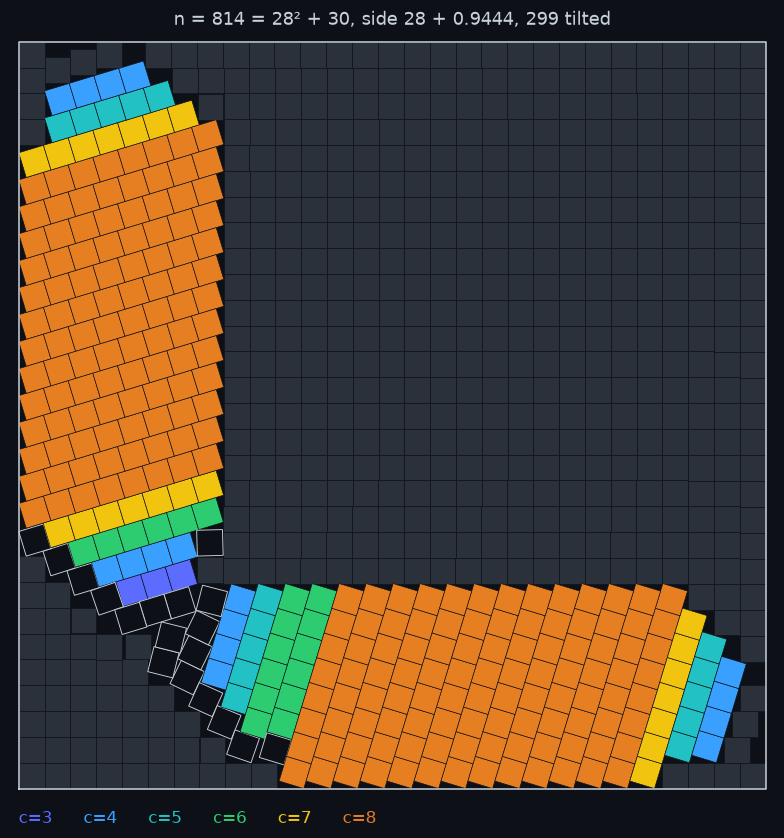
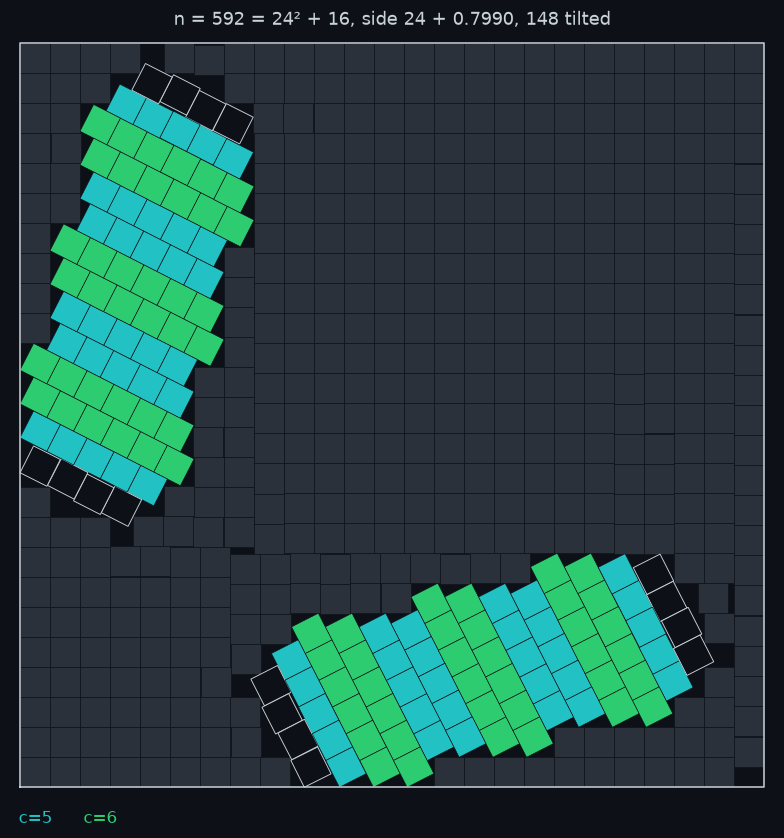
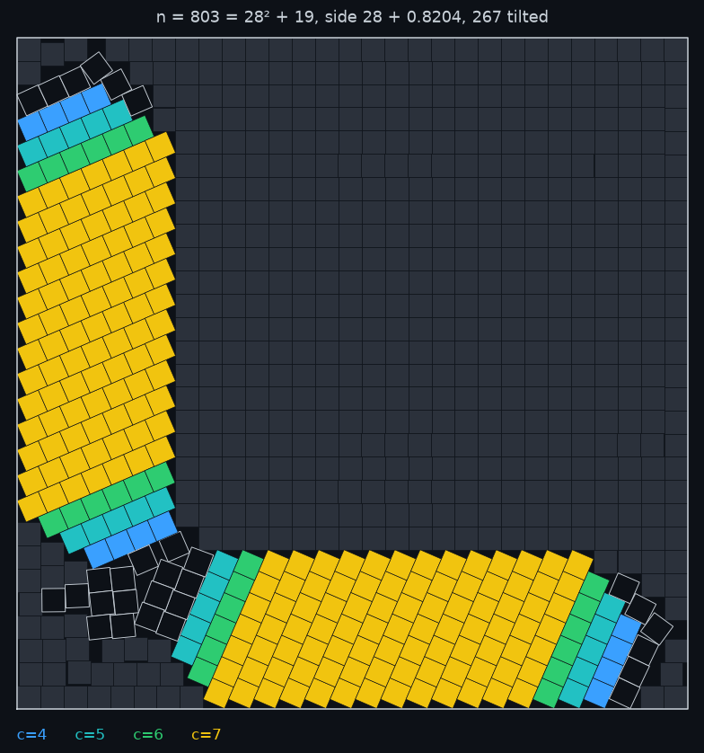
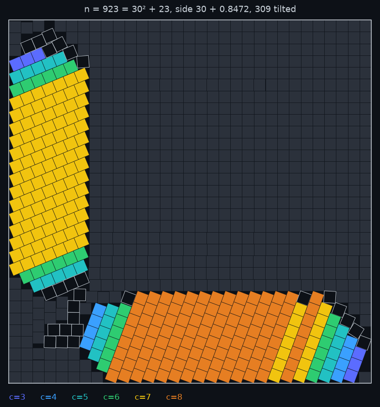

# Avenue: frontier (2026-11-11, round 8)

**Result: no n certified below the held file. Nothing was submitted from here. Three generators that try to add the missing square failed their controls, and each one says why. This round adds a measurement. A held layout is two arms of rigid stacks, and the stacks gain squares at an exact rate. Every square we are short of is lost in three small zones: the two far ends of the arms and the corner between them.**

This avenue had one job: find out how a packing at the board's side holds one more square than ours, and turn that into a generator.

Words used here: "held" is `gather/round7-2026-11-11a.csv` (22.1934052297, gate dir `gate/cand-round7-1111a`). "The board" is the per-puzzle board, the best side per n over all teams. The side is `L = m + f` with `m` whole, and `k = n - m²`. A "stack" is a row of tilted squares set face to face, rigid as one piece. An "arm" is a row of stacks along a wall. The "deficit" of an n is `L_ours² - L_board²`: the area, in squares, that the board's packing saves on the same n.

## 1. The board has not moved since 2026-11-08

The notebook `inversion/squares-in-squares-per-puzzle-leaderboard` writes no output file. Its table is inside the rendered page. The Kaggle CLI returns only the run log. So we read the page of the newest version as data. The public view model gives the address of the rendered output.

- The newest version is 28, run 2026-11-08 23:03Z. The newest entry in its table is dated 2026-11-08 04:29 UTC.
- All 1,000 sides equal `results/per-puzzle-lb-2026-11-09.json`. The sum of the board is 22.0508835713.

So the targets changed only on our side. [`tools/targets-2026-11-11b.tsv`](../tools/targets-2026-11-11b.tsv) is the table against the held file:

| | 2026-11-11 (round 7 start) | 11b (held now) |
|---|---|---|
| sum of our gaps to the board | 0.1438 | 0.1426 |
| n one square short at the board's side | 492 | 493 (0.1016 of score) |
| n two short | 122 | 120 (0.0401) |
| shells 28 to 31, `m/4 < k <= 3m/4` | 59 n, 0.0328 | 59 n, 0.0328 |
| shells 24 to 27, same band | 51 n, 0.0200 | 48 n, 0.0199 |

The outside columns of the table are those of the register at `591644a9`, carried over from the round 7 table. The register was not cloned again.

**The deficit is less than one square, and it grows with the shell.** "One square short" counts squares at the board's side. In area the board saves less. The median deficit for `k <= m`, by shell:

| m | 18 | 20 | 22 | 24 | 26 | 27 | 28 | 29 | 30 | 31 |
|---|---|---|---|---|---|---|---|---|---|---|
| median deficit, squares | 0.12 | 0.18 | 0.27 | 0.38 | 0.33 | 0.57 | 0.71 | 0.72 | 0.87 | 0.80 |

In shells 28 to 31 it is largest for `f` between 0.6 and 0.7 (median 1.26, up to 2.53) and smallest for `f` above 0.9 (median 0.48). A held layout wastes 24 to 32 squares of area there, so the board is ahead by up to 8% of the waste.

## 2. What a held layout is made of

`frontier_stacks.py` finds the stacks of every layout. In the shells that hold the gap the layout is always the same object:

- Two arms on two neighbouring walls. Each arm is a row of equal stacks, 7 to 11 squares long (`c`), that slide along each other.
- **A stack is flush.** A stack of `c` squares at tilt `t` spans `c cos t + sin t` across the arm. In every arm that span is `c - 1 + f`: the room of `c - 1` upright columns plus the whole slack of the side. The held stacks meet this to 1e-4. So the tilt is not a free number: it follows from `c` and `f`.
- The upright squares fill the rest on the grid of the far corner.
- Each arm ends in a taper: stacks of `c - 1`, `c - 2`, ... squares, then loose squares at other tilts. Between the arms is a corner zone of loose squares and upright blocks.

One more family exists below `f = 0.80`: stacks of 6 at 27.03° that alternate with stacks of 5. Its members are n = 498, 544, 591, 592, 641 and 693, all at `f = 0.7990`. All came with the public harvests of 2026-11-10 and 2026-11-11.

**The gain rate.** A flush arm holds `c cos t` squares per unit of wall where the grid holds `c - 1`. So it gains `g = f - sin t` squares per unit of wall, and one more stack is worth `c - (c - 1)/cos t` squares. At `f = 0.94` and `c = 8` that is 0.647 per unit of wall.

## 3. Where the squares are won and lost

`frontier_profile.py` turns each layout so that arm 1 is on the left wall and arm 2 on the bottom wall. It cuts the box into the strip of arm 1, the strip of arm 2 and the rest. Then it counts the squares in each zone against the plain grid. The zone counts add up to `k` exactly on every layout. 76 held layouts with n ≥ 300 have two flush arms and are in the table (`work/profile-held.tsv` in the take dir).

Three named n. "At the flush rate" is what a zone of that length would gain if the stacks ran through it. Arm 1 can also win `(c1 - 1) f` at its far end, because its strip is `f` longer than `m` rows.

| zone | 803 (c = 7 and 7, deficit 1.52) | 923 (c = 7 and 8, deficit 1.12) | 814 (c = 8 and 8, deficit 0.07) |
|---|---|---|---|
| flush run of arm 1: gain, at the flush rate | 5.99, 5.99 | 7.02, 7.02 | 8.87, 8.88 |
| flush run of arm 2 | 5.99, 5.99 | 6.92, 6.92 | 8.87, 8.88 |
| far end of arm 1: lost | 2.29 | 2.27 | 2.72 |
| far end of arm 2: lost | 2.29 | 3.07 | 2.72 |
| corner zone, both arms: lost | 1.83 | 2.99 | 3.80 |
| rest of the box | -1 | 0 | 0 |
| **k** | 19 | 23 | 30 |
| lost in the three end zones, total | 7.4 | 8.3 | 9.2 |

What the table says, over all 76 layouts:

- **The flush run gains exactly its rate.** Nothing can be won inside an arm.
- **A far end loses 2.3 squares at c = 7 and 2.7 at c = 8, and the same end is in every layout.** For c = 8 the far end of arm 1 gains 3.78 over the flush rate in the median. On nine layouts between n = 813 and n = 996 it gains 3.74 to 3.93. The public files share one end cap.
- **The corner zone loses 2 to 4 squares.** It is the zone that differs most between layouts.
- **So a layout loses 7 to 9.5 squares at its ends, and the board is ahead by 0.1 to 2.5.** If the board's packings are built from the same arms, they lose 10% to 25% less at the ends. One more square at the board's side is then one better end cap or one better corner.

## 4. What the board's sides say under the same rule

For two arms that share a corner the count is `k = g1 L + (c1 - 1) f + g2 (L - W1) - E`, with `W1 = c1 - 1 + f` and `E` the squares lost at the ends. The term `(c1 - 1) f` is fixed, so we set `E' = g1 L + g2 (L - W1) - k` and compare it between files.

Take the leader's 0.794 family (n = 299, 454, 498, 544, 747, 803). The board's count at `f <= 0.7942` is 10, 10, 11, 12, 13, 14, 15, 15, 16, 17, 18, 19, 19, 20, 21 for m = 17 to 31. Ours is 9, 10, 11, 11, 12, 13, 14, 14, 15, 16, 16, 17, 18, 18, 19. For m = 20 to 31:

| arms | gain per shell | board's `E'`, smallest to largest by shell | ours |
|---|---|---|---|
| 6 and 6 | 0.675 | -1.53 to 0.08 (falls with m: the line is steeper than this) | 0.10 to 1.08 |
| 7 and 7 | 0.768 | 0.51 to 1.43 | 1.67 to 3.04 |
| 7 and 8 | 0.805 | 1.29 to 2.11 | 2.29 to 3.92 |
| 8 and 8 | 0.841 | 1.74 to 2.78 | 2.74 to 4.62 |

The median `E'` of the held layouts, by stack length:

| c | 6 | 7 | 8 | 9 | 10 | 11 |
|---|---|---|---|---|---|---|
| layouts | 5 | 12 | 22 | 3 | 2 | 6 |
| median `E'` | -0.1 | 2.2 | 3.3 | 4.5 | 5.2 | 6.4 |

Three readings follow. The last two are inference from sides alone, because no board packing is public.

- **The leader's 0.794 line gains 0.79 squares per shell** (11 more squares over 14 shells). The public 6 and 5 family gains 0.675. That is why the public family ties the leader at m = 22 and 23 (0.7990 against 0.7939) and is one to two squares behind from m = 27. A family in k and m is a pair of stack lengths, and the slope of its line names the pair. This one is 7 and 7, 7 and 8, or 8 and 8.
- With those arms the board's end cost is about 1 square below the cost of our layouts of the same stack length.
- At `f <= 0.85` the board's count is `m - 6` for m = 25 to 31 at sides between 0.8374 and 0.8417. Ours holds the same count at 0.848 for m = 25 to 27 (n = 644, 696, 750, all found on 2026-11-11) and drifts up to 0.859 at m = 31. Our layouts there have stacks of 6 and 7, with one arm of 8 at n = 806 and 986. The line needs a gain of 1.0 per shell: 8 and 8 gives 1.006, 7 and 8 gives 0.970.

## 5. Three generators, all red

### The arm stretch at a fixed f (`frontier_arm.py`)

The rule: a stack that is flush at `f` is flush at `f` in every shell. So an arm of one donor can be cut between two stacks, lengthened by whole periods, and carried to side `m' + f`. The uprights are refilled exactly (Evan Daniel's `fillfast`). Every layout is scored by its own count.

**Control: rebuild a held family member from the member one shell below it.** The control has eight pairs with the same `f` in two shells: 872 to 932, 932 to 994, 641 to 693, 498 to 544, 797 to 855, 812 to 870, 913 to 975, 644 to 696.

- **0 of 8.** Seven end one square short and one ends four short (975).
- No variant with a period added or removed beats the rigid patches. For 872 to 932 the rigid patches give 931 and the best variant with one more stack gives 928. For 641 to 693 it is 692 against 688.
- **Why.** The period of an arm is `1 / cos t` (1.046 at c = 8 and f = 0.94, 1.123 for the 6 and 5 family). A shell adds exactly 1. So the far taper lands 0.05 to 0.12 off the grid it was fitted to, and the refill loses a row beside it. The held members differ in their tapers. The arm of 872 ends in stacks of 4 and 3. The same arm of 932 has one more stack of 7 there.

The scan over all donors was not run, as the control is red.

### The shell step on today's file (`rowangle_shell.py`, unchanged)

The step of 2026-11-10 moves patches rigidly. It was dry then, and the harvest has since brought new donors. Rerun on the held file: 131 targets in shells 26 to 31 with `m/4 < k <= m`, donors one and two shells away, 9,930 refills in 22 minutes. **0 hits.** 76 targets end one short, 39 two short, 16 three or more.

### One more stack, then a soft relaxation (`frontier_grow.py`)

One arm gets one more stack, the far part moves one period, the `c - 1` uprights it overlaps most are removed. That is n + 1 squares with small overlaps. The state is relaxed with the overlap energy of `methods_soft` in boxes from just under the held `L(n + 1)` upwards, then repaired by the exact LP and quenched by `fq`.

- n = 932 to 933 (held 30.950019): at the held side 652 squares still overlap, by up to 0.008. The first overlap-free box is 0.09 above it. After `fq` the two children end at 31.011785 and 31.013633, **0.062 and 0.064 above the held side**.
- n = 923 to 924: 712 squares overlap at the held side, the first overlap-free box is between 0.06 and 0.15 above it.
- n = 970 has no arm with a period, so the largest step in the file (970 to 971, 0.0378) cannot be tried this way.

The arithmetic says what the answer should be. A larger side turns every flush stack upright a little, so 14 stacks of 8 free `3.2 δ` of wall when the side grows by `δ`. One more stack then fits at `δ = 0.011`. The held step from 932 to 933 is 0.0091. So our own file already is "one more stack and every stack turned". The step from n to n + 1 in an arm family costs what the tilt costs. Only the end zones can make it cheaper. The soft relaxation does not find even that step. It stops 0.06 above.

## 6. What the next round starts from

The target is now a small problem with a number on it.

- **The end cap.** A far end of a c = 8 arm loses 2.7 squares, the same in every public layout. It is a wedge about 8 wide and 2.5 deep: the last flush stack, the wall beside it, the wall ahead and the upright grid. A solver for that window alone has 40 to 60 squares, not 900. Its control is exact and takes seconds: rebuild the held cap (loss 2.72 at n = 814) from the last flush stack and the walls. Its go line: a cap that loses 1.7 or less at the same `f`. One such cap moves every layout that has a c = 8 arm, 27 held layouts in the table for arm 1 alone.
- **The corner.** It loses 1.8 to 3.8 on the three named n, so the held file already holds corners that differ by two squares. A corner is a window of about `W1 × W2`. The first step needs no search. Cut the corner window of each of the 76 layouts and sort them by loss at equal `c1`, `c2` and near `f`. Then put the best corner into the layouts that have a worse one.
- **The stack lengths at f near 0.84.** The board's `k = m - 6` line needs a gain of 1.0 per shell. Our layouts on that line use stacks of 6 and 7 from m = 28 on. A layout with two c = 8 arms at `f = 0.84` (tilt 20.6°) and the caps of 814 is a concrete build for n = 806, 864, 924 and 986.

Two things do not work, and the next round must not repeat them:

- Moving a whole arm or a whole patch to another shell. The pitch is `1 / cos t` and the step is 1.
- Asking a relaxation to make room for a stack. The tapers must be rebuilt, and the relaxation does not rebuild them.

## Files

| file | what it does |
|---|---|
| `frontier_read.py` | Per n: tilted count, patches, tilt and box of the two largest, the walls they touch, uprights per corner grid. |
| `frontier_stacks.py` | The stacks of a layout: the two most common stack lengths, their tilts, how far each is from flush, and the deficit to the board. |
| `frontier_profile.py` | The zone table of section 3: gain per zone against the flush rate, for every layout with two flush arms. |
| `frontier_draw.py` | A picture of a layout on a dark background, stacks coloured by length. |
| `frontier_arm.py` | The arm stretch at a fixed `f`: `ctl` (the eight pairs), `one`, `scan`. Control red. |
| `frontier_grow.py` | One more stack, soft relaxation in a ladder of boxes, exact LP. Red on 932 and 923. |
| [`tools/targets-2026-11-11b.tsv`](../tools/targets-2026-11-11b.tsv) | The targets against the held file of round 7. |

All six tools are our own code. `frontier_arm.py` imports Evan Daniel's MIT packer from the lane's clone and copies none of it. `frontier_grow.py` imports `methods_soft.py` and `methods_lp.py`.

On boxA, under `<scratch>/bounties-squares/take-frontier-r8`: `take.tsv` (empty: no n improved), `board/` (the notebook page of version 28 and its 1,000 rows), `targets/`, and `work/` with `read-held.tsv`, `stacks-held.tsv`, `profile-held.tsv`, the stack tables of the files of 2026-11-10, `shell/shell.tsv` (the shell step) and `grow-test/`.

To repeat: `frontier_stacks.py SUB.csv TARGETS.tsv OUT.tsv`, `frontier_profile.py SUB.csv TARGETS.tsv OUT.tsv`, `frontier_draw.py SUB.csv DIR N ...`, `SQ_BEST=SUB.csv frontier_arm.py ctl`.

## Summary

- **No n improved.** Three generators are red. The arm stretch passes 0 of 8 controls, one square short. The shell step on today's file hits 0 of 131. One more stack with a soft relaxation ends 0.06 above the held side.
- **The board is the one of 2026-11-08.** The notebook has not run since. The targets changed only on our side: gap 0.1426, 493 n one short, 120 two short.
- **A held layout is two arms of flush stacks.** The tilt follows from the stack length and `f`. An arm gains `f - sin t` squares per unit of wall, and the held arms gain exactly that.
- **All the loss is at the ends.** Each far end loses 2.3 to 2.7 squares, with the same cap in every public layout. The corner loses 2 to 4. A layout loses 7 to 9.5 there, and the board is ahead by 0.1 to 2.5.
- **The leader's 0.794 line gains 0.79 squares per shell,** which is arms of 7 or 8, where the public family at 0.7990 uses 6 and gains 0.675. Read from sides alone.
- **Next:** a solver for the end cap window, with the held cap of 814 as its control and one square less lost as its go line. Then a swap of corners between held layouts, and a build with two c = 8 arms at `f = 0.84`.
