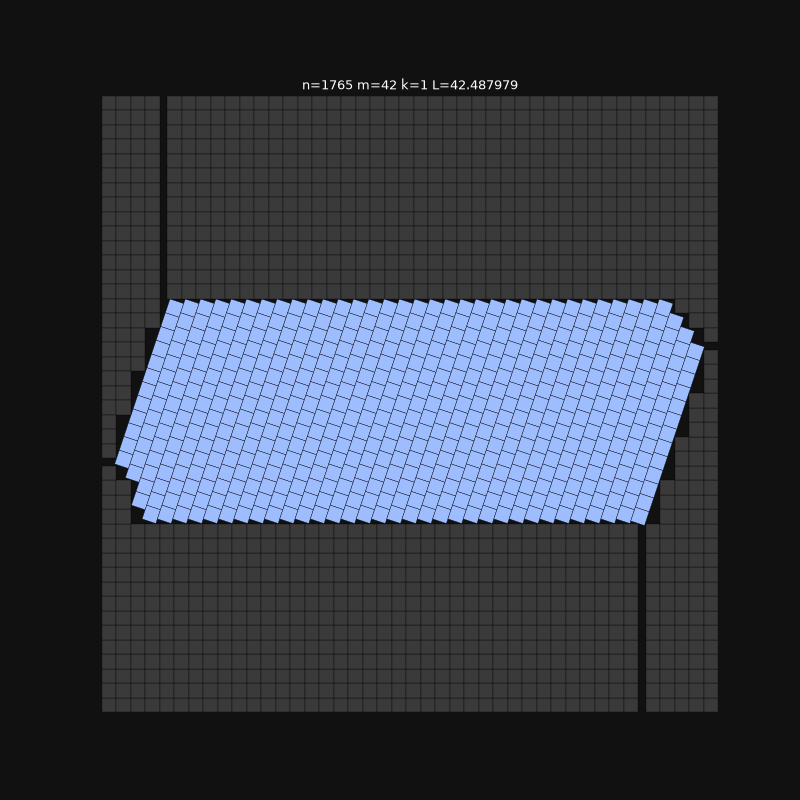
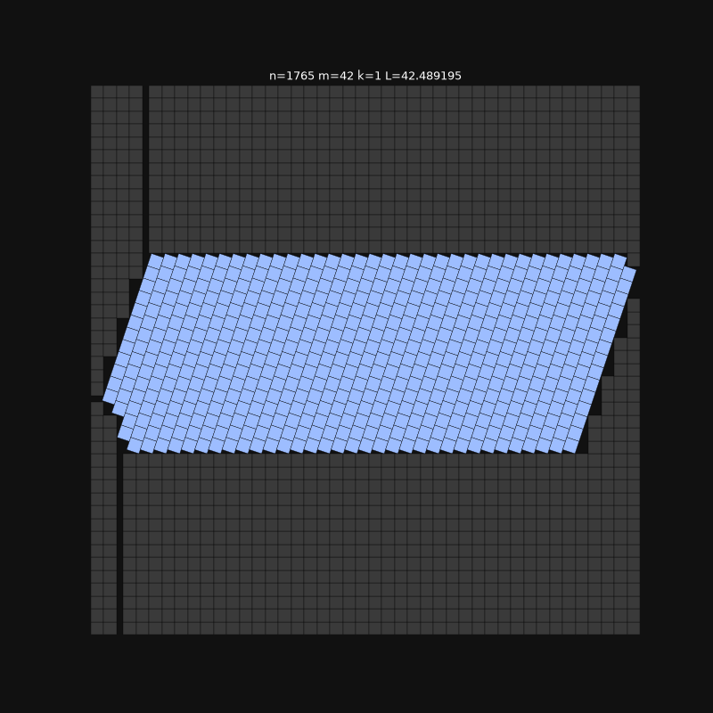
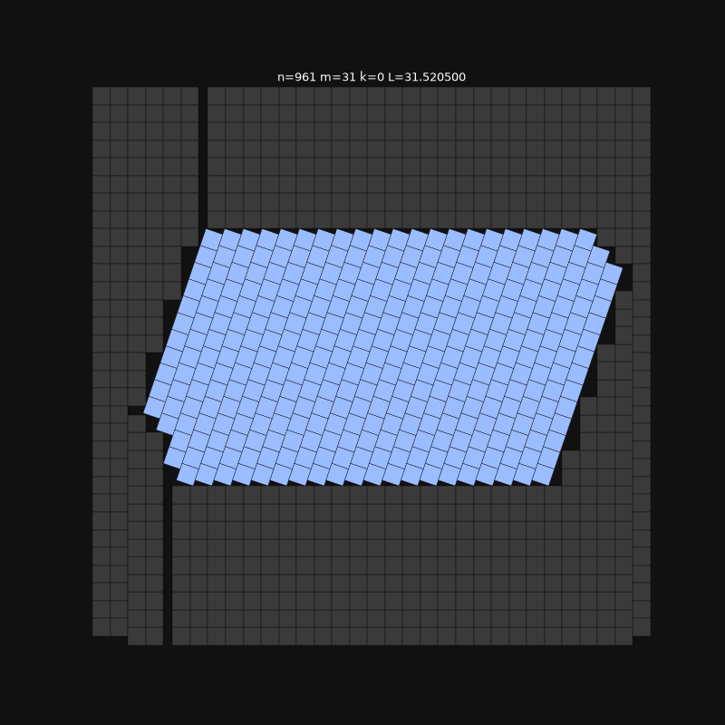

# Avenue: gadget (2026-11-12, round 13)

**Result: dry. No slot or rigid block beats a side we hold at k ≤ 3, m = 20 to 31. Nothing to certify: `take-gadget-r13` holds an empty `take.tsv`. What we have now: the outside record for these n, an exact count for slots, and a measured gap. The count rebuilds the published s(1765) to the square, and its search finds a design of that class from scratch. At m = 31 the best slot is one square short of beating our k = 1 side, and one square short of beating our k = 2 side.**

This avenue looked at the n just above a full square, `n = m² + k` with k = 1, 2, 3 and m = 20 to 31. There the board is far ahead of us: 0.0120 of score over 36 n (board of 2026-11-09). We read the outside record for these n and wrote an exact count for the two design families that hold them. We checked the count on designs we know and searched one family. The rows are in [`results/gadget-r13-2026-11-12.tsv`](../results/gadget-r13-2026-11-12.tsv).

Words used here: the side is `L = m + f`. `k = n − m²` is what the design adds to the plain grid. The *gain* of a design is its count minus m². A *slot* is a band of tilted columns that runs across the whole box between two bands of upright rows. Its *ends* are where it meets the two walls.

## 1. The board at k ≤ 3

f = L − m, ours from the held file `gather/round11-2026-11-11b.csv`, the board's from `results/per-puzzle-lb-2026-11-09.json`.

| m | k = 1: board | ours | k = 2: board | ours | k = 3: board | ours |
|---|---|---|---|---|---|---|
| 20 | 0.5261 | 0.5355 | 0.5355 | 0.5355 | 0.5649 | 0.5714 |
| 21 | 0.5229 | 0.5355 | 0.5355 | 0.5355 | 0.5647 | 0.5714 |
| 22 | 0.5229 | 0.5355 | 0.5355 | 0.5355 | 0.5647 | 0.5714 |
| 23 | 0.5173 | 0.5355 | 0.5355 | 0.5355 | 0.5624 | 0.5624 |
| 24 | 0.5173 | 0.5355 | 0.5348 | 0.5355 | 0.5623 | 0.5624 |
| 25 | 0.5110 | 0.5208 | 0.5311 | 0.5355 | 0.5355 | 0.5355 |
| 26 | 0.5103 | 0.5208 | 0.5239 | 0.5355 | 0.5355 | 0.5355 |
| 27 | 0.5093 | 0.5208 | 0.5239 | 0.5355 | 0.5355 | 0.5355 |
| 28 | 0.5059 | 0.5208 | 0.5216 | 0.5355 | 0.5355 | 0.5355 |
| 29 | 0.5022 | 0.5208 | 0.5182 | 0.5355 | 0.5331 | 0.5355 |
| 30 | 0.5022 | 0.5208 | 0.5141 | 0.5355 | 0.5296 | 0.5355 |
| 31 | 0.5022 | 0.5208 | 0.5141 | 0.5355 | 0.5228 | 0.5355 |

Gap of score to the board: k = 1 0.0068, k = 2 0.0036, k = 3 0.0016, together 0.0120.

Three things in this table matter for a design:

- The board's f falls as m grows, and it keeps a value across m once a design fits (k = 1 at m = 29, 30, 31: 0.502153 each). So each design has a smallest m, and the border step carries it up.
- One more square costs about 5 to 6 units of m at the same f. k = 2 at m = 26 (0.5239) sits where k = 1 sits at m = 21 (0.5229). k = 2 at m = 29 (0.5182) sits where k = 1 sits at m = 23 (0.5173). A design whose gain grows by one square for every 5 or 6 units of width behaves like this.
- Most board values at k ≤ 3 for m ≥ 20 are not rigid 45° values. The exceptions are k = 2 at m = 20 to 23 and k = 3 at m = 25 to 28, where the board holds 0.5355339059 exactly, as we do. Ours are rigid 45° values except k = 3 at m = 20 to 24 (0.5714 and 0.5624).

## 2. The outside record

| family | where | side | what it reaches at m ≤ 31 |
|---|---|---|---|
| rigid 45° block, a = 5 (Göbel) | Ellsworth's table, `s(82) = 6 + 5√2/2` and every `m² + 1` up to `s(226)` | f = (5√2 − 6)/2 = 0.535534 at every m ≥ 8 | our k = 1 at m ≤ 24, our k = 2 at m ≥ 20, our k = 3 at m ≥ 25 |
| rigid 45° block, a = 17 | `s(626) = 27/2 + 17√2/2` (Ellsworth, January 2025) | f = (17√2 − 23)/2 = 0.520815 from m = 25 | our k = 1 at m ≥ 25 |
| 45° diamond of `2t(t+1) + 1 = k²` (Kearney and Shiu 2002, Fig. 3) | t = 3, k = 5: f = 0.5355 at m = 8. t = 20, k = 29: f = 0.5061 at m = 42 | f = k/√2 − t | nothing new at m ≤ 31 |
| **slot, plain ends** (Kearney and Shiu 2002, Fig. 6) | `s(43² + 1) < 43.5`: 28 rows, a slot of 15.5 with 36 columns of 16 at 18.4°, two trapezia of 35 uprights in rows | our exact count gives f = 0.488781 at m = 43, 0.507039 at m = 42 | at f = 0.5208 the best plain slot has gain −1 for m = 25, 28, 29 and 0 at m = 30, 31 (section 5) |
| **slot, better ends** (Hajba, then Ellsworth, November 2024) | `s(1765) = 42.487978511860`, a root of `2s⁴ − 212s³ + 8129s² − 148140s + 1362276` | the same 36 columns of 16, between 14 and 13 rows. The two ends are columns of uprights that step down 3 cells per column, short tilted columns (12, 13, 15 and 15, 14, 13), and the last three slid along their axis by 1, 2 and 3.148 so that the last corner sits in the gap of f between the two upright blocks | one square more than the plain slot at m = 42, and it fits one m lower |
| two copies of `s(50)` (Ellsworth) | `s(171) = 13 + 4/7` | k = 2, f = 0.5714 | nothing new here |

Kearney and Shiu also prove that `s(m² + 1) − m` goes to 0 like `m^(−1/3)` (their Theorem 2: a slot that fills the whole height). Their own numbers show it is far from 0.5 at m ≤ 31.

The competition forum and the public notebooks hold no description of the board's k ≤ 3 designs that we could find. The Kaggle search finds only repos that rebuild the rigid 45° families.

## 3. The families and where their waste lies

Total waste is `W² − n = 2mf + f² − k` with `W = m + f`.

**Rigid 45° block** (`structure_rigid45.pred`). An a × b block at 45° gains `ab − ceil((AB + A + B)/2)` with `A = ceil(a√2 − 2f)`. Its waste lies along its four edges, where a 45° edge meets a staircase. A gain of 1 needs `f − 1/2 ≥ 0.354/(a + b)`, and the block must fit, `a + b ≤ √2(m − 1)`. So at m = 31 it cannot go below f = 0.508, and below m = 42 the only values are 0.5355 and 0.5208. Used up (structure avenue).

**Slot.** Height `H = h + f`, columns of `c = h + 1` at the angle a with `c cos a + sin a = H`, so each column of width `sec a` holds one square more than h uprights would in width 1. Its waste has three parts:

- the upright bands: `(m − h)·f`, f per row.
- the columns: `tan a` each (the two corner triangles), so `N tan a` for N columns.
- the two ends: in `s(1765)` they waste 14.98, which is 0.97 H.

The gain per column is `c − h·sec a`: 0.11 at h = 10 and f = 0.5, 0.20 at h = 15, 0.29 at h = 28. The ends cost about H of area, so a slot needs a long middle. If the ends waste exactly H, a continuum count gives these smallest f:

| m | k = 1: continuum (h) | board | k = 2: continuum (h) | board | k = 3: continuum (h) | board |
|---|---|---|---|---|---|---|
| 20 | 0.5216 (8) | 0.5261 | 0.5565 (8) | 0.5355 | 0.5900 (9) | 0.5649 |
| 21 | 0.5189 (8) | 0.5229 | 0.5515 (9) | 0.5355 | 0.5837 (9) | 0.5647 |
| 22 | 0.5158 (9) | 0.5229 | 0.5469 (9) | 0.5355 | 0.5779 (9) | 0.5647 |
| 23 | 0.5127 (9) | 0.5173 | 0.5427 (9) | 0.5355 | 0.5720 (10) | 0.5624 |
| 24 | 0.5099 (9) | 0.5173 | 0.5385 (10) | 0.5348 | 0.5665 (10) | 0.5623 |
| 25 | 0.5070 (10) | 0.5110 | 0.5343 (10) | 0.5311 | 0.5614 (10) | 0.5355 |
| 26 | 0.5040 (10) | 0.5103 | 0.5304 (10) | 0.5239 | 0.5566 (11) | 0.5355 |
| 27 | 0.5012 (10) | 0.5093 | 0.5267 (10) | 0.5239 | 0.5517 (11) | 0.5355 |
| 28 | 0.4986 (10) | 0.5059 | 0.5230 (11) | 0.5216 | 0.5471 (11) | 0.5355 |
| 29 | 0.4958 (11) | 0.5022 | 0.5194 (11) | 0.5182 | 0.5428 (11) | 0.5331 |
| 30 | 0.4930 (11) | 0.5022 | 0.5159 (11) | 0.5141 | 0.5387 (11) | 0.5296 |
| 31 | 0.4904 (11) | 0.5022 | 0.5127 (11) | 0.5141 | 0.5346 (12) | 0.5228 |

This continuum count ignores the whole-number staircases, so it is a guide, not a bound: at m = 42 it gives 0.4651 (h = 14), 0.023 below the real `s(1765)`. What it gets right is the slope. One more square costs 5 to 6 units of m at the same f, as on the board. That cost is the slot's gain per column times its columns per unit of width: 0.17 to 0.2 squares per unit of m. So the board's k ≤ 3 designs behave like slots, about h = 8 to 11 high. The exact counts of section 5 say that our slots are one square short of our own side at m = 31. So they are at least one square short of the board. Either the board's ends are 1 to 2 squares better than the best ends we can build, or the board uses a family we did not model.

The other families of the plan (a block plus a tilted band, two blocks, blocks with sliding rows) were not modelled. Our reading, which we did not count: a second slot or block brings its own two ends, each about H/2 of waste. At m ≤ 31, each of two slots would be shorter than the one slot that is already a square short.

## 4. The exact count and its controls

`gadget.py` counts a slot exactly. In its frame, y points down from the near wall. Each upright cell of width 1 holds a stack from each wall. Up to its split, a band's cells are flush with the left wall. After the split they are flush with the right wall, so the gap of f sits at the split. A stack goes as deep as the tilted columns allow in its strip. Two stacks that share an x range hold at most m together. A dynamic programme over the chain of cells enforces this, and it runs only on chains where the two caps add up to more than m. Nothing is optimised inside a count.

| control | expected | got |
|---|---|---|
| rigid rule, k = 1, m = 20 | f = 0.535534 (a = 5), our held 401 | 0.5355339059 (a = 5) |
| rigid rule, k = 1, m = 25 | f = 0.520815 (a = 17), our held 626 | 0.5208152802 (a = 17) |
| plain slot, Kearney and Shiu m = 43, f = 0.5 | 1850 = 43² + 1 | 1850 (36 columns, two trapezia of 35). Smallest f: theirs 0.4888, ours 0.488781 |
| `s(1765)` as published (lengths, slides, x1 = 1 + 11 tan a) | 1765 at 42.487978511860 | **1765**, and the free search over the splits finds the published ones (4 and 37) |
| the same at f − 1e-6 | must drop | 1732 |
| the `s(1765)` layout written out and checked | no overlap, inside the box | smallest gap −1.4e-14 (exact contacts), box [0, 42.487978511860] |
| fast count against the full dynamic programme | equal | equal on 60 random designs |
| **the search from scratch**, m = 42, h = 15, f = 0.49 (0.002 above `s(1765)`, 0.017 below the plain slot) | gain 1 | first two versions: gain 0 (red, below). Third version: **gain 1**, left end 12, 13, 15 on the near line (as published), right end one column of 15 slid to the far line. Its smallest f: **0.489195**, against 0.487979 published and 0.507039 plain |

The search was red twice before it went green, and both causes are now fixed in the tool:

- It combined the two ends only where full columns fit at the left wall. The published left end sits at x1 = 4.683, where a full column does not fit, so it was never tried.
- Its grid was 0.02 wide, and at f = 0.49 the window of x1 in which the published design holds 1765 is 0.012 wide (4.682 to 4.694). The ends now come from a grid of 0.01. The search counts the pair on a grid of 0.002, with the best configurations of both neighbouring grid points of each end.

The search keeps the short columns of the left end on the near line and slides those of the right end to the far line, as `s(1765)` does. It does not try the extra slide of 0.148 that puts the last corner into the gap at the split. In the model that slide is worth nothing. With slides 1, 2 and 3.0 at x1 = 1 + 11 tan a, the model holds 1765 at the published side. Its smallest f is then 0.4879785118, equal to the published value to 5e-11. The 0.48807 that `transplant.py` gave came from its 0.002 grid in x1, which misses a window narrower than the grid.

## 5. The search

A smaller box holds fewer columns between the same two ends, so the gain at a fixed side falls with m. The plain counts show it: gain 0 at f = 0.5205 for m = 31 and 30, and −1 for m = 29, 28 and 25. Our sides are the same at every m of a block. They are 0.5208 for k = 1 at m ≥ 25, and 0.5355 for k = 1 at m ≤ 24 and for k = 2 and 3 at m ≥ 25. So m = 31 is where a slot has its best chance against them, and the search of the ends ran only there. It ran at f = 0.5205, where k = 1 must reach gain 1 to beat our 0.5208. It also ran at f = 0.5352, where k = 2 must reach gain 2 to beat our 0.5355 and k = 3 must reach gain 3. The smaller m have only the plain counts below the table.

| m | f | h | plain slot (rows in the trapezia) | slot with searched ends | needed |
|---|---|---|---|---|---|
| 31 | 0.5205 | 8 | 0 | 0 | 1 |
| 31 | 0.5205 | 8, ends up to 6 short | 0 | 0 | 1 |
| 31 | 0.5205 | 9 | −3 | −1 | 1 |
| 31 | 0.5205 | 10 | −2 | −2 | 1 |
| 31 | 0.5205 | 11 | −1 | −1 | 1 |
| 31 | 0.5205 | 12 | −1 | −1 | 1 |
| 31 | 0.5205 | 13 | −2 | −2 | 1 |
| 31 | 0.5205 | 14 | −1 | **0** (left 11, 12, 14 on the near line, right 13, 14 slid to the far line) | 1 |
| 31 | 0.5205 | 14, ends up to 6 short | −1 | 0 (the same ends) | 1 |
| 31 | 0.5205 | 15 | −1 | −1 | 1 |
| 31 | 0.5352 | 14 | 1 | 1 | 2 (k = 2) |
| 31 | 0.5352 | 14, ends up to 6 short | 1 | 1 (the same ends) | 2 (k = 2) |

The searched ends gain over the plain ones at h = 9 (+2) and h = 14 (+1), and that is never enough. In the rows without a note, a short column is at most 4 squares short. At h = 8 and 14 we also let it be 6 short, and the gain stayed the same. We wrote out the h = 14 design with gain 0 at 31.5205. It passes `floatsafe` and the official metric with 961 squares, so the build path from the model to a certified file works:

We also counted the plain slot over every h and every column count (`proto_land.py`). It has gain 0 at f = 0.5205 for m = 30 and 31 (h = 8), and −1 for m = 25, 28 and 29. At m = 20 and 24 and f = 0.5352 it is −1, so k = 1 at m ≤ 24 is two squares short. For k = 3 at m = 20 to 24 (our 0.5714 and 0.5624) the plain slot has gain 0 at f = 0.5712 and 0.5622 (h = 7), three squares short. The plain slot first reaches gain 1 at m = 31 between f = 0.532 and 0.536 (h = 14), 0.011 to 0.015 above our side.

We also moved the ends of `s(1765)` to m = 31 with `transplant.py` in the work dir. The left end is 12, 13, 15 on the near line. The right end is 15, 14, 13, slid to the far line. The tool places x1 and N again at each f. These ends do worse than the plain ends. They give gain −1 or −2 at f = 0.5205 for h = 8 to 12, 14 and 15, and −1 at f = 0.5352 for h = 10, 12, 14 and 15. Those ends are tuned to their angle (a step of 3 cells per column, `1/tan a = 2.98`), and they do not carry to another h.

**The closest design** is the plain slot at m = 31, h = 8: 24 columns of 9 at 26.13°, one square short at f = 0.5205. Its waste of 32.54 splits into the two bands 11.97 (23 rows × f), the columns 11.77 (24 × tan a) and the ends 8.80, which is 1.03 H. To gain the missing square at this side the ends would have to waste 0.92 H. In `s(1765)` they waste 0.97 H.

**Kill line.** The controls pass. The rigid family is used up (structure avenue). We searched the slot family at m = 31 over h = 8 to 15. Each end had up to three short columns, kept on the near line at the left end and slid to the far line at the right end. At every position the search tried the two largest column counts. Nothing beats our sides by 5e-4. We did not model three families of the plan: a block plus a tilted band, two blocks, and blocks whose rows slide. Section 3 gives our reading, which we did not count, of why a second gadget does not fit at m ≤ 31.

## 6. What to search next

- **First make the search's control honest.** Both published ends of `s(1765)` are inside the searched family. At f = 0.49 the search counted the published pair at 1765, a tie with the design it reported. It keeps the first maximum and refines only that one, on a grid in x1: a finer scan gives 0.489177 for the reported design, not 0.489195. Keep every design that ties the maximum and refine each with an exact x1 window. The control is then that the tied set at f = 0.49 gives 0.487979. Also fix the right-end table, which does not rank ends at u below its start S.ca, where slid ends such as those of `s(1765)` sit.
- **Ends that are better than those of s(1765).** The board's slope is the only sign of slots. Any family whose gain grows linearly with a length gives the same slope. To reach the board's 0.50215 at m = 31, a slot needs ends that waste 0.81 H (h = 8) to about 0.89 to 0.91 H (h = 12 to 16). The published ends waste 0.967 H, so this is 6 to 16 % less. Before anyone builds better ends, test cheaper families that also give a linear slope. The held 404 (56 squares at 40.97°) and 629 (48 at 39.65°) are non-45° tilted blocks already in our file.
- **Where the score is.** At k = 1 the value sits at m = 20 to 24: the board has 0.517 to 0.526 against our 0.5355, on 5 n worth about 0.003 of score. There plain slots are about 2.4 squares behind the board, and searched ends at m = 20 and 24 gave gain -1 to -2 (gain 1 is needed). A win at m = 31 alone, between 0.5202 and 0.5208, is worth about 1e-5, because no border step goes above m = 31.
- **Short slots, h = 8 to 11, at m = 25 to 31.** The continuum puts the board's values there. With better ends the slot that is one square short at m = 31 may close the gap. If it does, the border step carries it up and the refine and build of `gadget.py` (layout at the model side, then `fq`, then `methods_take.py`) make the take.
- **k = 2 and k = 3** need gain 2 and 3 from the same slot at one side, so they follow from better ends. By our reading (section 3, not counted) two slots do not fit at m ≤ 31.
- **What the board holds.** Cats and boxes hold most of these n since 2026-10-29. A packing of theirs would settle the family in minutes. It is not public.

## Files

| file | what it does |
|---|---|
| `gadget.py` | `control`: the controls of section 4. `scan OUT.jsonl DEADLINE STEP m:f:h[:dmax] ...`: the largest count of the slot family per job. `refine IN.jsonl K OUT.jsonl`: the smallest f of each design with gain ≥ K. `build DESIGN.jsonl LINE N OUT.csv`: the packing of one design. |

On boxA, `<scratch>/bounties-squares/take-gadget-r13/work/`: the job logs and records (`*.jsonl`), the plain-slot prototypes (`proto_slot.py`, `proto_land.py`), and under `lit/` the Kearney-Shiu paper and Ellsworth's `s(1765)`, `s(1850)` and `s(626)` drawings, read as data.

## Summary

- Dry. No design of the rigid or slot family beats our sides at k ≤ 3, m = 20 to 31. Nothing to submit.
- Only two published designs get below f = 0.5: Kearney and Shiu's slot (2002), and its version with better ends by Hajba and Ellsworth (`s(1765)`, 2024). Both need m = 42 or 43.
- The count is exact and controlled. It gives our two rigid sides, Kearney and Shiu's 1850, and the published `s(1765)` to the square. It drops when the side is 1e-6 too small. The search finds an `s(1765)`-class design from scratch at m = 42 (f = 0.489195, published 0.487979, plain slot 0.507039).
- At m = 31 the best slot is one square short: gain 0 at f = 0.5205 for k = 1, and gain 1 at f = 0.5352 for k = 2. Its ends waste 1.03 H, and 0.92 H would win.
- The board behaves like slots: one more square costs 5 to 6 units of m, which is a slot's gain per unit of width. Next: an end search with more columns and free slides, with the published `s(1765)` side as its control.

Sections 1, 4 and 6 were corrected after the gadget skeptic of 2026-11-12 (the 0.148 slide, the control gap, the board's rigid values).
