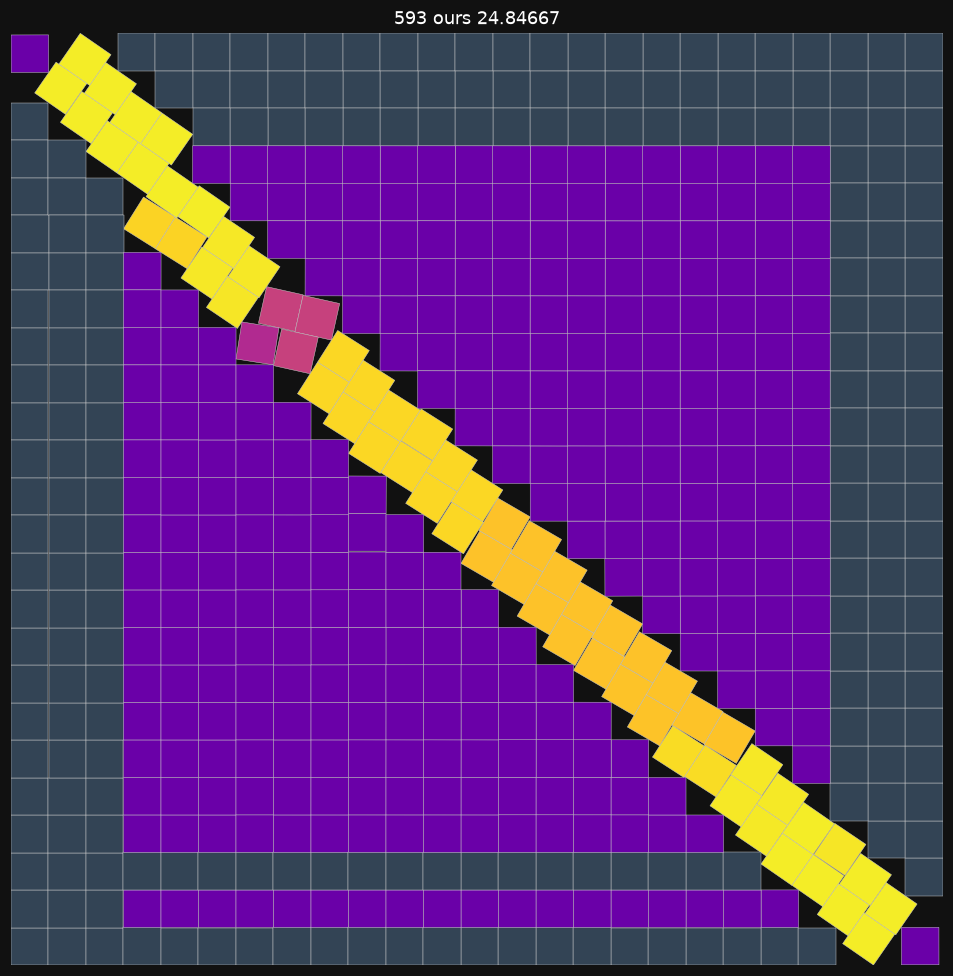
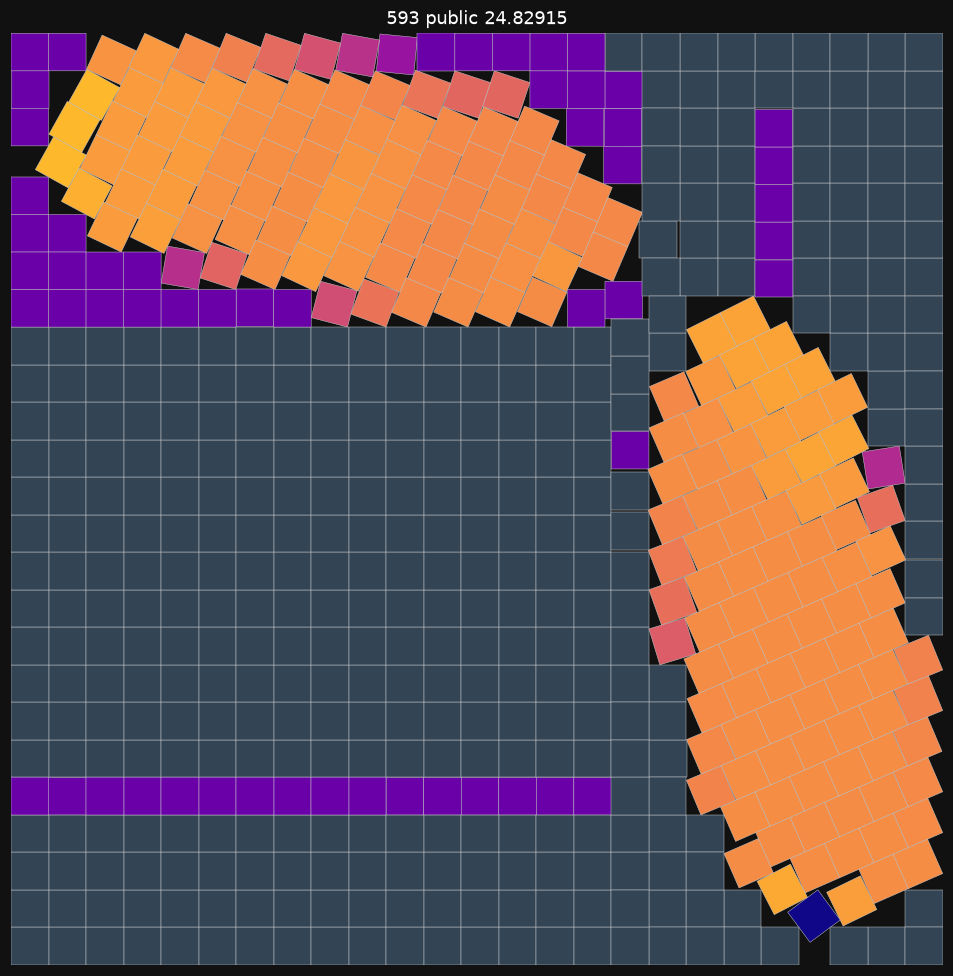

# Avenue: outline (2026-11-10, evening)

**Result: public score 22.2000677210 → 22.1998273413 (2026-11-10 20:03Z, ref 58213300, 24 n smaller, 0.000240), then a second file with 7 n more (0.00000033, ref 58214066, public 22.1998270133). The 261 control is red, so the search as specified was not run on other n. The same moves scored by their own count win 3 n (0.000061). The cause of the board's lead is not a number of the layout: a better layout of the same n is another arrangement.**

This avenue had two jobs. The first was to find the common cause of the board's lower waste. The second was to build the outline search that the [band avenue](band.md) specified, and to pass its control on n = 261.

Words used here: the side is `L = m + f` with `m` whole. A "patch" or "block" is a connected group of tilted squares. An "arm" is a patch that runs along a wall: a stack of tilted rows. "Exact refill" is Evan Daniel's `fillfast.fill` (MIT): the largest set of upright squares around given tilted squares. `fq` is his all-free quench. "The base" is the best certified packing per n that the lane holds. "The board" is the per-puzzle best of all teams, read on 2026-11-09.

## 1. The public record moved, and it changes the question

Before any code we fetched every public notebook and dataset that was new or re-run since 2026-11-09 (`harvest_delta.py`, 26 notebooks and 5 datasets). One of them is JoeGun's notebook and dataset of 2026-11-10 15:50Z, public score 22.2004. Its file is below ours on 144 n, by 0.0145 of score. The angle avenue merged the same harvest and submitted it (22.2000677211, ref 58211343). So this avenue could do what the task asked for and what was not possible this morning: compare, for the same n, a better published layout with ours.

The same notebooks also publish their methods. Three of them matter here:

- **Fault-line DP** (Chris Deotte's idea; alex chilton's starter kit ships a rebuild, `fault_dp.py`). A layout is two upright lattices, one shifted by `f` in x and y, that meet along a staircase. Along the staircase sits a chain of gadgets. A gadget is `w × h` cells that hold `w·h + dm` squares inside `(w + f) × (h + f)`. Gadgets are cut from good packings of any n. A dynamic programme picks the chain for each n, and the side is `K +` the largest `f` in the chain.
- **Stretch**: take a good packing of a nearby n, cut one column of a tilted arm in or out, quench.
- **Seeds**: quench not only the tightest public layout of an n but also the looser ones. JoeGun reports that 80 of his 92 polish gains started from a looser layout.

## 2. Six puzzles, square by square

Six n where the published layout leads ours by about one square's worth of side (0.007 to 0.018). `outline` scratch script `an4.py` measured each pair. "Waste by tilted" is the uncovered area within 1.25 of a tilted square; "elsewhere" is the rest (lattice seams and walls).

| n | | side | tilted squares | patches | median tilt | waste: total = by tilted + elsewhere |
|---|---|---|---|---|---|---|
| 593 | ours | 24.84667 | 62 (10%) | one strip, 2 × 31, on the diagonal | 32.4° | 24.36 = 23.67 + 0.35 |
| | public | 24.82915 | 178 (30%) | two arms, 91 and 87 | 23.7° | 23.49 = 22.52 + 0.52 |
| 544 | ours | 23.82380 | 58 (11%) | one strip on the diagonal | 26.3° | 23.57 = 23.08 + 0.35 |
| | public | 23.80951 | 164 (30%) | two arms, 85 and 79 | 23.5° | 22.89 = 22.02 + 0.42 |
| 643 | ours | 25.84704 | 213 (33%) | 147 and 66 | 19.5° | 25.07 = 22.94 + 1.76 |
| | public | 25.83443 | 182 (28%) | two equal arms, 91 and 91 | 23.6° | 24.42 = 23.25 + 1.47 |
| 747 | ours | 27.82288 | 245 (33%) | one, 245 | 23.6° | 27.11 = 25.16 + 1.79 |
| | public | 27.81207 | 280 (37%) | one, 280, two tilt groups (191 and 86) | 18.4° | 26.51 = 25.61 + 1.30 |
| 814 | ours | 28.95462 | 243 (30%) | 150 and 93 | 16.5° | 24.37 = 22.49 + 2.20 |
| | public | 28.94482 | 310 (38%) | one, 310 | 16.9° | 23.80 = 22.92 + 0.59 |
| 491 | ours | 22.69239 | 169 (34%) | rigid 13 × 13 at 45° | 45.0° | 23.94 = 19.31 + 5.07 |
| | public | 22.68532 | 140 (29%) | 112 and 28 | 23.7° | 23.62 = 20.47 + 2.92 |




What the six pairs show:

- **In all six the better layout is another arrangement, not ours made tighter.** A diagonal strip becomes two arms along two walls (593, 544). Two patches become one (814). A rigid 45° block becomes a tilted arm (491).
- **No single number separates them.** The tilted share goes up in four pairs and down in two. The tilt goes down in four, up in one and stays in one. The waste beside the tilted squares goes down in two pairs and up in four; the waste elsewhere goes down in four and up in two. Only the total always falls, by 0.3 to 0.9, which is 1% to 4% of the waste.

Over all 49 n ≥ 300 where the published file leads ours by more than 0.002 (`an5.py`): the tilted share is 29.8% for ours and 31.4% for the public layout, the median tilt 21.40° and 21.37°, the largest patch 161 and 190 squares, the number of patches 1.67 and 1.43. The public layout has more tilted squares on 31 of 49 and a lower tilt on 17 of 49. 42 of the 49 stay in the class the structure avenue called slots, on both sides.

## 3. The cause, as three claims, each tested

**Claim A: the lead comes from composing each n again out of shared pieces.** If so, a fault-line DP over the pool of public packings gives sides below the pool's best.

Test: we ran alex chilton's `fault_dp.py`, unchanged, on the merged pool (our file, JoeGun's file, the kit's own files and Couzo's register: 1,703 donors, 126,263 gadget keys, 16,182 after dominance).

- Result: **1 n lower, 0.000011 of score** (n = 497).
- The DP side equals the pool's side on 332 of 359 n ≥ 325 that have a chain, and it is above it on 26. 146 of the 332 are chains of two or more gadgets, and 186 are one gadget.
- So the public record is closed under this composition already. The teams that publish run it after every merge. **Claim A is false for the pieces the public holds.** The pieces themselves would have to be tighter: if every binding gadget lost 0.01 of `f`, the DP would gain 0.088 of score, which is the size of the board's lead.

**Claim B: tighter pieces can be had from a different cut of the same donors.** The DP always keeps the `w·h + dm` squares that stick out least. Another choice of edge squares, or the same key cut from a looser donor, might quench lower.

Test: `outline_gadget.py search` on the 20 keys with the most leverage (the ranking is in the tool): the public squeeze loop as the base line, the same key cut from up to five other donors, and 15 one-square swaps at the edge of the cut, each scored by `fq` in rectangle mode.

- Result: **0 of 298 variants ended lower** (20 squeeze loops, 98 other donors, 180 swaps). The run was stopped there; it had covered 20 of the 80 keys queued.
- **Claim B is false at this depth.** The gadgets of the pool are jammed against a one-square change of their cut.

**Claim C: the lead sits at the ends of the arms, and it shows only when a move is scored by its own count.** A move at the end of an arm changes how many uprights fit. The state after it holds `c` squares with `c` near n, seldom n itself. A search that scores at a fixed n discards these states. A search that compares each state with the base side of its own count keeps them.

Test: `outline_frontier.py` (section 5). Result: **3 n lower out of 410, 0.000061 of score** (591, 592 and 593, each from the cut of an end row). Two more rounds from the new layouts gave one more step on 593 and then nothing. **Claim C holds, but only on three fresh layouts that sit side by side, and it is far too small to explain the board's lead (0.15).**

## 4. The control on n = 261: red in three forms

The band avenue set the control: from the quenched 8 × 13 block at side 16.68438, reach the held 16.67878.

First, what the target is. `outline_lib.label` gives every tilted square whole lattice coordinates by following neighbours, so slips are allowed in both directions. The held block is not a rectangle with one extra square. It is 13 wide and 8 rows high, and its lower two rows are shifted by one site, with a row of 14 between:

```
#############.
#############.
#############.
#############.
#############.
##############
.#############
.#############
```

All 105 squares stand at 41.882°. Each row is a copy of every other row, and each column a copy of every other column: the position of square (i, j) is `a(i) + b(j)`. Along a row the slips are 0 or 0.077, eight of them in twelve steps. Between rows the slips are 0.212, 0.243, 0.167, 0.077, 0, 0.077 and 0.110. The quenched rectangle has two tilt domains (43.9° and 46.1°) and slips of 0.00 to 0.04.

| form | what ran | result |
|---|---|---|
| 1. The search as specified | `outline_search.py ctl`: 160 moves from the quenched rectangle (row and column shifts, glides, add, delete), each scored by exact refill and `fq`. The refill was tried at the present side and at seven larger sides, up to +0.05 | **Red.** 2 of 160 moves reach 261 squares at any of the eight sides; both are deletions that change nothing. The others end 1 to 3 squares short, also at +0.05 |
| 2. The known answer, given | Every glide and every glide plus one added square (273 states, the held outline is one of this kind), each moved rigidly on an 11 × 11 grid of 0.1 | **Red.** The best exact refill holds 259 of 261. The histogram runs from 252 to 259 |
| 3. The same starts, completed with overlaps | The 23 best states of form 2, filled to 261 with a tolerant refill (0.2), then `fq` with three loosen values | **Red.** 15 ran before the stop. The best ends at 16.7620, the next at 16.8015; ten end at 17.0 or above. The rectangle is 16.6844 |

Why it fails: a perfect lattice with the held outline, at the held angle and the held centre, refills to 245 of 261 at the held side, and to 248 at +0.08. The held layout fits its staircases only with its own slips. An outline move changes which slips are needed, and the exact refill sees the old slips. So **the score "exact refill, then quench at a fixed n" cannot see a new outline of a block that spans the box.** This is a property of the score, not of the moves.

The task said to run the search on other puzzles if the control passes. It did not pass, so the search of form 1 was not run on other n.

## 5. The same moves, scored on the frontier

`outline_frontier.py` keeps the moves and changes the score. For every tilted patch of a base layout it cuts or adds a whole end row or end column. It refills the uprights exactly at the base side, takes whatever count `c` results, quenches, and compares the side with the base side of `c`. A state also wins `c − 1` and `c − 2` when its side is below those base sides, because a square can always be deleted.

Controls:

- **Null move** (refill the uprights around the held tilted squares, quench): the base side comes back on **14 of 30** n, to 1e-6. On the other 16 the refill ends 1 to 5 squares short, because their uprights are not on the wall grids. The search is blind on those n. A regional refill, which keeps every upright farther than 3, 5 or 8 from the change, was tried on four n: it gives 1 to 2 squares fewer than the full refill and was dropped.
- **Cut a row and put it back**: not a valid control, as it turned out. On n = 593 the cut of an end row refills to 593 squares again, so there is nothing to put back.

The run (`fr1`, on boxD): the four whole-row and whole-column moves on up to three patches of each of 410 n, 5,392 moves. The base was the file with the public harvest of 2026-11-10 merged.

| | moves |
|---|---|
| total | 5,392 |
| the move does not fit (no place for the new tilted squares) | 506 |
| refill ends with fewer squares than n | 4,814 |
| refill ends with n squares | 70 |
| refill ends with more squares than n | 2 |
| quenched (count within 1 of n) | 959 |
| side below the base side of its count, by more than 1e-7 | 4 moves, 3 n |

| n | move | base side | new side | gain of score |
|---|---|---|---|---|
| 591 | cut the end row at −7 | 24.802729874 | 24.802728606 | 0.00000005 |
| 592 | cut the end row at −7 | 24.812906111 | 24.812251971 | 0.0000269 |
| 593 | cut the end row at 8 | 24.829153222 | 24.828325679 | 0.0000340 |

- All three wins are the cut of an end row of an arm, and in all three the refill gives n squares again: the uprights take the place of the row. No move that changed the count won. So the frontier idea itself (compare a state with the base of its own count) earned nothing; the wins are plain row cuts at a fixed n.
- The three n are neighbours and all three layouts came from the public harvest of the same day. On the 407 other n the same moves found nothing, the 110 other fresh layouts included.
- 89% of the moves lose squares at the refill (the histogram runs to −24). An end row of an arm is worth more squares than the uprights that replace it.

**Rounds two and three** (rows: `results/outline-frontier2-2026-11-10.tsv`). Round two started from the submitted file, on the 24 n that had just moved and nine neighbours, with the count window opened to 2 and with single edge-square shifts added (`row`, `col`).

| round | n | moves | kept the count | quenched | wins |
|---|---|---|---|---|---|
| 2, whole rows and columns | 33 | 430 | 4 | 114 | 1: n = 593, the end row at −7 of the second arm, 24.828325680 → 24.828318807 (0.00000028) |
| 2, one edge square shifted | 15 | 1,082 | 0 | 70 | 0 |
| 3, whole rows and columns, from the round-two file | 6 (590 to 595) | 88 | 0 | 26 | 0 |

- **A shift of one edge square never keeps the count**: 430 of the 1,082 do not fit, and the other 652 refills end 1 to 7 squares short. That part of round two was stopped after 15 of the 33 n. It is the 261 control again, on 15 other n.
- With the window at 2, the nearest state with a changed count is 0.0036 above the base side of its count (591 with a row cut, 590 squares). Nothing with a changed count is close.
- The chain on 593 stops after two row cuts.

## 6. Seeds: quench the looser layouts too

`outline_seeds.py` collects, per n, the tightest public layout of each distinct structure (number of tilted squares and median tilt) within 0.02 of the base side: 2,485 layouts on 412 n from 314 public files, 2,073 of them not the tightest of their n. Each gets `fq` with the deep polish flags and the default flags, up to three rounds.

The run was stopped after 318 quenches of the 1,910 queued layouts (the ones nearest to the base side ran first), on 177 n. Rows: `results/outline-seeds-2026-11-10.tsv`.

- **15 n lower, 0.000172 of score, from the layout we already held.** These are layouts of the public harvest of 2026-11-10. The harvest merged them as published, and nobody had run `fq` on them. Two carry nearly all of it: n = 543 (side 23.796228 → 23.792792, 0.000147) and n = 497 (0.000024).
- **6 n lower, 0.0000071 of score, from a looser layout** (643, 645, 690, 696, 914, 915). The largest is n = 643: a layout 0.000045 above the base ends 0.000168 below it (0.0000066).
- 195 of the 318 quenches made their layout smaller, and 54 ended below the base side they were queued against. After the angle avenue's merge of the same harvest, 21 n were still below.
- The yield by distance from the base, in the order the layouts ran (`sq2`, about 80 minutes of three workers per group): 

| layouts, in run order | start side minus base side | n below the base | gain of score | CPU minutes |
|---|---|---|---|---|
| 1 to 60 | −0.0008 to +0.000001 | 18 | 0.000232 | 80 |
| 61 to 129 | +0.000001 to +0.00004 | 4 | 0.0000003 | 76 |
| 130 to 290 | +0.00003 to +0.0006 | 4 | 0.0000066 | 143 |

  (The base in this table is the file before the harvest merge, so the first group is mostly the fresh layouts themselves.) Past the first group the rate is about 0.000003 of score per CPU hour, nearly all of it one puzzle. The other 1,620 layouts start farther away and were not run.

So JoeGun's report (80 of 92 polish gains from a looser layout) does not repeat on the file we hold now: 6 of 21 here, and they are the small ones. The rule that pays is simpler: **run `fq` on every layout a harvest brings in, on the same day.**

## 7. The submission

`outline_seeds.py certify` passed the 24 n through the lane's `floatsafe` (2.2e-11 clearance; the dilation cost at most 2e-9 of side). Five more n that were less than 2e-9 below the base were left out. `engine_assemble.py` put the 24 n on top of `gather/angle-2026-11-10c.csv`, as `gather/outline-2026-11-10a.csv` on boxA (SHA-256 `f1f48274…`). The gate was GREEN at 22.1998273414 against `gate/cand-angle-1110c`, with 24 n moved and a smallest gap of 2.206e-11 ([`results/outline-gate-2026-11-10a.json`](../results/outline-gate-2026-11-10a.json), gate dir `gate/cand-outline-1110a`: the next gate run uses `--last gate/cand-outline-1110a`). Submitted 2026-11-10 20:03Z as ref 58213300. Kaggle's public score is **22.1998273413**; it was 22.2000677210.

| source | n | gain of score |
|---|---|---|
| `fq` on the fresh harvest layouts | 15 | 0.000172 |
| end-row cuts (frontier run) | 3 | 0.000061 |
| looser public layouts, quenched | 6 | 0.000007 |
| total | 24 | 0.000240 |

A second file, `gather/outline-2026-11-10b.csv` (SHA-256 `37316bf9…`), adds the round-two step on 593 (0.00000028) and six seed results that had been left on the second box (500, 791, 867, 914, 915, 933; 0.00000005 together). The gate was GREEN at 22.1998270134 against `gate/cand-outline-1110a`, 7 n moved, smallest gap 2.206e-11 ([`results/outline-gate-2026-11-10b.json`](../results/outline-gate-2026-11-10b.json), gate dir `gate/cand-outline-1110b`: the next gate run uses `--last gate/cand-outline-1110b`). Submitted 2026-11-10 20:41Z as ref 58214066. Kaggle's public score is **22.1998270133**.

## 8. What this says about the board's lead

- A better layout of the same n is a different arrangement (section 2). Nothing in its angle histogram, its tilted share or its patch count predicts it.
- The public record is closed under gadget composition, and its gadgets do not move under a one-square change of their cut (claims A and B). So the leader's lead is not a better composition of the public pieces.
- What does move is the end of an arm of a fresh layout (claim C). It moved three n, by 0.000061. That is real and it is small.
- The practical rule the public teams state, and that our numbers agree with: a fresh layout is worth more than hours on an old one. The lane polished only what it held; the teams ahead quench every new layout, cut and stretch it to the neighbouring n, and compose again, after every merge.

## Files

| file | what it does |
|---|---|
| `outline_lib.py` | Lattice labels for a tilted block (slips allowed in both directions), text map of an outline, refill and quench wrappers. |
| `outline_search.py` | The search as specified: moves on the outline of one block, exact refill and `fq` at a fixed n, tabu walk. `ctl` is the 261 control. |
| `outline_frontier.py` | The same moves scored on the frontier (count, side). `run` and `ctl`. Resumable. |
| `outline_gadget.py` | Fault-line DP through alex chilton's public kit, the leverage ranking of gadget keys, and the outline search on a gadget (other donors, edge swaps). |
| `outline_seeds.py` | Collects the distinct public layouts of each n, quenches them, certifies the winners with the lane's `floatsafe`. |

The tools import Evan Daniel's MIT packer from the lane's clone and alex chilton's starter kit (`fault_dp.py`, `skeleton.py`, `ensemble.py`, from the public dataset `alexchilton/squares-in-squares-starter-kit`) from `OUTLINE_KIT`. They copy none of it. `SQ_BEST` is the base submission and `SQ_BOX` the box dir, as in the other avenues. Rows: [`results/outline-frontier-2026-11-10.tsv`](../results/outline-frontier-2026-11-10.tsv), [`results/outline-frontier2-2026-11-10.tsv`](../results/outline-frontier2-2026-11-10.tsv), [`results/outline-gadget-2026-11-10.tsv`](../results/outline-gadget-2026-11-10.tsv), [`results/outline-seeds-2026-11-10.tsv`](../results/outline-seeds-2026-11-10.tsv).

One trap for the next run on a Mac: a killed `multiprocessing` parent leaves its workers alive, and their command line does not name the script. Kill them by parent pid (`pgrep -P`), not by name.

## Summary

- **Score:** 22.2000677210 → 22.1998273413 on the board (ref 58213300), then 22.1998270133 (ref 58214066). 31 n moved, 0.000240 in total. The lane's rank does not change with this.
- **The cause of the board's lead, as far as the public record shows it:** a better layout of the same n is another arrangement (a strip becomes two arms, two patches become one). No number of the layout predicts it. The public pieces are already composed as well as the fault-line DP can compose them (1 n of 359), and their cuts do not move under one-square changes (0 of 298).
- **The 261 control is red** in three forms. Exact refill at a fixed n cannot see a new outline of a block that spans the box, because the held layout fits its staircases only with its own slips. The same holds elsewhere: of 1,082 single-square shifts on 15 n, none keeps the count (652 lose 1 to 7 squares at the refill, 430 do not fit).
- **What paid, in order:** `fq` on the layouts a harvest brings in (15 n, 0.000172), the cut of an end row of an arm on fresh layouts (3 n and one more step, 0.000061), looser public layouts quenched (6 n, 0.000007).
- **Next:** make "`engine_polish.py` on every n a harvest moved" a fixed step of the daily harvest. The outline search and the seed pool are not worth more CPU: the seed pool pays about 0.000003 of score per CPU hour, and the frontier found nothing on 407 of 410 n. To pass the public record the lane needs new arrangements per n, which none of these tools make.
