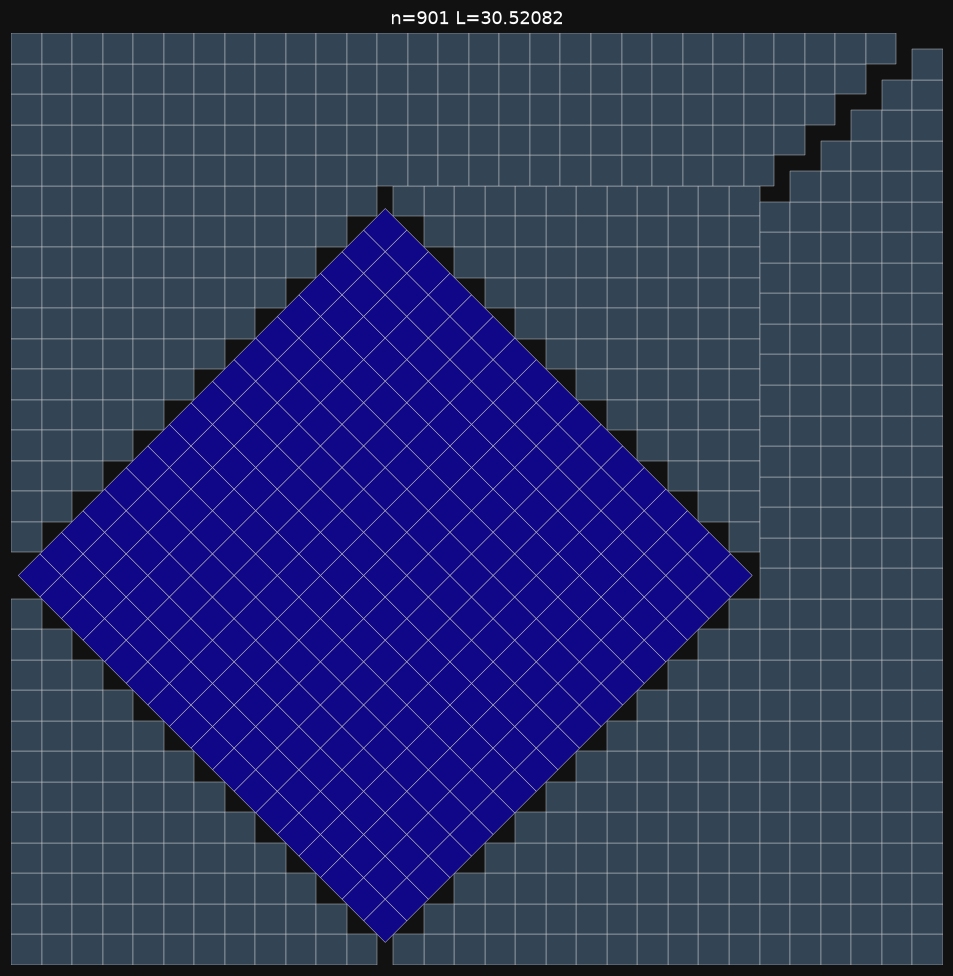
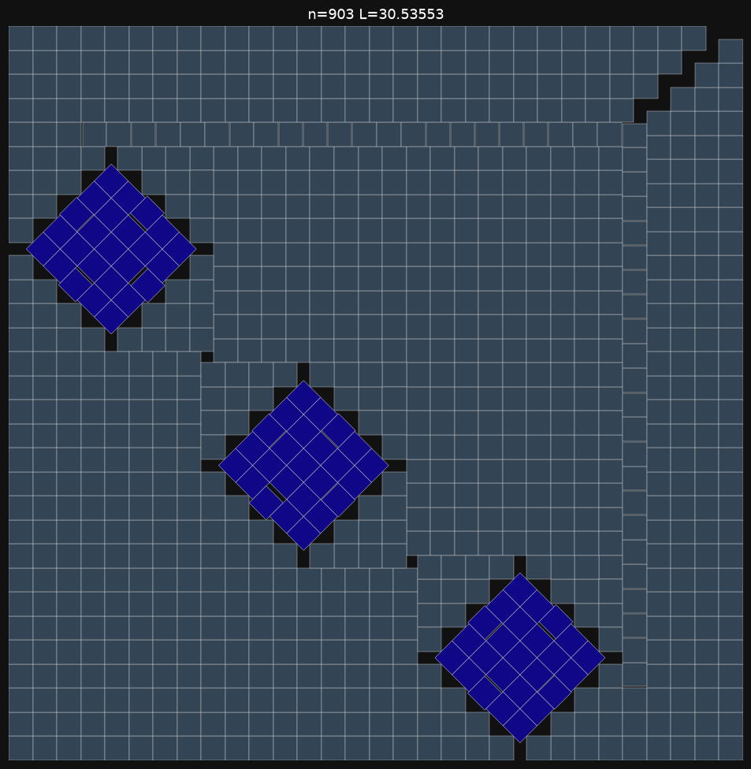
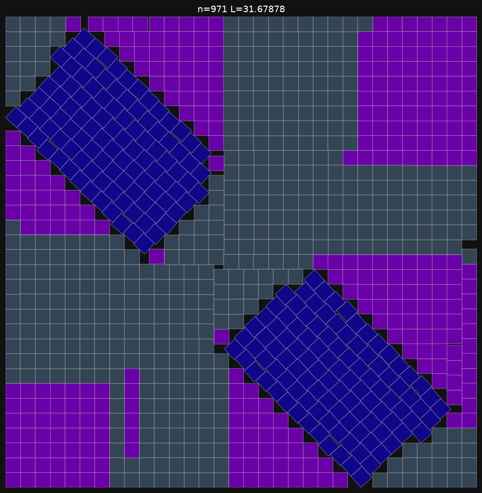
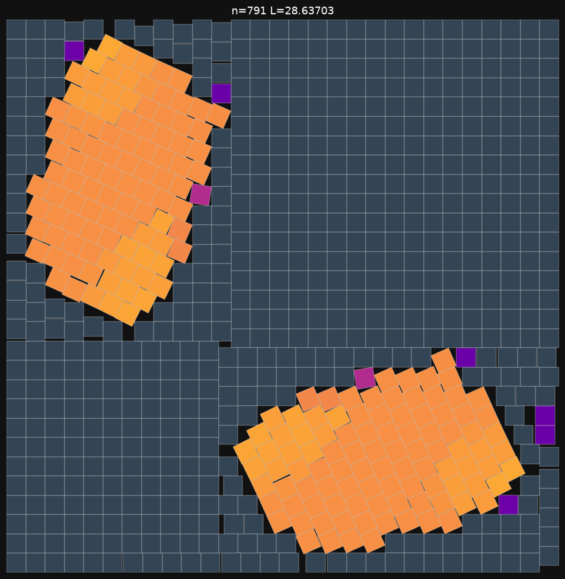
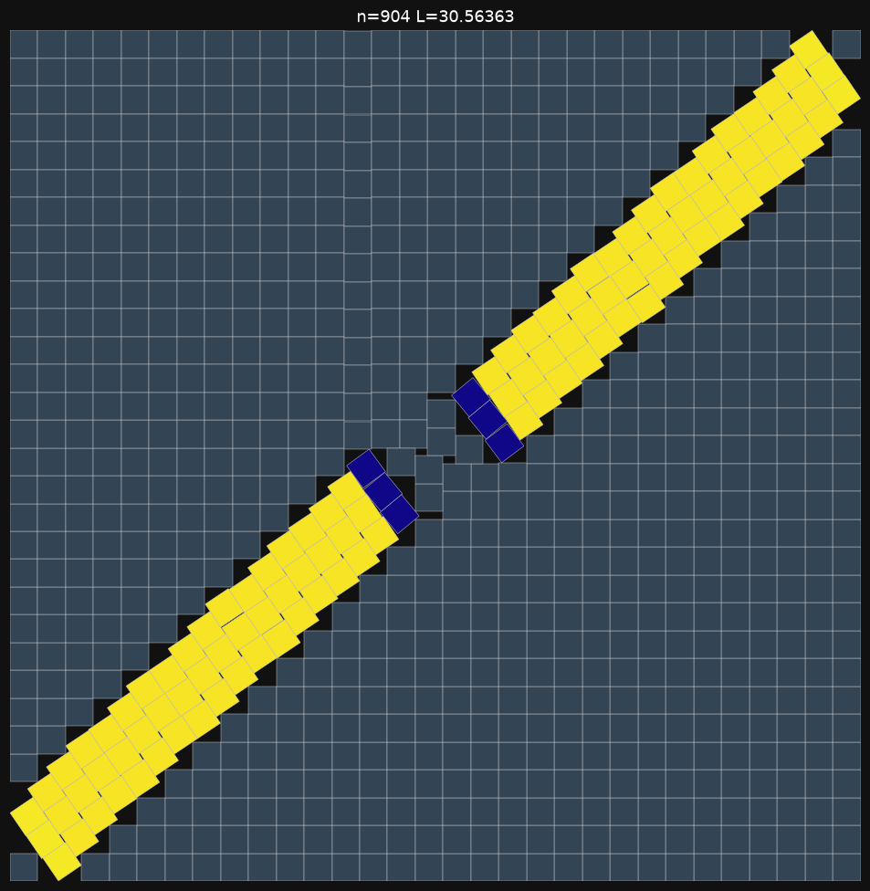

# Avenue: structure and theory (2026-11-10)

**Result: no layout beats our best. Nothing was submitted. The public score stays 22.2149239905.**

We read the structure of the layouts we hold, wrote down the count rules that explain them, and built four constructors from those rules. One rule is exact and proves that a whole class is used up. Every constructor failed its positive control by 1 to 25 squares. The measurements are in [`results/structure-2026-11-10.tsv`](../results/structure-2026-11-10.tsv).

Words used here: the side is `L = m + f` with `m` whole and `0 < f < 1`. `k = n - m²` is the gain over the plain grid. "Exact fill" is Evan Daniel's `fillfast.fill` (MIT, imported from his clone): given the tilted squares, it returns the largest set of upright squares on the wall-anchored grids. It refills our 498, 593, 791, 901 and 971 to the exact held count in 0.06 to 0.23 s.

## 1. Where the gap sits, by the class of the layout we hold

The gap to the per-puzzle board is 0.1650 on 415 puzzles (board of 2026-11-09).

| class of our layout | n | behind | gap | share | squares short |
|---|---|---|---|---|---|
| slots, tilted rows at a median angle under 28° | 325 | 293 | 0.1146 | 69% | 382 |
| rigid 45° blocks and strips (every tilted square at exactly 45°) | 105 | 47 | 0.0245 | 15% | 57 |
| sheared 45° (median 38° to 45°, not exact) | 71 | 48 | 0.0176 | 11% | 56 |
| steep row stacks (median 28° to 38°) | 52 | 20 | 0.0073 | 4% | 22 |
| plain grid, no tilted square | 447 | 7 | 0.0009 | 1% | 10 |

For m ≥ 20, by how far n is into its shell:

| band | n behind | gap | gap per n |
|---|---|---|---|
| k ≤ 3 | 35 | 0.0131 | 0.00037 |
| k 4 to 8 | 53 | 0.0188 | 0.00035 |
| k/m < 0.5 | 45 | 0.0261 | 0.00058 |
| k/m 0.5 to 0.8 | 93 | 0.0508 | 0.00055 |
| k/m ≥ 0.8 | 125 | 0.0370 | 0.00030 |

## 2. The classes

### Rigid 45° blocks: an exact rule, and the class is used up




A block of `a × b` squares at 45° sits where four grids meet. Each grid is anchored to its own corner of the box, so two neighbours differ by `f` in x, in y, or in both. A 45° edge meets a grid staircase with no extra waste only when the edge passes through that grid's corners. That fixes the two extents of the block modulo 1, and it gives a closed rule:

```
A = ceil(a·√2 − 2f),  B = ceil(b·√2 − 2f)
gain(a, b, f) = a·b − ceil((A·B + A + B) / 2)
the block fits when m ≥ (A + B)/2 + 2
```

So a block helps only from `f = (a·√2 − A)/2` up, for its own whole A. This gives every public family:

| f | a | gain | fits from |
|---|---|---|---|
| 0.5208 | 17 | 1 | m ≥ 25 |
| 0.5355 | 5 | 1 | m ≥ 8 |
| 0.6066 | 15 | 5 | m ≥ 22 |
| 0.6569 | 8 | 4 | m ≥ 12 |
| 0.6924 | 13 | 7 | m ≥ 19 |
| 0.7426 | 6 | 4 | m ≥ 9 |
| 0.7071 | 1 (the strip one square wide) | | |

Checks (`structure_rigid45.py`):
- The rule against the exact fill: 14 of 14 cases match, with squares, rectangles, and sides 0.004 under a threshold.
- All blocks with a, b ≤ 44 and a positive gain: 1,935. With the fit rule, **0 of them beat a side we hold**, for m = 8 to 31.
- With the fit rule loosened by 1 there are 36 candidates. The exact fill gives the predicted gain minus 1, or the block does not fit. 0 wins.

Two consequences:
- The public data is complete for single rigid 45° blocks. No search in that class can gain.
- A single block needs `f − 1/2 ≥ 0.3536/(a + b)` for a gain of 1, and the fit rule caps `a + b` near `√2·(m − 1)`. At m = 31 that is f ≥ 0.5083. The board holds n = 842, 901 and 962 at f = 0.50215. **The board's k = 1 layouts are not rigid 45° layouts.** The same holds for its k = 2 values (0.5141 at m = 30, 31, against the rigid 0.5355).

### Sheared 45° blocks



In our 971 the squares stand at 41.88°, but each chain of 13 squares runs along the exact diagonal. Each square is shifted 0.054 against the one before, so the chain direction is 45° while the squares are 3.12° off. The outline of the block stays at 45°, and its extents become continuous. The rigid rule still counts it: two blocks of 8 chains by 13, A = 10, B = 17, gain 5 each, and 971 = 31² + 10.

Rigid, that block needs f ≥ 0.6924. We hold it at 0.6788. The 0.0136 has two sources. The teeth of the sheared edge lock into the grid staircase. The chains also slide against each other by uneven amounts (0.21, 0.08, 0, 0.08, 0.16 in our file).

Control (`structure_shear.py`, m = 16, where we hold gain 5 at 0.6788): the tight sheared lattice gives gain 5 at f = 0.6925 and eps = 0, as the rule says. At f = 0.6789 it gives 0 at eps = 0, −1 at 1° and 2°, −2 at 3° and 3.118°, −3 at 4° and 5°. **Red.** A lattice with one shared slide does not lock into the staircase. The uneven slides are needed.

### Slots: rows of tilted squares stacked along a wall



In 791 and 498 each tilted block is a stack of rows. All rows share one angle (24.1° in 791). Each row holds 5 to 9 squares and has its own slide. The measured slide per row in 791 is 0.42 to 0.64, around `1 − tan 24.1° = 0.553`. That value makes a stack run straight up a wall. A slot of rows with `c` squares, tilted by θ where `c·cos θ + sin θ = c − 1 + f`, holds `f − sin θ` more squares per unit of length than upright columns. The two ends of the slot cost squares.

The leader's count in the m + 0.794 group grows by 0.82 per unit of m. Two slots of rows of 8 at 22° give `2 × (0.794 − 0.375) = 0.84`. So the leader is in the same class as our layouts, and is ahead by 1 or 2 squares of detail, not by a different construction.

Control (`structure_slot.py`, m = 30, f = 0.52, where a gain of 1 would beat our 0.5208): a straight slot clipped to the box, with the exact fill.

| rows of c | 6, 7 | 8 to 11 | 12 | 13 to 22 | 23 to 30 |
|---|---|---|---|---|---|
| best gain over 12 phases | −4 | −3 | **−2** | −3 to −5 | −6 to −9 |

Greedy removal of single squares at the two ends (30 rounds) and 45° cuts of the four slot corners both stay at −2. **Red: 3 squares short.**

### Sheared diagonal strips



Our 904 is a strip three squares wide at 33.9° along the diagonal. It is not one lattice: the squares step along 49°, and every 5 to 7 steps a slip brings the strip back to the diagonal. A rigid strip at the mean direction (`structure_strip.py`) gives gain −25 where we hold +4. **Red.**

## 3. The band model

All of these classes share one fact. The tilted squares of a block have one angle, and they lie in bands one square wide. Squares in different bands cannot overlap. Inside a band they only need a distance of 1. So when the two grid staircases are fixed, the best tilted fill is exact and needs no search: each band holds `floor(free length)` squares. The search is then only over the whole-number staircases, and one change of a staircase moves a full row of tilted squares.

`structure_band.py` does this for one channel between the top-left grid and the bottom-right grid. It anneals the two staircases at 15,000 to 40,000 steps per second. A layout it writes scores `ok` in the official metric.

Positive controls: start from the staircases of a layout we hold.

| layout | held | model with the held staircases | after annealing |
|---|---|---|---|
| 974 (rigid strip, 45°) | 974 | 973 | 973 |
| 904 (sheared strip, 33.9° / 56.1°) | 904 | 880 | 899 / 900 |
| 593 (steep rows, five angles tried) | 593 | 585 to 586 | 587 to 589 |

From a straight channel at the side of 904, with 400,000 steps per start, the annealer falls back to the plain grid (900).

**Verdict: no-go as built.** It is 1, 4 and 4 squares short of layouts we already hold. What it lacks, from the controls:
- Uprights on the other two corner grids. In 974 the square at each end of the strip is anchored to the opposite wall. A model with two grids cannot place it, and it ends 1 square short. In 904, 18 uprights are on neither of the two grids.
- A second angle. 12 of the 108 tilted squares in 904 are not at 33.9°.

## 4. Other checks

- **Exact refill of every held layout** (`structure_refill_all.py`, n = 100 to 1000, tilted squares fixed, side unchanged): no layout takes one more upright. The only extra squares are at n just under m², where the m grid has spare cells.
- **The algebraic form of the board's exact families.** The board repeats the same fractional part across m for 791/908 (0.60588), 842/901/962 (0.50215), 902/963 (0.51408) and others. The public sides agree to 10 or 11 digits only. No polynomial of degree 2, 3 or 4 with small coefficients (up to 400, 60 and 20) fits, and none is `p + q·√2` with p, q up to 200. They are not rigid constructions with a short closed form.

## 5. Ranking by gain per unit of work

1. **k ≤ 8 at m ≥ 20: 88 puzzles, 0.032.** We hold public rigid 45° layouts or single strips there, and the board holds relaxed ones. The rule above says exactly how far a rigid layout can go, so each of these is a known distance from the board. This is the cheapest target for a solver that has free slides.
2. **The 47 puzzles where we hold a rigid 45° layout and the board is ahead: 0.0245.** Largely the same puzzles as 1.
3. **Slots, 293 puzzles, 0.115.** One or two squares each. Same class as the leader, so the gain needs better detail in every puzzle, not a new idea.

## 6. What a next step would need

The band model is the right size of move, and the controls say what to add: uprights on all four corner grids, and two angle families. With that, the model must first rebuild 974, 904 and 593 to their held counts. That is the go line, and it can be measured in minutes because the count is exact. We did not build it. As measured today, nothing here adds a square.

## Files

| file | what it does |
|---|---|
| `structure_lib.py` | Loads a submission (angles are radians), bounding side, dark renderer. |
| `structure_classify.py` | Angle histogram, tilted blocks, and the rows of each block with their slides. |
| `structure_rigid45.py` | The rigid 45° rule, its check against the exact fill, and the search of all blocks against our sides. |
| `structure_slot.py` | Straight slot of tilted rows, with the exact fill. Also the wrapper around `fillfast`. |
| `structure_shear.py` | Sheared 45° block and its control. |
| `structure_strip.py` | Rigid sheared diagonal strip. |
| `structure_band.py`, `structure_band_ctl.py` | The band model, its annealer and the control on held layouts. |
| `structure_refill_all.py` | Exact refill of every held layout at its own side. |

`EVAND_PACKER` points at Evan Daniel's `search/packer` (default: the clone on boxA). `SQUARES_BEST` points at the submission to read.

## Summary

- No gain. No submission used. Best stays 22.2149239905.
- Rigid 45° blocks follow an exact rule, checked 14 of 14 against the exact fill. With it, 0 of 1,935 blocks beat a side we hold. The class is used up, and the board's k = 1 and k = 2 values cannot come from it.
- The leader's m + 0.794 group has the slope of two slots of rows of 8 at 22°. It is the class we already hold, one or two squares better.
- Four constructors failed their controls: straight slot −2 against +1, tight sheared block −2 against +5, rigid strip −25 against +4, band model 899 to 900 against 904.
- The cause is the same each time. The best layouts need one free slide per row, uprights on all four corner grids, and a few squares at a second angle.
- **Next, if this avenue continues:** add the four grids and a second angle to the band model. Its go line is to rebuild 974, 904 and 593.
